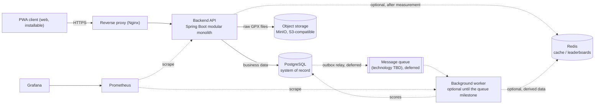
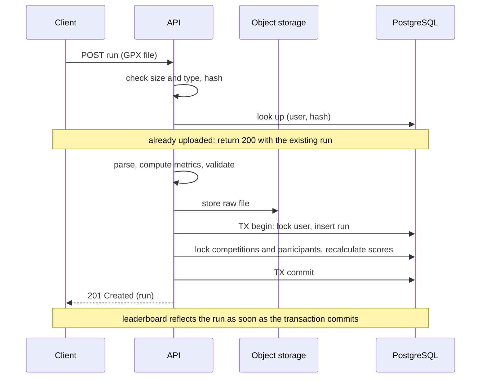

# Running Competitions App: Architecture & Decisions

> **Status:** Detailed design phase. Requirements, load estimates, access patterns, main technology choices, the **database design**, the **API design** and the **class design** are agreed. Cache, queue and observability design are **not** finalized yet. Anything marked **OPEN** is a proposal, not a decision.
>
> **Design documents:**
> - [docs/design/database.md](docs/design/database.md): schema, indexes, transactions and leaderboard queries.
> - [docs/design/api.md](docs/design/api.md): API design and rationale.
> - [docs/api/openapi.yaml](docs/api/openapi.yaml): the API contract, and the source of truth for the HTTP API.
> - [docs/design/classes.md](docs/design/classes.md): class design for the Phase 1 backend, with module interfaces, flows and traceability.
>
> This file is the single source of truth for project decisions. Update it (and the decision log) whenever a decision changes.

---

## 1. Working Agreement (for Claude and other assistants)

- The project owner is a third-year CS student with limited industry experience. The assistant acts as **tech lead**: it gives its honest opinion, challenges decisions with reasoning (even when it disagrees with the owner), and makes decisions jointly with the owner.
- **Learning is a primary goal**, equal to shipping the product. Explain trade-offs and why, not just what.
- **Work top-down:** requirements -> non-functional requirements -> load estimates -> access patterns -> high-level architecture -> detailed design per topic -> implementation. Do **not** jump to detailed design or code before the previous level is agreed.
- Every significant decision gets a short ADR entry (see the decision log). Do not silently change an agreed decision; propose the change and explain why.
- Prefer **measure first, then add complexity**. Distributed components (cache, queue, replicas, service splits) must be justified by measurements from load tests, not by intuition.
- **Zero-cost constraint:** only free and open-source tools and free tiers.
- Language: conversation replies are in **English**. All repository artifacts (code, docs, comments, commit messages) are also in **English**.

---

## 2. Project Goals

1. **Learn** distributed systems and backend engineering through building: databases (SQL vs NoSQL, caching, replication, partitioning, consistency), application layering, sync vs async processing, transactions, API design, message queues, caching, monitoring and logging.
2. **Build a real product** that can realistically serve **hundreds to a few thousand users** (not millions).
3. Frontend is secondary and may be largely AI-generated. **The backend is the focus.**

### Product Summary

A running app where users:

- Upload runs (GPX files).
- Create and join **competitions** (e.g. most distance this week, fastest 5K, longest single run) among friends, work groups or public groups.
- Join/create **groups** (e.g. a public group for a city, a private one for a workplace).
- Later: earn and share achievements, view a social feed, find running partners by area, age and level.

---

## 3. Phases

| Phase | Scope |
|---|---|
| **Phase 1 (core)** | Registration/login/profile; GPX run upload and history; friends; groups (public/private); competitions with 3 rule types; leaderboards |
| **Phase 2** | Achievements and sharing; social feed; **area-coverage competition**; additional competition types (streak, consistency, personal improvement, team vs team); live run recording in the PWA (experimental); history import without scoring (backlog) |
| **Phase 3** | Running-partner matching (by area, age, level), with privacy-preserving coarse location (PostGIS); external integrations (e.g. Garmin) via adapters |

Rationale for Phase 3 placement: partner matching exposes location data (privacy-sensitive) and needs a critical mass of users per area.

---

## 4. Functional Requirements (Phase 1)

### Users & profile
- Register, log in, log out.
- Edit profile: display name, photo, birth date, city.
- Set run privacy: private / friends / public.
- Delete account (removes the user's data).

### Runs
- Upload a **GPX file** (no manual entry; manual runs are **not** supported).
- The system computes distance, duration and pace from the file.
- Reject overlapping runs, runs that start or end in the future, and runs that start more than 30 days ago (configurable). A duplicate file creates nothing, and returns the existing run, so that retries are safe. Implausible runs (e.g. impossible pace) are stored as `invalid` with a reason and never scored. Rejection is automatic only: there is no manual invalidation in Phase 1.
- View history (paginated, newest first) and personal stats (weekly/monthly totals, personal bests).
- **Users cannot delete runs** (see decision D14).

### Friends
- Send, accept, decline friend requests; remove a friend.
- Find other users by display name, and view their runs as their privacy setting allows (D54).

### Groups
- Create a **public** (anyone joins) or **private** (invite) group.
- Roles: admin and member.
- Search public groups by name and area.

### Competitions
- Create a competition: rule type, period, visibility (private/invite-only or public), optionally tied to a group.
- Join, and leave until the competition's period ends (D39). Runs already inside the window count when a user joins. Joining a public competition is consent to appear in its public top N, and the join UI must say so.
- Leaderboard updates after each qualifying run.
- Competition closes after its period plus a grace period (default 6 hours), and the UI shows a "finalizing" state in between. The final result is stored and never changes, except that deleted users are removed (D17).
- **Rule types (Phase 1):**
  - `total_distance`: cumulative distance in the period.
  - `longest_run`: longest single run in the period.
  - `fastest_pace`: best average pace among runs of at least X km (X is a competition parameter). Whole-run average pace only; best-segment-within-a-run is out of scope.
- A run is evaluated against **every active competition the runner participates in**; it may count in one competition and not in another (e.g. a run that doesn't improve the runner's best pace).

---

## 5. Non-Functional Requirements

| Area | Requirement |
|---|---|
| **Cost** | $0. Free/open-source tools and free tiers only |
| **Scale** | Design for **5,000 users**; operate initially at **a few hundred** (up to ~300); load-test with synthetic data beyond that |
| **Availability** | **99%** (about 7 hours downtime/month). A single free machine does not justify more |
| **Latency** | Leaderboard read `p95` < 200 ms; other reads `p95` < 300 ms; search < 500 ms; run upload completed, including parsing and scoring, < 1 s |
| **Leaderboard freshness** | A new run is reflected in leaderboards within **30 seconds** (immediately while scoring is synchronous, see D26) |
| **Consistency** | **Strong:** authorization, competition membership, competition closure, final results. **Eventual allowed:** leaderboards, personal stats, feed |
| **Durability** | An acknowledged run is never lost. Daily backups, and restores must be **practiced** for real |
| **Degradation** | If a secondary component (Redis, queue) fails, the app keeps working in a degraded mode instead of crashing |
| **Security** | Argon2/bcrypt for passwords; secure XML parsing of GPX (protect against XXE) with size limits; per-user rate limiting; privacy zone around start/end of routes; full data deletion on account removal (two phases, D29; backups expire on a documented schedule) |
| **Observability** | Structured logs with a request ID across the whole path; metrics per service (request rate, errors, latency); alerts on SLO violations |
| **Maintainability** | Automated tests and CI (GitHub Actions free tier); schema changes via migrations (Flyway); decisions recorded as ADRs |

### Load estimates

Assumptions: 40% of registered users are weekly-active, 3 runs per week per active user, ~350 KB per raw GPX file.

| Parameter | ~300 users (initial) | 5,000 users (design target) |
|---|---|---|
| Weekly-active runners | ~120 | ~2,000 |
| Runs per day | ~50 | ~860 |
| Leaderboard views per day | ~500 | ~10,000 |
| Raw GPX storage | ~18 MB/day, ~6.5 GB/year | ~300 MB/day, ~100 GB/year |
| Read:write ratio | >= 10:1 (leaderboard dominates) | >= 15:1 |

Takeaways:
- Actual load is tiny. One server and one PostgreSQL instance are enough. Distributed components exist here for **learning**, justified through load tests with synthetic data on the developer machine (e.g. 5,000+ users and a year of runs).
- **Storage is the real long-term problem**, not request rate. GPS points must **not** be stored as one DB row each (about 1 billion rows/year at 5,000 users). Compress files or store an encoded polyline; store only summaries in relational tables.

---

## 6. Access Patterns

### Reads

| ID | Operation | Frequency (at 5,000 users) | Target |
|---|---|---|---|
| R1 | Authenticate request (session) | every request (~50K/day, including leaderboard polling, D51) | < 5 ms |
| R2 | **Competition leaderboard** (top N + my rank) | ~10K views/day, ~30K requests/day with polling (D51) | `p95` < 200 ms |
| R3 | My run history (paginated) | ~6K/day | < 300 ms |
| R4 | My stats (weekly/monthly, personal bests) | ~3K/day | < 300 ms (precomputable) |
| R5 | Competition details + participants | ~5K/day | < 300 ms |
| R6 | My competitions (active and finished) | ~4K/day | < 300 ms |
| R7 | Friends and group members | ~2K/day | < 300 ms |
| R8 | Search public groups/competitions (name, area) | ~500/day | < 500 ms |

### Writes

| ID | Operation | Frequency | Target |
|---|---|---|---|
| W1 | **Upload run** | ~860/day | complete < 1 s |
| W2 | Update competition scores after a run | ~860/day x (competitions per runner, at most 10 open) | inside W1's transaction (D26) |
| W3 | Create/join/leave competition | ~150/day | < 300 ms, rules enforced |
| W4 | Close competition at period end | a few/day | not latency-critical, scheduled, result is final |
| W5 | Friend requests, group actions | ~200/day | < 300 ms |
| W6 | Registration, profile edit, account deletion | ~100/day | deletion touches many tables |

### Key observations
1. The leaderboard (R2) dominates reads. Try PostgreSQL with correct indexes first; add Redis only if measurements show a need.
2. One run triggers updates in several competitions (write amplification). This is the main candidate for background processing, but only after measurements justify it (D26).
3. Data is highly relational: PostgreSQL is the natural source of truth.
4. Most queries are "by user" or "by competition" plus time: natural future partition keys.

---

## 7. High-Level Architecture

### 7.1 Component diagram



Solid lines are in the initial design. Dashed lines are added only when justified by measurements (Redis, the queue milestone) or are supporting infrastructure. Scheduled jobs (competition closure, account-deletion sweeper, orphan-file cleanup) run inside the API process for now.

### 7.2 Run upload flow



Principles: parsing and scoring are synchronous (D26, D30), because they are cheap at this scale and easier to keep correct. The file is stored before the commit, so an acknowledged run always has its file. Outbox and a queue are a designed but deferred milestone, introduced only after baseline measurements (see [docs/design/database.md](docs/design/database.md)).

### 7.3 Backend modules (inside the modular monolith)

| Module | Responsibility |
|---|---|
| `identity` | Registration, authentication, profile, privacy settings, account deletion |
| `social` | Friendships, groups, memberships |
| `runs` | Upload, storage, parsing, validation, history, personal stats |
| `competitions` | Competition lifecycle, participation, scoring rules, closure |
| `leaderboards` | Ranking and read models (initially SQL, possibly Redis later) |
| `platform` | Cross-cutting: config, security, rate limiting, logging, metrics |

Rules: modules talk through explicit interfaces, and writes only go through the module that owns the table. This keeps future service extraction possible and cheap. Section 7.5 describes the code structure inside each module, and [docs/design/classes.md](docs/design/classes.md) has every module's public interface and classes.

Modules form a strict dependency chain, so cycles are impossible: `leaderboards -> competitions -> runs -> social -> identity -> platform` (D58). The few calls that must go the other way use callback interfaces owned by the lower module (D59).

Documented read-only exceptions (D35), all in one database schema, each in one named class:
- `leaderboards` reads `competition_participants`, `competitions` and `users`, because ranking needs joins and a read-time filter (`LeaderboardReader`).
- `competitions` reads `runs`, because score recalculation aggregates a user's runs (`EligibleRunsReader`).
- `competitions` reads `users`, because the participant count and list must hide deleted users (`ParticipantUsersReader`).
- `platform` holds the lock statements on `users`, `groups`, `competitions` and `competition_participants`, so that one place enforces the lock order (`RowLocks`, D61).

### 7.4 Scoring design

- Each competition `rule_type` is a **Strategy** implementation: it **recalculates** the score from all of the participant's eligible runs, so repeating it is harmless and order doesn't matter (D27).
  - `total_distance`: sum of run distances.
  - `longest_run`: maximum run distance.
  - `fastest_pace`: best (lowest) pace among runs of at least X km.
- Eligibility: the run has status `valid`, **started inside the competition window** (`starts_at <= started_at < ends_at`), and was **received before `closes_at`**.
- `closes_at = ends_at + grace`. Grace defaults to 6 hours, is configurable, and may be 0 (D28). The UI shows a "finalizing" state between `ends_at` and closure.
- Joining recalculates too, so runs already inside the window count (D31).
- If the score does not change, **nothing is written**.
- New competition types (streak, consistency, improvement, team) are new Strategy implementations.
- Ties: participants with the same score share the same rank (SQL `RANK()`: 1, 1, 3).

### 7.5 Backend code structure (D40)

**Package by feature, layered inside each feature:**

```text
com.pace.<module>/          identity, social, runs, competitions, leaderboards
    api/                    the module's public contract for other modules (D58)
    web/                    controllers and request/response types. No business logic
    service/                business rules and transaction boundaries
    persistence/            SQL and data access
    domain/                 plain types with no Spring or JDBC imports (D58)
com.pace.platform/          cross-cutting code, organized by concern rather than by layer
```

The full layout, down to class names, is in [docs/design/classes.md](docs/design/classes.md).

- **Dependencies point downward only:** web -> service -> persistence -> domain. A lower layer never knows about a higher one. Each layer may use its own module's `api`.
- **Across modules:** one module calls another through the other's `api` package, never through its persistence layer. The read-only exceptions in D35 are the documented cases.
- **Enforced by ArchUnit tests** (free and open source), which run with the normal test suite and fail the build on a violation. The tests arrive with the first code. Without enforcement, rules like these erode.

**Why:** all the code for one feature sits together, so a module's boundary is visible in the package tree, and extracting a module later is cheap (D5). The layers keep HTTP concerns out of business rules, and SQL out of both.

**Why MVC and MVVM don't apply:** the API returns JSON and renders no views, so there is no server-side "V". "Spring MVC" is only the framework's name here. MVVM is a client UI pattern, and any such choice belongs to the frontend.

**Rejected:**

| Alternative | Why |
|---|---|
| Package by layer (`controllers/`, `services/`, `repositories/`) | Scatters one feature across the whole tree, and hides module boundaries, which are the point of D5 |
| Full Hexagonal or Clean Architecture | Ports and adapters around every module add interfaces and mapping code, to protect against swaps we don't expect. The one real swap point, the run source adapter (D11), can be an interface on its own |

---

## 8. Technology Stack

| Concern | Choice | Notes |
|---|---|---|
| Language/framework | **Java 21+ with Spring Boot** | Strong typing, OOP, enterprise standard, great distributed-systems ecosystem |
| Client | **PWA** (web app installable to the phone) | No app-store cost; native mobile later if the product succeeds |
| Primary database | **PostgreSQL** (+ **PostGIS** in Phase 3) | Relational data, transactions, constraints, rich indexes |
| Data access | **Spring `JdbcClient` with plain SQL** | No ORM. The design depends on explicit locks and hand-verified statements (D57) |
| Raw file storage | **MinIO** (S3-compatible, free) | Raw GPX files; DB holds only the reference and summaries |
| Cache / leaderboards | **Redis** (only after measurement) | Always derived from PostgreSQL and rebuildable |
| Message queue | **OPEN**: Kafka / RabbitMQ / Redis Streams | Deferred until after baseline measurements (D26). Decide in the queue design step |
| Observability | Prometheus + Grafana, structured logs, OpenTelemetry (optional) | Free, open source |
| Maps | Leaflet or MapLibre + OpenStreetMap | Free (no Google Maps) |
| Geo grid (area coverage) | H3 cells (Phase 2) | Count unique cells visited |
| Migrations | Flyway | Schema as versioned code |
| CI | GitHub Actions (free tier) | |
| Runtime | Docker Compose | Local dev is the primary learning environment |

---

## 9. Hosting and Environments

- **Local Docker Compose is the main environment** (app, PostgreSQL, MinIO, Prometheus, Grafana; worker, queue and Redis only when their milestones arrive). Load tests, replication and partitioning experiments run here.
- **Deployment is deferred** until there is a presentable product.
- Candidate free hosting: Oracle Cloud Always Free. Reports in 2026 say its Ampere A1 allocation was halved to 2 OCPU / 12 GB (many older guides still say 4/24). A credit card is required for verification, and capacity is sometimes unavailable in popular regions. **Re-verify current terms before relying on it.**
- **OPEN:** free HTTPS and domain. PWA installation, the browser Geolocation API, `Secure` cookies and `Sec-Fetch-Site` (D44) require a secure context (`localhost` is fine for dev). A domain is also the main dependency for email delivery (D50).

---

## 10. Decision Log

| ID | Decision | Status |
|---|---|---|
| D1 | Language/framework: Java 21+ with Spring Boot | Decided |
| D2 | Client: PWA first; native mobile only if the product succeeds | Decided |
| D3 | Runtime: Docker Compose; local development is the main learning environment | Decided |
| D4 | Zero-cost: free/open-source tools only | Decided |
| D5 | Architecture: **modular monolith** plus a background worker (same codebase). Split services only with a measured reason | Decided |
| D6 | PostgreSQL is the system of record | Decided |
| D7 | Raw GPX files in object storage (MinIO); DB stores references and summaries. GPS points are **not** stored one-per-row | Decided |
| D8 | Redis only after measurement; derived and rebuildable; if used for both cache and queue, use **separate instances** (eviction policy conflict) | Decided (conditional) |
| D9 | Message queue technology | **OPEN** |
| D10 | Reliable event publishing via the **Outbox pattern**, deferred until after baseline measurements | Decided (amended, see D26) |
| D11 | Run sources: **GPX upload only**. Strava is **excluded** (its API terms since Nov 2024 forbid showing a user's activity data to other users, which breaks competitions/feed). Ingestion is built around a source adapter abstraction so live recording and other providers can be added later | Decided |
| D12 | Only running is supported (no walking/cycling) | Decided |
| D13 | Competition closure is by **server receive time**, not timestamps inside the file. A run counts if it **started inside the window** and was **received before `closes_at`**, where `closes_at = ends_at + grace` (see D28) | Decided (amended) |
| D14 | Users cannot delete runs. Runs have a status marking implausible runs `invalid`, set automatically at ingest. No manual invalidation in Phase 1. Account deletion is supported | Decided (amended) |
| D15 | Ties share the same rank | Decided |
| D16 | Public competitions: anyone, including logged-out visitors, can view the top **N** (default 10, configurable) with display name and the metric only (no route, location, user ID or personal details). Joining a public competition is consent to appear there, even with `run_privacy = 'private'`. The join UI must say so, and the API requires an explicit consent flag (D55) | Decided (amended) |
| D17 | A deleted user is removed from leaderboards **at read time** (filtered) and ranks are recomputed, then their scores are **physically purged** shortly after (see D29). Slight rank shifts in closed competitions are acceptable | Decided (amended) |
| D18 | Scoring via the Strategy pattern per rule type, by **recalculation instead of incremental update** (see D27); no write when the score does not change | Decided (amended) |
| D19 | Each run is evaluated against all active competitions of the runner | Decided |
| D20 | Groups (long-lived communities) and competitions (time-boxed events) are separate entities; a competition may optionally belong to a group | Decided |
| D21 | Phasing: area-coverage competition, achievements, feed in Phase 2; partner matching in Phase 3 | Decided |
| D22 | SLOs: 99% availability, leaderboard freshness <= 30 s, latency targets as in section 5 | Decided |
| D23 | Capacity: design for 5,000 users, operate at hundreds, load-test synthetically beyond | Decided |
| D24 | Identifiers: UUIDv7 for primary keys. Exception: the deferred outbox table uses `bigint` | Decided |
| D25 | DB constraint preventing overlapping **valid** runs of the same user (`EXCLUDE` on a time range, requires `btree_gist`) | Decided |
| D26 | Synchronous scoring first: scores update inside the ingest transaction, and ingest returns 201. Outbox and queue are deferred until after baseline measurements, then measured before and after | Decided |
| D27 | Scoring recalculates from all eligible runs (idempotent, independent of order). Eligible: valid, started inside the window, received before `closes_at` | Decided |
| D28 | Grace period defaults to 6 hours, configurable, 0 allowed. `closes_at` stores `ends_at + grace`. The UI shows a "finalizing" state until closure | Decided |
| D29 | Two-phase account deletion: immediately wipe personal data and filter at read time, then a background sweeper purges files and rows | Decided |
| D30 | GPX is parsed synchronously in the API. No `pending` status. No manual invalidation in Phase 1 | Decided |
| D31 | Runs inside the window before joining count, by recalculating the score on join (backfill) | Decided |
| D32 | Private groups are invitation-only in Phase 1, with no join requests | Decided |
| D33 | `READ COMMITTED` isolation plus constraints and explicit row locks. Lock order: user, then groups by ascending ID, then competitions by ascending ID, with each competition's participant directly after that competition (database.md CLS-2) | Decided (amended) |
| D34 | A per-user row lock serializes ingest and join, so a run can't be missed by both | Decided |
| D35 | Module boundaries: one schema, documented read-only cross-module exceptions (listed in section 7.3, each in one named class), writes only through the owning module. Foreign-key cascades are declared schema behavior, not application writes | Decided (amended) |
| D36 | Run sanity: the API rejects runs that start or end in the future, or start more than 30 days ago (configurable), because file timestamps are user-controlled. `duration_s` is limited to 7 days in the schema as a backstop against generated-column overflow; this is not a product rule, and stricter plausibility thresholds are in D49. "In the future" allows 2 minutes of configurable tolerance for device clock drift | Decided (amended) |
| D37 | Migrations: Flyway, forward-only, never edit applied migrations, sequential `V0001__name.sql` naming, separate migration and application roles | Decided |
| D38 | Design iteratively; measure before adding distributed components | Decided |
| D39 | Leaving a competition is allowed only until `ends_at`, and refused from then on, to prevent leaving to avoid a poor final placement | Decided |
| D40 | Backend code structure: package by feature, layered web -> service -> persistence, with downward dependencies only, enforced by ArchUnit tests. MVC and MVVM don't apply to a JSON API. Full Hexagonal/Clean Architecture and package-by-layer are rejected (section 7.5). Extended by D58 | Decided |
| D41 | API style: REST and JSON under `/api/v1`, camelCase, units in field names, open enums for values that will grow, strict requests and tolerant readers. Breaking changes need `/api/v2`, or deprecation with at least 30 days of overlap | Decided |
| D42 | The PWA and the API share one origin through the reverse proxy, so there is no CORS | Decided |
| D43 | Authentication: opaque random session tokens, stored as SHA-256 hashes in PostgreSQL, sent in an `HttpOnly`, `Secure`, `SameSite=Strict` cookie. Sliding 30 days, absolute 90 days. No JWT, because revocation must be immediate. No bearer token until a native client exists | Decided |
| D44 | CSRF: `SameSite=Strict`, plus a server check of `Sec-Fetch-Site` with `Origin` as the fallback. Requests with neither are rejected. No CSRF tokens | Decided |
| D45 | Errors: RFC 9457 Problem Details, with a stable machine-readable `code` and the `requestId` in every body | Decided |
| D46 | Authorization responses: can't see it returns 404, and can see it but can't do this returns 403, so private resources can't be discovered by probing | Decided |
| D47 | Keyset pagination with an opaque cursor, and one fixed index-backed order per list. No `sort` parameter and no total counts in lists | Decided |
| D48 | Run upload: raw `application/gpx+xml` body up to 20 MB, spooled to disk. Duplicate check before parsing. A new run returns 201, and an existing one returns 200. The response doesn't list affected competitions | Decided |
| D49 | Starting plausibility thresholds, configurable: pace under 150 or over 1,800 s/km, a GPS segment over 15 m/s for at least 50 m, duration over 48 hours. Tuning stays in open question 6 | Decided |
| D50 | Email verification and password reset are deferred, and **must ship before opening to the public**. Until then, a forgotten password means a lost account, and registration reveals which emails exist | Decided |
| D51 | Leaderboard freshness by polling every 25 s while visible, with ETags that exclude `asOf`, and a server-set `pollIntervalSeconds`. SSE deferred, for reasons of simplicity rather than capacity | Decided |
| D52 | Contract-first: `docs/api/openapi.yaml` (OpenAPI 3.1) is hand-maintained and the source of truth, linted with Spectral | Decided |
| D53 | Rate limiting in the app with in-memory state (Bucket4j), failing open. No database table and no Redis for it now | Decided |
| D54 | Users find each other by display-name search, logged in only. Other users' runs are viewable as `run_privacy` allows, where `public` means any logged-in user. Invalid runs and stats are owner-only | Decided |
| D55 | A competition's creator joins automatically, in the same transaction. Public competitions require an explicit consent flag in the API, both on creating and on joining | Decided |
| D56 | No `Idempotency-Key` and no `If-Match` in Phase 1. Groups and competitions can't be edited. A creator can delete a competition before it starts, while they are its only participant | Decided |
| D57 | Data access: Spring `JdbcClient` with plain SQL in repository classes, and no ORM. The cost is no JPA experience from this codebase, and no compile-time SQL checks, so every repository method needs a Testcontainers test. jOOQ is the runner-up. Repositories are concrete classes, not interfaces | Decided |
| D58 | Module structure: a strict dependency chain `leaderboards -> competitions -> runs -> social -> identity -> platform`. Extends D40 with `api/` (each module's public contract) and `domain/` (plain types) packages. Package-private can't span D40's sub-packages, so ArchUnit enforces module boundaries, and package-private is used only inside one layer | Decided |
| D59 | Calls that must go up the chain use callback interfaces owned by the lower module: `SessionAuthenticator`, `AccountDeletionParticipant`, `AccountPurgeParticipant`, `RunAcceptedListener`. Spring events are rejected, because they would hide ordering and failure behavior. `RunAcceptedListener` is the Outbox seam | Decided |
| D60 | Write transactions go through `TransactionRunner`, an execute-around helper, instead of `@Transactional`: it sets `transaction_timeout` on every write transaction and retries the whole transaction on `40P01`. Its body can run more than once, so nothing non-transactional goes inside | Decided |
| D61 | Every row lock goes through one class, `RowLocks`, which checks the D33 order at run time per transaction and fails on a violation. A source-scan test rejects lock clauses anywhere else, except the sweeper's `SKIP LOCKED`. A compile-time staged builder is rejected, because it can't check sort order | Decided |
| D62 | Domain model: rich only where invariants exist (`Competition`, `NewCompetition`, `Rule`, `PlausibilityRules`, `FriendPair`), and plain records elsewhere. Typed IDs yes. Value objects for distance, duration and pace no, except `RunMetrics`. Scoring strategies choose an aggregate, and the SQL stays in persistence. Eligibility is one SQL fragment, with no Java copy. The D11 seam is the `ParsedRun` record, not an interface. The one new port is `FileStore` | Decided |
| D63 | Time: anything compared against a stored competition or session time uses the database clock, with `now()` selected alongside the row and passed to domain methods. Coarse validation of client input uses `java.time.Clock` | Decided |
| D64 | Errors: one `ErrorCode` enum holds the catalog, including statuses. One `ApiException` carries a code, a detail and optional extensions. `ProblemFactory` is the only place that builds a Problem. No exception class per code | Decided |
| D65 | Response shapes: separate records where the shape differs (`RunDto` and `OwnRunDto`, `TopNEntryDto` and `FullEntryDto`). `JsonNullable` where a field has three states (absent, null, value), and for `PATCH /me` requests. Its Jackson 3 and record support must be checked in the vertical slice | Decided |

---

## 11. Data Model

The final data model is in **[docs/design/database.md](docs/design/database.md)**, along with indexes, transactions, leaderboard queries, the deferred Outbox milestone, migration rules and the validation plan. Its schema, constraints, lock behavior and query plans were verified on PostgreSQL 18.6. Section 13 of that document has the results and what wasn't covered. Performance figures remain predictions until load tests exist.

---

## 12. Open Questions and Next Steps

### Open design questions
1. ~~**Where GPX parsing happens.**~~ Resolved: synchronously in the API (D30).
2. **Message queue technology** (Kafka vs RabbitMQ vs Redis Streams). The Outbox relay is designed in `docs/design/database.md` and deferred (D26).
3. **Cache design:** what to cache, invalidation, and whether leaderboards move to Redis sorted sets, all driven by load tests.
4. ~~**Authentication mechanism.**~~ Resolved: opaque session tokens in a cookie (D43, D44). Email flows remain deferred (D50).
5. ~~**API design.**~~ Resolved: see `docs/design/api.md` and `docs/api/openapi.yaml`.
6. **Anti-cheat and validation rules.** Overlaps (D25), timestamp sanity (D36) and starting thresholds (D49) are resolved. What remains: tuning the thresholds against real GPX files, and moving versus elapsed time.
7. ~~**Transactions and isolation.**~~ Resolved: see D33, D34 and `docs/design/database.md`.
8. **Replication, partitioning and consistency:** read replicas and read-your-writes, partitioning runs by time or user. Prove with experiments, not assumptions.
9. **Storage strategy as data grows:** compression or polyline-only storage.
10. **Free HTTPS/domain** for a hosted PWA, and an email provider. The domain is the main dependency for email delivery, which must ship before opening to the public (D50).
11. **Observability details:** SLO dashboards, alert rules, tracing.

12. ~~**Class design and data access technology.**~~ Resolved: see D57 to D65 and `docs/design/classes.md`. Library versions, including the Spring Boot line and Jackson 3, are chosen when scaffolding starts. The list to check is in section 15 of that document.

### Backlog
- **Phase 2: history import without scoring.** The 30-day limit (D36) blocks uploading older runs. An import path would add past runs to history, stats and personal bests, without entering any competition. Scoring recalculates from all eligible runs, so eligibility must also exclude imported runs, or the next recalculation would count them (`docs/design/classes.md`).

### Planned order of work
1. ~~Requirements, NFRs, load estimates, access patterns~~ (done)
2. ~~High-level architecture~~ (done)
3. ~~Database design~~ (done, see `docs/design/database.md`)
4. ~~API design~~ (done, see `docs/design/api.md` and `docs/api/openapi.yaml`)
5. ~~Class design~~ (done, see `docs/design/classes.md`)
6. A thin synchronous vertical slice (next)
7. Infrastructure and CI
8. Synthetic-data load tests and observability
9. Email flows and a domain, **before opening to the public** (D50)
10. Only then Outbox/queue, Redis, replication or partitioning, each justified by measurements. Service splits only if justified
