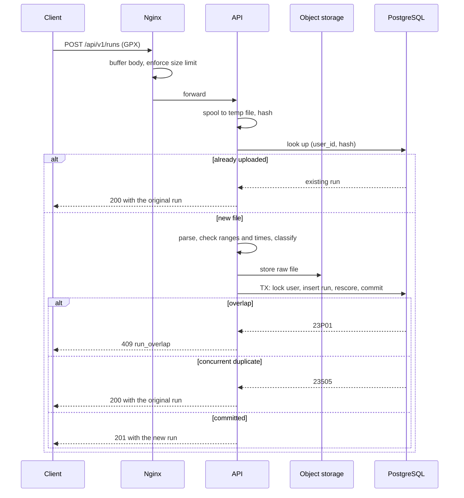
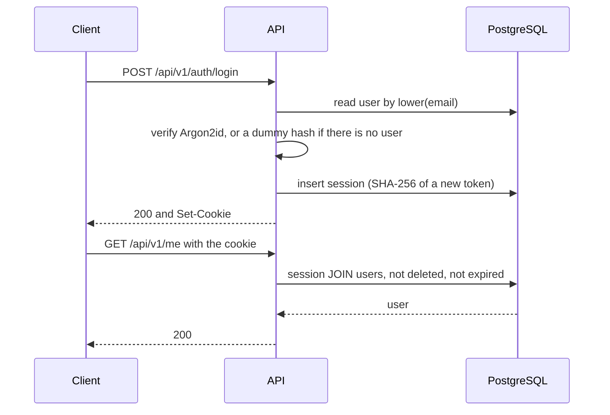

# API Detailed Design (Phase 1)

> **Status:** Design approved by the project owner. No application code exists yet.
>
> **The contract itself is [`docs/api/openapi.yaml`](../api/openapi.yaml).** If this document and that file disagree, the file wins, and the disagreement is a bug. This document explains why the contract looks the way it does.
>
> **Performance statements are predictions** until the data generator and load tests exist. Section 21 lists what was verified and what wasn't.

The decision IDs (D-numbers) refer to the log in section 10 of `ARCHITECTURE.md`. "Database 6.3" means section 6.3 of [`database.md`](database.md).

## Contents

1. [Design summary](#1-design-summary)
2. [Constraints](#2-constraints)
3. [Conventions](#3-conventions)
4. [Endpoint catalog](#4-endpoint-catalog)
5. [Data placement](#5-data-placement)
6. [Pagination, sorting and filtering](#6-pagination-sorting-and-filtering)
7. [Run upload](#7-run-upload)
8. [Authentication](#8-authentication)
9. [Authorization](#9-authorization)
10. [Error model](#10-error-model)
11. [Idempotency and concurrency](#11-idempotency-and-concurrency)
12. [Competition and leaderboard semantics](#12-competition-and-leaderboard-semantics)
13. [HTTP caching](#13-http-caching)
14. [Rate limiting and size limits](#14-rate-limiting-and-size-limits)
15. [Security checklist](#15-security-checklist)
16. [Observability](#16-observability)
17. [Contract, tooling and tests](#17-contract-tooling-and-tests)
18. [Mapping to the database](#18-mapping-to-the-database)
19. [Polling versus push](#19-polling-versus-push)
20. [Coverage](#20-coverage)
21. [Verification](#21-verification)
22. [Sources](#22-sources)

---

## 1. Design summary

| Topic | Decision | ID |
|---|---|---|
| Style | REST, JSON, `/api/v1`, camelCase, units in field names | D41 |
| Hosting | PWA and API on one origin, so no CORS | D42 |
| Authentication | Opaque session token, stored hashed, in an `HttpOnly` cookie. No JWT, and no bearer token yet | D43 |
| CSRF | `SameSite=Strict`, plus a server check of `Sec-Fetch-Site` and `Origin`. No tokens | D44 |
| Errors | RFC 9457 Problem Details, with a stable `code` | D45 |
| Hidden resources | Can't see it: 404. Can see it, can't do this: 403 | D46 |
| Pagination | Keyset with an opaque cursor, and one fixed order per list | D47 |
| Upload | Raw body. Duplicate check first. New run 201, existing run 200 | D48 |
| Plausibility | Configurable starting thresholds | D49 |
| Email | Deferred, but **required before opening to the public** | D50 |
| Freshness | Polling every 25 s while visible, with ETags | D51 |
| Contract | Hand-written OpenAPI 3.1, linted | D52 |
| Rate limits | In the app, in memory | D53 |
| Finding people | Display-name search, and run viewing gated by `run_privacy` | D54 |
| Creating a competition | The creator auto-joins. Public competitions need an explicit consent flag | D55 |
| Retries | No `Idempotency-Key`, no `If-Match`. Groups and competitions can't be edited | D56 |

---

## 2. Constraints

These were decided before this design, and aren't reopened here.

| Constraint | Source |
|---|---|
| PWA client, Spring Boot modular monolith, package-by-feature with web -> service -> persistence layers, and no business logic in controllers | D2, D5, D40 |
| IDs are UUIDv7. Times are `timestamptz`. Distances and durations are integers, and pace is a generated integer | D24, database 2 |
| GPX upload only, with no manual entry, no user deletion of runs and no manual invalidation | D11, D14, D30 |
| Ingest is synchronous: parse in the API, then one transaction inserts the run and rescores | D26, D30 |
| Duplicates return the existing run, overlaps are a conflict, and implausible runs are stored as invalid | D25, database 3.2 |
| Future-dated runs, and runs older than 30 days, are rejected | D36 |
| Eligibility: started in the window, and received before `closes_at`. Grace defaults to 6 hours | D13, D27, D28 |
| Joining backfills the score. Leaving is refused from `ends_at` on | D31, D39 |
| Ties share a rank. Deleted users are filtered at read time | D15, D17 |
| Public top N: display name and metric, and joining is consent to appear there | D16 |
| Private groups are invitation-only. Competitions are separate from groups | D20, D32 |
| Two-phase account deletion, where sessions are revoked immediately | D29 |
| No route geometry is stored, so the API never exposes routes or coordinates | Database 3.2 |
| Zero cost | D4 |
| Leaderboard p95 < 200 ms, other reads < 300 ms, search < 500 ms, upload < 1 s, freshness <= 30 s | D22 |

**Phase 2 and 3 endpoints aren't designed here.** Section 3.8 checks that they will fit.

---

## 3. Conventions

### 3.1 REST, JSON, `/api/v1` (D41)

**Why:** this data maps cleanly onto resources, and everything can be inspected with free tools.

**Rejected:** GraphQL, because flexible client queries make latency targets harder to protect, and it solves a many-clients problem we don't have. gRPC, because browsers can't call it directly.

### 3.2 Same origin (D42)

The PWA and the API are served from one origin through Nginx. **CORS** is the browser rule for calling another origin, and this avoids it entirely, along with preflight requests. Cookies also get simpler. Local development uses a dev-server proxy to keep the same shape.

**Rejected:** an `api.` subdomain, which brings preflights and cookie-scope questions with no benefit for one client.

### 3.3 URLs

- Plural kebab-case nouns, with at most one level of nesting under a parent.
- `/me` is a real sub-tree for the current user's own data, which removes a whole class of "wrong user ID" bugs.
- `/me` under a parent, such as `/groups/{groupId}/members/me`, is a literal path that takes priority over `{userId}`. OpenAPI defines this priority too.

`/auth/*` isn't pure REST. Login and logout aren't really resources, and pretending otherwise (a `/sessions` collection) adds nothing here. The prefix also groups them neatly for rate limits.

### 3.4 JSON

| Rule | Example | Why |
|---|---|---|
| camelCase fields | `startedAt` | JavaScript's convention, and the frontend is the main reader |
| Lowercase snake_case enums, matching the database | `total_distance` | One spelling everywhere, so logs and SQL read the same |
| Units in field names | `distanceMeters`, `paceSecondsPerKm` | A bare `distance` invites km/m bugs, and a contract should not need footnotes |
| RFC 3339 UTC times | `2026-11-03T07:00:00Z` | Unambiguous and sortable |
| Dates as `YYYY-MM-DD` | `birthDate` | A birth date is not a moment in time |

`score` is the one generic field, because its unit depends on the rule. The leaderboard's `scoreUnit` names it.

**Null versus absent:**
- **Null** means the viewer may know this, and there is no value.
- **Absent** means the viewer isn't entitled to the field, or it doesn't apply.

So `userId` is absent in a public top N, while `city` is `null` if the user never set it. The shape stays stable, and the two cases really are different.

**One deliberate exception:** a competition's `group` is `null` both when there is no group and when the viewer can't see it. Using absent there would reveal that a private group exists.

**`PATCH` uses JSON Merge Patch** (RFC 7396): absent means unchanged, and `null` clears the field. Its media type is `application/merge-patch+json`. In Java, plain DTOs can't tell absent from null, so the implementation needs a wrapper for these requests. The class design chooses `JsonNullable` (D65).

### 3.5 Tolerant readers, strict requests

- **Clients ignore unknown response fields**, so adding a field is safe.
- **The server rejects unknown request fields** with 400. This is stricter than Spring's default, and it catches typos and accidental mass-assignment (a client setting a field it was never meant to set).

### 3.6 Open enums

`rule.type`, `invalidReason`, `source` and `scoreUnit` use `x-extensible-enum` rather than `enum`, and clients must handle unknown values.

**Why:** Phase 2 adds rule types. With a closed `enum`, generated clients would break on a new value, and adding one would be a breaking change. Request bodies keep a real `enum`, because the server decides what it accepts.

### 3.7 Evolution policy

| Non-breaking | Breaking |
|---|---|
| New endpoint | Removing or renaming anything |
| New optional request field | A new required request field |
| New response field | Tightening validation |
| New value in an open enum | Changing a type or meaning |
| Loosening an authorization rule | Tightening an authorization rule |

A breaking change needs `/api/v2`, or a deprecated field with `Deprecation` (RFC 9745) and `Sunset` (RFC 8594) headers and **at least 30 days of overlap**.

**Why this matters with only one client:** a PWA service worker keeps old bundles running on phones, so old clients really do exist.

### 3.8 Room for Phase 2 and 3

Checked, not designed:
- `/feed`, `/me/achievements`, `/competitions/{competitionId}/teams` and `/partners` collide with nothing.
- Nested `rule: {type, minDistanceMeters}` leaves room for new rule parameters.
- `source` on runs, and a new content type on `POST /runs`, leave room for live recording.
- A bearer token and SSE can both be added without breaking anything (sections 8.1 and 19).

---

## 4. Endpoint catalog

Paths are under `/api/v1`. Auth: **A** = logged in, **O** = optional (anonymous allowed), **N** = none.

**Not repeated in every row:** every endpoint can return 429, 500 and 503. Authenticated endpoints can return 401 `unauthenticated`. Unsafe methods can return 403 `csrf_rejected`. Requests with a body can return 413, 415 and, for JSON, 422 `validation_failed`. Query parameters that parse but break a rule, such as an out-of-range `limit` or an unknown enum value, also return 422 `validation_failed`. Anything with parameters can return 400 `malformed_request`, and with a cursor, 400 `invalid_cursor`.

| Endpoint | Auth | Request | Success | Other errors | Serves |
|---|---|---|---|---|---|
| `POST /auth/register` | N | email, password, displayName, timeZone? | 201 CurrentUser + cookie | 409 `email_taken`, 422 `weak_password` | W6 |
| `POST /auth/login` | N | email, password | 200 CurrentUser + cookie | 401 `invalid_credentials` | R1 |
| `POST /auth/logout` | A | none | 204, clears cookie | | R1 |
| `GET /me` | A | none | 200 CurrentUser | | R1, W6 |
| `PATCH /me` | A | displayName, birthDate, city, timeZone, runPrivacy | 200 CurrentUser | | W6 |
| `PUT /me/password` | A | currentPassword, newPassword | 204, new cookie | 403 `password_incorrect`, 422 `weak_password` | W6 |
| `POST /me/deletion` | A | password | 204, clears cookie | 403 `password_incorrect` | W6 |
| `PUT /me/photo` | A | raw JPEG or PNG | 200 PhotoResponse | 422 `image_invalid` | W6 |
| `DELETE /me/photo` | A | none | 204 | | W6 |
| `GET /me/stats` | A | weeks?, months?, weekStart? | 200 Stats | | R4 |
| `GET /users` | A | q, limit? | 200 list | | R7 |
| `GET /users/{userId}` | A | none | 200 UserCard | 404 `not_found` | R7 |
| `GET /users/{userId}/photos/{photoId}` | A | none | 200 image | 404 `not_found` | R7 |
| `GET /users/{userId}/runs` | A | limit, cursor | 200 list | 403 `runs_not_visible`, 404 `not_found` | R3 |
| `POST /runs` | A | raw GPX | 201 new, or 200 existing | 409 `run_overlap`, 422 `gpx_malformed` `gpx_out_of_range` `run_in_future` `run_too_old`, 503 `storage_unavailable` | W1, W2 |
| `GET /me/runs` | A | limit, cursor | 200 list | | R3 |
| `GET /runs/{runId}` | A | none | 200 Run | 404 `not_found` | R3 |
| `GET /me/friends` | A | status=accepted\|incoming\|outgoing, limit, cursor | 200 list | | R7 |
| `PUT /me/friends/{userId}` | A | none | 201 pending, or 200 accepted/no change | 404 `not_found`, 422 `friend_self` | W5 |
| `DELETE /me/friends/{userId}` | A | none | 204 | | W5 |
| `POST /groups` | A | name, visibility, city? | 201 Group | | W5 |
| `GET /groups` | A | q, city, limit, cursor | 200 list | | R8 |
| `GET /me/groups` | A | limit, cursor | 200 list | | R7 |
| `GET /groups/{groupId}` | A | none | 200 Group | 404 `not_found` | R7 |
| `DELETE /groups/{groupId}` | A | none | 204 | 403 `forbidden`, 404 `not_found` | W5 |
| `GET /groups/{groupId}/members` | A | limit, cursor | 200 list | 403 `forbidden`, 404 `not_found` | R7 |
| `PUT /groups/{groupId}/members/me` | A | none | 201 joined, or 200 already in | 404 `not_found` | W5 |
| `DELETE /groups/{groupId}/members/me` | A | none | 204 | 404 `not_found` | W5 |
| `PATCH /groups/{groupId}/members/{userId}` | A | role | 200 Member | 403 `forbidden`, 404 `not_found`, 409 `last_admin` | W5 |
| `DELETE /groups/{groupId}/members/{userId}` | A | none | 204 | 403 `forbidden`, 404 `not_found`, 409 `last_admin` | W5 |
| `PUT /groups/{groupId}/invitations/{userId}` | A | none | 204 | 403 `forbidden`, 404 `not_found`, 409 `invitation_not_applicable` | W5 |
| `GET /groups/{groupId}/competitions` | A | limit, cursor | 200 list | 404 `not_found` | R5, R6 |
| `POST /competitions` | A | name, rule, visibility, startsAt, endsAt, gracePeriodSeconds?, city?, groupId?, consentToPublicLeaderboard? | 201 Competition | 403 `forbidden`, 404 `not_found`, 409 `competition_limit_reached`, 422 `consent_required` | W2, W3 |
| `GET /competitions` | A | q, city, state, limit, cursor | 200 list | | R8 |
| `GET /me/competitions` | A | status=active\|finished, limit, cursor | 200 list | | R6 |
| `GET /competitions/{competitionId}` | O | none | 200 Competition | 404 `not_found` | R5, W4 |
| `DELETE /competitions/{competitionId}` | A | none | 204 | 403 `forbidden`, 404 `not_found`, 409 `competition_not_deletable` | W3 |
| `GET /competitions/{competitionId}/participants` | A | limit, cursor | 200 list | 403 `forbidden`, 404 `not_found` | R5 |
| `PUT /competitions/{competitionId}/participants/me` | A | consentToPublicLeaderboard? | 201 joined, or 200 already in | 404 `not_found`, 409 `competition_limit_reached` `competition_join_closed`, 422 `consent_required` | W2, W3 |
| `DELETE /competitions/{competitionId}/participants/me` | A | none | 204 | 404 `not_found`, 409 `competition_leave_closed` | W3 |
| `PUT /competitions/{competitionId}/invitations/{userId}` | A | none | 204 | 403 `forbidden`, 404 `not_found`, 409 `invitation_not_applicable` | W3 |
| `GET /competitions/{competitionId}/leaderboard` | O | limit, cursor, If-None-Match | 200 Leaderboard, or 304 | 403 `full_leaderboard_forbidden`, 404 `not_found` | R2 |
| `GET /me/invitations` | A | none (newest 100) | 200 list | | W3, W5 |
| `DELETE /me/invitations/groups/{groupId}` | A | none | 204 | | W5 |
| `DELETE /me/invitations/competitions/{competitionId}` | A | none | 204 | | W3 |

**W4 (closure)** is a scheduled job with no endpoint of its own. Clients observe it through `state`, which is why `GET /competitions/{competitionId}` is tagged with it.

**Added beyond the requirements, and why:**

| Endpoint | Why |
|---|---|
| `PUT /me/password` | The only password control there is, with no email reset |
| `GET /users`, `GET /users/{userId}` | Friend requests and invitations need a way to find a person (D54) |
| `GET /users/{userId}/photos/{photoId}` | Photos are in private object storage, so they need a route |
| `GET /users/{userId}/runs` | Without it, `run_privacy` would do nothing in Phase 1 (D54) |
| `GET /groups/{groupId}/competitions` | The database already indexes it (`ix_competitions_group`) |
| `DELETE /competitions/{competitionId}` | The only fix for a mistake, since competitions can't be edited (D56) |
| `DELETE /groups/{groupId}/members/{userId}` | The admin role needs some real power |

**Deliberately left out, all addable without breaking anything:** editing groups or competitions, changing email, revoking invitations, listing a group's invitations, listing sessions.

**No accept endpoint for invitations.** Accepting is the same `PUT` as joining (section 11.3).

### 4.1 Finding people and viewing their data (D54)

**Search:** `GET /users?q=` matches display names, for logged-in users only, with at least 3 characters and at most 20 results. It returns `UserCard`, never email.

**The cost to accept:** anyone with an account can list names. Registration without email verification is cheap, so "logged-in only" is a weak barrier. A later "hide me from search" setting would be non-breaking.

**Rejected:**

| Alternative | Why |
|---|---|
| Exact email lookup | Confirms whether an email is registered, which is the enumeration leak section 8.5 tries to avoid |
| Friend code or link | Best for privacy, but needs a new column and sharing outside the app |
| Shared contexts only | Two friends with nothing in common could never connect |

**`UserCard`:** ID, display name and photo URL, for any logged-in user. `city` appears only on `GET /users/{userId}`, for friends and the user themselves. Birth date and email are never shown to anyone else.

**Runs** follow `run_privacy`: `public` means any logged-in user, `friends` means accepted friends, and `private` means the owner only. **Invalid runs are owner-only**, as are `status`, `invalidReason`, `receivedAt` and stats.

Run dates and times reveal a person's routine, which is why `private` stays the default, and why `public` doesn't extend to logged-out visitors.

---

## 5. Data placement

Ask one question for each piece of data.

| Location | Question it answers | Examples | Never |
|---|---|---|---|
| **Path** | *Which resource?* Identity only | `/competitions/{competitionId}` | Filters, secrets |
| **Query** | *How do I want to view it?* Never changes state | `q`, `city`, `state`, `limit`, `cursor` | Secrets, because URLs end up in logs and browser history |
| **Body** | *What state am I sending?* | Profile fields, GPX file, passwords | Anything on `GET` |
| **Headers** | *What is this request's metadata?* | Cookie, `Content-Type`, `X-Request-Id`, `If-None-Match` | Business data |

**Worked examples:**

| Data | Where | Why |
|---|---|---|
| Competition ID | Path | It says which resource |
| "Only running competitions" | Query | Same resource, different view |
| Search text | Query | Bookmarkable, and it changes no state |
| Consent flag on join | Body | It is state the client asserts |
| Password on account deletion | Body | A secret. This is also why deletion is `POST`: `DELETE` bodies have undefined meaning, and proxies may drop them |
| Session token | Cookie header | Metadata about who is asking, and never visible to JavaScript |
| Filename of a GPX file | Nowhere | The server doesn't use it |

**Filters** use plain names, and multiple values repeat the key: `state=upcoming&state=running`.

**Search parameters** are `q` for free text, plus named filters such as `city`. Matching is case-insensitive substring, and `%` and `_` in the input are escaped.

**Access logs record the route template, not the query string**, so `q=` searches for people's names stay out of logs.

---

## 6. Pagination, sorting and filtering

### 6.1 Keyset pagination (D47)

**Keyset pagination** continues from the last row seen, rather than counting past rows as `OFFSET` does.

Response shape: `{items, nextCursor}`, where `null` means the last page. Default `limit` is 20, and the maximum is 100.

**Cursor:** base64url JSON with a version field, holding the last row's sort key. It is **opaque by contract**: clients must not parse it, and the server can change it freely. It is not signed, because every query still applies the viewer's authorization, so tampering gains nothing. A cursor that doesn't parse gets 400 `invalid_cursor`. Changing filters while keeping a cursor gives harmless but meaningless results, and the contract tells clients to keep them unchanged.

**Why not `OFFSET`:**
- Deep pages get slower, because the database reads and discards every skipped row.
- A new run arriving between pages shifts everything, so rows repeat or get skipped.

With a keyset, new rows land before the cursor, so nothing is skipped or repeated.

**No total counts in lists:** they'd need a full count on each page. Details endpoints show `participantCount` and `memberCount`, which are cheap once rather than on every page.

**Exceptions, both without a cursor:**
- `GET /me/invitations` returns the newest 100. **That is a cap, not a proof of smallness.** A user with over 100 pending invitations won't see the oldest. Adding `nextCursor` later is non-breaking.
- `GET /users` returns at most 20. If the person isn't there, the client should search for something more specific.

### 6.2 Fixed orders, no `sort` parameter

Each list has one fixed order, chosen because an index serves it. **A free `sort` parameter would promise orders we can't serve efficiently.**

| List | Order | Why |
|---|---|---|
| Run history | `started_at DESC, id DESC` | `ix_runs_user_started` |
| Leaderboard | `score, user_id`, direction by rule | `ix_participants_leaderboard` |
| Participants | `user_id` | Primary key |
| Group members | `user_id` | Primary key |
| My competitions | `competition_id DESC` | UUIDv7 sorts by creation time |
| My groups | `group_id DESC` | Same |
| Friends | The other user's ID | Both friendship indexes |
| Searches | `id DESC` | Newest first |

**The honest cost:** participants and members appear in an order that means nothing to people. Alphabetical order would need a sort, and we'd accept that only when someone asks.

### 6.3 Leaderboards

One request serves the whole screen, because R2 is one screen:

```json
{
  "state": "running",
  "scoreUnit": "meters",
  "viewerAccess": "full",
  "asOf": "2026-11-03T10:00:00Z",
  "pollIntervalSeconds": 25,
  "entries": [
    { "rank": 1, "displayName": "Noa Peretz", "score": 42000, "userId": "...", "photoUrl": null, "isMe": false },
    { "rank": 1, "displayName": "Amir Cohen", "score": 42000, "userId": "...", "photoUrl": null, "isMe": false },
    { "rank": 3, "displayName": "Dana Levi", "score": 31000, "userId": "...", "photoUrl": "...", "isMe": true }
  ],
  "me": { "rank": 3, "score": 31000 },
  "nextCursor": null
}
```

**Rejected:** a separate "my rank" endpoint, which would cost a second request for every screen and every poll.

- `limit` defaults to 10 here. For top N viewers it is capped at N.
- `me` appears on the first page only, because it can cost up to 5,000 index entries.
- **Deep pages** find the rank of their first row with the same count query as "my rank" (database 7.2), then assign ranks within the page. No rank goes in the cursor, because the count stays correct even as scores change.
- **Scores can move between pages.** A user could appear twice or be missed when paging during a score change. Eventual consistency allows this (database 7.3).

---

## 7. Run upload

### 7.1 Format (D48)

`POST /runs` with a raw body, `Content-Type: application/gpx+xml`.

**Why raw:** there is no other metadata, so multipart would add a parsing layer for no benefit. Browsers also can't send this type cross-site without a preflight, which is a small extra CSRF barrier.

**A trap for the client:** browsers often leave `File.type` empty for `.gpx` files, so **the client must set the header explicitly**. Anything else gets 415.

Compressed request bodies (`Content-Encoding: gzip`) are refused with 415, because of decompression bombs: small files that expand enormously.

### 7.2 Order of validation

Cheap and retry-safe checks come first.

| # | Step | On failure |
|---|---|---|
| 1 | Session, CSRF, rate limit | 401, 403 `csrf_rejected`, 429 |
| 2 | Content type | 415 `unsupported_media_type` |
| 3 | `Content-Length` over the limit, if declared | 413 `payload_too_large` |
| 4 | Spool to a temp file, counting bytes and hashing with SHA-256 | 413 if the count passes the limit |
| 5 | **Look up `(user_id, hash)`** | Found: **200 with the existing run** |
| 6 | Secure streaming parse | 422 `gpx_malformed` |
| 7 | Distance under 1 m, or duration over 7 days | 422 `gpx_out_of_range` |
| 8 | Start or end in the future, with 2 minutes of tolerance | 422 `run_in_future` |
| 9 | Started over 30 days ago (configurable) | 422 `run_too_old` |
| 10 | Plausibility thresholds (section 7.5) | Continues, marked invalid |
| 11 | Store the file | 503 `storage_unavailable` with `Retry-After` |
| 12 | Transaction (database 6.3) | `23505`: 200 existing. `23P01`: 409 `run_overlap` |
| 13 | Commit | **201** with `Location`, whether the run is valid or invalid |

**Step 5 moved earlier than database 6.3 had it** (API-2). The original order had a defect: a client retrying an accepted upload after its `started_at` passed the 30-day limit got "too old" rather than its own run.

**The 2-minute tolerance is a small deviation from D36's wording.** Device clocks drift slightly, and without it, a just-finished run could be refused. It is configurable, and 0 restores the strict rule. D36 was amended to record this.



### 7.3 Size, buffering and timing

**Limit: 20 MB**, enforced by both Nginx and the API. The average file is 350 KB. A 24-hour ultra recorded once per second is about 17 MB, by my estimate of 200 bytes per trackpoint.

**Nginx buffers the body before forwarding it**, so a slow phone connection doesn't hold an application thread.

**The API spools to a temp file and never holds a file in the heap.** It then parses from disk and uploads from disk, and deletes the temp file in `finally`.

**Rejected:**
- **DOM parsing,** which builds a tree using many times the file size in memory.
- **A `byte[]` in memory,** which has a similar problem, multiplied by concurrent uploads.
- **Streaming straight into object storage while parsing,** which would store files we're about to reject.

**The 1-second target is measured from body received to response**, excluding mobile network time, which is outside our control. D22 says "completed", and this defines what that means.

### 7.4 Response

| Case | Status | Body |
|---|---|---|
| New run, valid | 201 + `Location` | `OwnRun`, `status: valid` |
| New run, implausible | 201 + `Location` | `OwnRun`, `status: invalid`, with `invalidReason` |
| This file was already uploaded | 200 | The original `OwnRun`, with its original status |

**How a client distinguishes "new" from "already existed" on a retry:** the status code. The body is the same shape, so the same code can render both.

**Rejected:**
- **409 on duplicates:** a retry after a lost response should look like success, not an error.
- **303 See Other:** `fetch` follows it automatically, hiding the distinction.

**The response deliberately doesn't list affected competitions.** It would be useful, but it would stop being available in the deferred async milestone (database 9), and removing it then would be a breaking change. The client refreshes leaderboards instead.

### 7.5 Plausibility thresholds (D49)

These are **starting values, all configurable.** They narrow open question 6, and don't close it. They are my estimates, not yet tested on real GPX files. Moving versus elapsed time stays open.

| `invalidReason` | Rule | Why |
|---|---|---|
| `pace_too_fast` | Average under 150 s/km | About the 5K world-record pace (roughly 151 s/km) |
| `pace_too_slow` | Average over 1,800 s/km | Slower than walking, likely a forgotten recorder |
| `gps_speed_jump` | A segment over 15 m/s, for at least 50 m | Above human sprint speed, with a floor for GPS noise |
| `duration_too_long` | Over 48 hours | Stricter than the 7-day schema backstop |

**A too-strict threshold is cheap to correct in one way only.** A wrongly invalid run can't be revalidated in Phase 1, because status never changes after insert (database 3.2). So thresholds should stay permissive until real data arrives, and these are set near the edge of the humanly possible rather than near typical values.

### 7.6 Safe parsing

**XXE** (XML External Entity) is an attack where an XML file tells the parser to read a server file or call a URL. This is an API-level requirement, not a parser detail.

- Use StAX, a streaming parser, with `SUPPORT_DTD=false` and `IS_SUPPORTING_EXTERNAL_ENTITIES=false`.
- Any `DOCTYPE` gets 422 `gpx_malformed`. A GPX file never needs one.
- Cap trackpoints at 200,000.
- Malformed: not XML, no trackpoints, missing timestamps, non-increasing times, or out-of-range coordinates.

**How metrics are computed:**
- Distance sums within track segments, not across gaps.
- Duration is the last timestamp minus the first, so elapsed time, as database 3.2 states.

Hostile fixtures are required tests: XXE, "billion laughs" (nested entities that expand enormously) and truncated files.

### 7.7 Profile photos

`PUT /me/photo`: raw JPEG or PNG, up to 2 MB, checked by magic bytes (the file's real signature, not its declared type) and pixel dimensions before decoding.

**Always re-encoded**, to a 512x512 JPEG. **Photos carry GPS coordinates in EXIF data**, which would contradict the privacy goals, and re-encoding removes that along with any hostile payload.

Each upload gets a new `photoId` in the URL, so the image can be cached as immutable. WebP isn't accepted, because Java's standard image library doesn't read it.

---

## 8. Authentication

### 8.1 Opaque session tokens in a cookie (D43)

An **opaque token** is a random string with no meaning, checked against the database on each request.

**Why:** revocation is immediate, and that is a requirement (logout, account deletion, D29). R1 becomes one primary-key lookup, predicted at under 5 ms.

**Rejected:**

| Alternative | Why |
|---|---|
| JWT | Verified without a lookup, so it can't be revoked without adding a lookup back, which removes its advantage. Its real strength is many services verifying tokens independently, and we have one |
| Refresh tokens | Complexity for a problem that sessions don't have |
| Spring Session with Redis | A new component, and the project rule is to measure before adding one (D8) |
| Bearer token now, alongside the cookie | No client needs it, since a native app is only "if the product succeeds" (D2). It adds token delivery, CSRF exemptions and XSS exposure to design and test |

**A bearer token stays possible.** It would use the same table, and adding it is non-breaking.

**Why cookie rather than `localStorage`:** an `HttpOnly` cookie can't be read by JavaScript, so an XSS bug can't steal the token. It can still act as the user while the page is open, which is why CSP matters too (section 15).

### 8.2 Token and cookie details

- 256 random bits from a secure generator, encoded as base64url.
- The database stores **the SHA-256 of the token** (API-1), so a database leak doesn't give an attacker working sessions.
- **SHA-256 rather than Argon2:** slow hashes protect low-entropy secrets such as passwords. A 256-bit random value can't be brute-forced, and this hash runs on every request.

```
Set-Cookie: __Host-pace_session=<token>; HttpOnly; Secure; SameSite=Strict; Path=/; Max-Age=<seconds>
```

The `__Host-` prefix makes the browser enforce `Secure`, `Path=/` and no `Domain`, so a sibling subdomain can't overwrite the cookie. The name and `Secure` are configurable for local development.

**Why `SameSite=Strict` has no downside here:** the usual cost is appearing logged out after following an external link. But the page itself is static, and its API calls come from our own origin, so the cookie is sent. Share links still work.

### 8.3 Session lifetime

| Rule | Value | Why |
|---|---|---|
| Sliding expiry | 30 days | Runners use the app a few times a week |
| Absolute maximum | 90 days | A stolen token can't live forever |
| Renewal | At most hourly | Ordinary reads shouldn't write |
| New token | On login and on password change | Prevents session fixation, where an attacker plants a known token |
| Password change | Revokes all other sessions | The expected "kick out an intruder" behavior |
| Account deletion | Deletes all sessions in the same transaction | D29 requires immediate effect |

**Renewal also refreshes the cookie.** The cookie's `Max-Age` has to slide with the session, or the browser would drop it 30 days after login, however active the user is. So any authenticated response may carry `Set-Cookie`, at most hourly, and the contract states this. *(Added by the class design, CLS-8.)*



### 8.4 CSRF (D44)

**CSRF** (Cross-Site Request Forgery) is when another site makes your browser send an authenticated request.

**Layer 1:** `SameSite=Strict`.

**Layer 2:** a filter on unsafe methods (`POST`, `PUT`, `PATCH`, `DELETE`), including login:
1. If `Sec-Fetch-Site` is present, it must be `same-origin`. (`none`, meaning the user acted directly, doesn't apply to `fetch` calls from our page, so it is refused.)
2. Otherwise, `Origin` must match the configured origin.
3. **If neither header is present, reject.**

Rejection returns 403 `csrf_rejected`. Test tools and load generators just set `Origin`.

**Why step 3:** OWASP says missing headers "are not evidence of a same-origin request". This is stricter than Go 1.25's `CrossOriginProtection`, which lets such requests through as non-browser clients. We can be stricter, because our only clients are our own PWA and our own tests.

**Rejected:** double-submit tokens, and Spring Security's default synchronizer tokens. They add client code and a contract rule to every write, and an XSS bug defeats them anyway.

**Being honest about the trade-off:**
- OWASP's general guidance still lists tokens as the default for stateful apps. It also accepts Fetch Metadata as a primary defense for modern-browser-only software, as long as `Origin` is the fallback, and that is the case we're relying on.
- Browsers that send neither header are refused rather than exposed, so very old browsers can't use the app at all. A PWA already has that limitation in practice.
- `Sec-Fetch-Site` is only sent to secure origins, which is one more reason HTTPS is required. HSTS closes the HTTP downgrade gap.
- Spring Security's built-in CSRF is turned off, so **this filter needs its own tests.** A mistake here fails silently.

### 8.5 Registration and login

**Registration** creates the account, and logs the user in immediately.

**Login is enumeration-resistant.** **Enumeration** means learning which accounts exist by watching responses. An unknown email and a wrong password return the same 401, and the server does a dummy hash check for unknown emails so the timing matches too.

**Registration is not, and can't be without email.** Real enumeration resistance needs "we've sent you an email", in which case the response doesn't change. Without email, `email_taken` must be returned, or nobody could tell why registration failed. **Strict per-IP limits are the only mitigation until D50 ends.**

### 8.6 Email flows deferred, with a hard gate (D50)

Email verification and password reset aren't in this version of the API.

**Consequences, which must be accepted knowingly:**
- **A forgotten password means a lost account.** An admin couldn't safely reset it, since nothing proves who is asking.
- Anyone can register using someone else's address, locking the real owner out.
- A typo in an email can't be corrected.
- Registration stays enumerable (section 8.5).

**"Email costs money" is mostly not the blocker.** Free tiers exist, as section 22 shows, though the limits differ between sources and need checking when one is chosen. **The real dependency is a domain**, which most providers require for good deliverability, and that is open question 10.

**Decision:** acceptable for local development and a closed beta with friends. **It must ship before opening to the public.** No schema is added now, and `emailVerifiedAt` will be an additive field.

### 8.7 Passwords

| Rule | Value | Why |
|---|---|---|
| Length | 10 to 128 characters | Length matters more than symbols. The maximum stops very long inputs being used for DoS |
| Composition rules | None | They push people to predictable patterns such as `Password1!` |
| Common passwords | Rejected, from a bundled list | The attacks that actually work use these lists |
| Hash | Argon2id, `m=19456 KiB, t=2, p=1` | OWASP's stated minimum, confirmed on its page. It is memory-hard, which makes GPU cracking expensive |
| Parameter changes | Rehash on next login | The hash string records its own parameters |

**Rejected:** bcrypt. The NFR allows it, but it accepts at most 72 bytes in most implementations. Spring's built-in Argon2 defaults are slightly lower than OWASP's minimum, so the parameters should be set explicitly.

**A semaphore caps concurrent hashes** (4 to start). Each one uses 19 MiB, and a login burst shouldn't exhaust memory on a small server.

### 8.8 Brute-force protection

Limit by email and by IP (section 14). **There is no hard account lockout**, because it would let anyone lock out a victim just by failing logins on purpose.

---

## 9. Authorization

### 9.1 404 versus 403 (D46)

**Can't see it: 404. Can see it, can't do this: 403.**

The server answers the same way for "doesn't exist" and "exists, but it's hidden from you", so private resources can't be discovered by probing. Where one module owns all the data, the implementation should use one query for both, such as `WHERE id = $1 AND (visibility = 'public' OR ...)`, so that timing doesn't differ either. **The one accepted exception:** a private competition tied to a group needs a second statement into `social` (D35, D58), so a hidden one can take about one query longer than a missing one. IDs can't be enumerated, so this isn't worth another cross-module read.

| Case | Status | Why |
|---|---|---|
| Stranger opens a private competition | 404 | Must not learn that it exists |
| Logged-out visitor opens a private competition | 404 | Same. The client can suggest logging in |
| Group member calls `DELETE /groups/{groupId}` | 403 | Already knows the group exists |
| Non-member lists a public group's members | 403 | The group is public |
| Non-member lists a private group's members | 404 | The group is hidden |
| Viewing a user whose runs are private: the list | 403 `runs_not_visible` | The user's existence is already visible, and the UI can explain why |
| Viewing that user's single run by ID | 404 | Must not confirm a specific run exists |

**IDs aren't secrets.** UUIDv7s are hard to guess but not meant to be private, so every endpoint checks authorization.

**"See" for a private resource** means: member or participant, creator, invitee, or, for a group's private competition, a member of that group.

### 9.2 Matrix

Each column adds to what its role can do. Blank means no access.

| Resource and action | Anonymous | Logged in | Friend | Member / participant | Admin / creator | Owner |
|---|---|---|---|---|---|---|
| Own profile, stats, email, birth date | | | | | | Yes |
| `UserCard` | | Yes | + `city` | | | Yes |
| Runs, by `run_privacy` | | `public` only | + `friends` | | | All, incl. invalid |
| Upload a run | | Yes | | | | |
| Search users, groups, competitions | | Yes | | | | |
| Public group: details | | Yes | | | | |
| Public group: members | | 403 | | Yes | Yes | |
| Public group: join | | Yes | | | | |
| Private group: details | | 404 (invitee: yes) | | Yes | Yes | |
| Private group: members | | 404 (invitee: 403) | | Yes | Yes | |
| Private group: join | | 404 (invitee: yes) | | | | |
| A group's competitions | | Public ones, of a public group | | All | All | |
| Invite to a group, kick, change role, delete group | | | | 403 | Admin | |
| Create a competition | | Yes | | Group-tied: 403 | Group admin | |
| Public competition: details, top N | Yes | Yes | | Yes | Yes | |
| Public competition: full board, participants | | 403 | | Participant | Only if participating | |
| Public competition: join (with consent) | | Yes | | | | |
| Private competition: details, top N | 404 | 404 (invitee: yes) | | Yes | Yes | |
| Private competition: full board, participants | 404 | 404 (invitee: 403) | | Participant | Only if participating | |
| Private competition: join | | 404 (invitee: yes) | | Group member: yes | | |
| Invite to a competition | | | | 403 | Creator, group admin | |
| Delete a competition | | | | 403 | Creator, before it starts, if alone in it | |

**Rules behind the table:**
- **Anonymous top N follows D16's "anyone".** Since registration is free and unverified, requiring login would add little privacy, but it would break share links. Search still requires login.
- **Top N responses contain rank, display name and score only.** No `userId` or photo, which also settles database 12.1: a UUIDv7 reveals its creation time, so public responses don't expose it.
- **Full access means being a participant**, with no special case for creators or admins. One rule is easier to test and to explain.
- **`group` on a competition is `null` if the viewer can't see that group**, otherwise a public competition would reveal a private group's name.
- **Starting strict is deliberate.** Only admins create group competitions, and only creators and group admins invite. Loosening later is non-breaking, while tightening is breaking (section 3.7).
- **Invitations apply only to private groups and competitions**, as in database 3.5. Otherwise: 409 `invitation_not_applicable`.

---

## 10. Error model

### 10.1 Shape (D45)

**RFC 9457 Problem Details** is a standard JSON format for HTTP errors, served as `application/problem+json`. Spring has built-in support.

```json
{
  "type": "urn:pace:problem:run_overlap",
  "title": "Run overlaps an existing run",
  "status": 409,
  "detail": "This run overlaps a valid run you already uploaded.",
  "instance": "/api/v1/runs",
  "code": "run_overlap",
  "requestId": "019a4c10-1111-7000-8000-abcdefabcdef",
  "conflictingRunId": "019a3f77-81cd-7e10-a2f4-90b1d3c6e805"
}
```

**Clients should switch on `code`, which is stable.** `title` and `detail` are for people, and can change. `type` is a URN rather than a URL, since we host no documentation pages for errors.

`conflictingRunId` is safe, because it is always the caller's own run.

**Validation errors** add field-level detail:

```json
{
  "code": "validation_failed",
  "errors": [{ "field": "displayName", "code": "too_long", "message": "Must be at most 50 characters." }]
}
```

**400 versus 422:** 400 means the request can't be understood (bad JSON, wrong type, unknown field). 422 means it was understood, but breaks a rule.

**Wrong current password: 403, not 401.** Clients usually treat 401 as "logged out" and redirect to the login page, which would be wrong here, since the session is still valid.

### 10.2 Catalog

| Code | Status | When |
|---|---|---|
| `malformed_request` | 400 | Bad JSON, a wrong type, an unknown field or a malformed UUID |
| `invalid_cursor` | 400 | A cursor that can't be read |
| `invalid_credentials` | 401 | Login with a wrong email or password |
| `unauthenticated` | 401 | No session, or it expired or was revoked |
| `forbidden` | 403 | Can see the resource, but can't do this |
| `csrf_rejected` | 403 | An unsafe request that isn't from our origin |
| `password_incorrect` | 403 | Wrong current password on password change or account deletion |
| `runs_not_visible` | 403 | `run_privacy` hides this user's runs |
| `full_leaderboard_forbidden` | 403 | A cursor sent by someone who isn't participating |
| `not_found` | 404 | Doesn't exist, or the viewer can't see it |
| `method_not_allowed` | 405 | Wrong method on a route. Handled by the framework, so not declared per operation in the spec |
| `email_taken` | 409 | Registering a used email |
| `run_overlap` | 409 | Overlaps a valid run. Includes `conflictingRunId` |
| `last_admin` | 409 | Would leave a group with no admin |
| `invitation_not_applicable` | 409 | Inviting to a public group or competition |
| `competition_limit_reached` | 409 | Already in 10 open competitions |
| `competition_join_closed` | 409 | Joining at or after `endsAt` |
| `competition_leave_closed` | 409 | Leaving at or after `endsAt` (D39) |
| `competition_not_deletable` | 409 | It has started, or has other participants |
| `payload_too_large` | 413 | Over the size limit |
| `unsupported_media_type` | 415 | Wrong `Content-Type`, or a compressed body |
| `validation_failed` | 422 | Field-level rule failures, listed in `errors` |
| `weak_password` | 422 | Too short, or a common password |
| `image_invalid` | 422 | Not a readable JPEG or PNG |
| `friend_self` | 422 | A friend request to yourself |
| `consent_required` | 422 | Joining a public competition without the flag |
| `gpx_malformed` | 422 | Not a usable GPX track (section 7.6) |
| `gpx_out_of_range` | 422 | Distance under 1 m, or duration over 7 days |
| `run_in_future` | 422 | Starts or ends in the future |
| `run_too_old` | 422 | Started more than 30 days ago |
| `rate_limited` | 429 | Over a limit. Includes `Retry-After` |
| `internal_error` | 500 | A bug. Quote the `requestId` |
| `temporarily_unavailable` | 503 | Safe to retry |
| `storage_unavailable` | 503 | Object storage is down. Nothing was saved |

### 10.3 Database errors

| Error | Meaning | Response |
|---|---|---|
| `23505` on `uq_users_email_lower` | Email taken | 409 `email_taken` |
| `23505` on `uq_runs_user_file_hash` | Concurrent duplicate | 200 with the existing run |
| `23505` on the friendship primary key | Both people sent a request at once | Doesn't reach the application: the insert uses `ON CONFLICT DO NOTHING`, then a locked read turns it into an acceptance |
| `23P01` on `ex_runs_no_overlap` | Overlap | 409 `run_overlap` |
| `23503` | The target was deleted meanwhile | 404 `not_found` |
| `40P01` deadlock | Should be rare, given the lock order | Retry the **whole transaction** up to 2 times, with 50 to 200 ms of jitter, then 503 |
| `40001` serialization failure | Not expected under `READ COMMITTED` | Same retry |
| `57014` statement timeout | | 503 `temporarily_unavailable` |
| `transaction_timeout` (`FATAL`) | The connection is terminated (database 6.3) | Treated as a lost connection, discarded from the pool, 503. Don't rely on a specific SQLSTATE |
| `22003`, `23514` | Validation should have caught this | 500 and an alert, since it is a bug |

**Why retries are bounded:** unlimited retries turn a brief problem into a pile-up.

**Why only the whole transaction:** PostgreSQL aborts the transaction on these errors, so retrying one statement can't work. Jitter keeps the two losers from colliding again.

---

## 11. Idempotency and concurrency

### 11.1 Every write (D56)

**Idempotent** means repeating the request has the same effect as doing it once.

| Write | On retry |
|---|---|
| `POST /runs` | Idempotent by file hash |
| Every `PUT` and `DELETE` | Idempotent by design |
| `PATCH /me`, role changes | Same final state |
| `POST /auth/register` | The second attempt gets `email_taken`. A rough edge after a lost response, which logging in resolves |
| `POST /auth/login` | An extra session, which expires |
| `POST /auth/logout` | The second call gets 401, because the session is gone. Harmless |
| `POST /me/deletion` | The second call gets 401, for the same reason |
| `POST /groups`, `POST /competitions` | **Can create duplicates** |

**No `Idempotency-Key` in Phase 1.** An **`Idempotency-Key`** is a client-chosen ID that lets the server recognize a repeated request. It needs a table with stored responses and expiry, to protect two rare actions. Double-clicks are handled by the client disabling the button while the request is in flight. A retry after a lost response could still create a duplicate, and we accept that.

**Recovery:** groups can be deleted, and so can competitions, using `DELETE /competitions/{competitionId}`. That is allowed only for the creator, before `starts_at`, and when they're the only participant. It is needed anyway, because competitions can't be edited, so a wrong date otherwise has no fix.

### 11.2 No optimistic concurrency

**Optimistic concurrency** means sending `If-Match` with a version, so an edit fails if someone else changed the resource first. **We don't need it, because no resource has two editors:**
- A profile has one editor. Last write wins across a user's own devices.
- Competitions can't be edited, because changing rules after people have joined breaks fairness.
- Groups can't be edited in Phase 1. Role changes are protected by a row lock instead (section 11.4).

### 11.3 Joining, leaving and friends use `PUT` and `DELETE`

**The client says "I am a member" rather than "do a join"**, so repeating it is harmless. `PUT` returns 201 if newly joined, and 200 if already in. `POST` isn't offered at all.

**Accepting an invitation is the same `PUT`.** The join transaction already deletes the invitation (database 6.4). Invitations have composite keys and no ID of their own, so this fits the schema.

**Rejected:** an `/invitations/{id}/accept` action, which needs an invented ID, and creates a second way to do the same thing.

**Friends use one row and one verb pair.** `PUT /me/friends/{userId}` means "I want this friendship":

| Current state | Result | Status |
|---|---|---|
| No row | Pending request created | 201 |
| Their pending request | Accepted | 200 |
| My pending request | No change | 200 |
| Already friends | No change | 200 |

`DELETE /me/friends/{userId}` covers decline, cancel and remove, since the schema deletes the row in all three.

**Why:** a simultaneous mutual request stops being a special case, which fits database 3.5.

**Rejected:** separate request, accept and decline endpoints, which need three routes and invented request IDs.

**The cost:** the frontend must read `status` to know what happened, and a stale screen could accept a request while intending to send one. In that case, both people wanted the friendship anyway.

### 11.4 Races the API adds

Database 6 covers ingest, join, closure and deletion. API-3 and API-6 add these:

| Race | What happens |
|---|---|
| Double-click on the join that reaches the limit | The already-participant check runs first (API-3), so both succeed |
| Retry of a join after `ends_at` by a participant | Same check, so 200 |
| Two admins demoting each other at once | The group row lock serializes them, so the second gets `last_admin` |
| The last admin leaves | The longest-standing member is promoted, and an empty group is deleted |
| Demoting yourself as the last admin | 409 `last_admin` |
| Join racing with competition deletion | The lock serializes them. Either the join sees 404, or the deletion sees another participant and refuses |
| Login racing with account deletion | The session lookup joins `users`, so the session can't authenticate (API-1) |

---

## 12. Competition and leaderboard semantics

### 12.1 Derived state

`state` is computed on every read, using the database clock and the rules in database 3.3. The query selects `now()` with the row, and `Competition.stateAt(now)` applies the rule in Java, so there is one copy of it. Search filters on `state` need the same rule in SQL, and a test keeps the two in agreement (`docs/design/classes.md`). **It is never stored**, so it can't disagree with the timestamps.

| `state` | Condition | Runs count? | Join or leave? | Results |
|---|---|---|---|---|
| `upcoming` | `now() < starts_at` | Not yet | Yes | None |
| `running` | `starts_at <= now() < ends_at` | Yes | Yes | Changing |
| `finalizing` | `ends_at <= now()`, and `closed_at IS NULL` | Late uploads, if received before `closes_at` | No | **May still change** |
| `closed` | `closed_at IS NOT NULL` | No | No | Final, except D17 |

`finalizing` also covers the short gap between `closes_at` and the job setting `closed_at`. No new runs count during that gap, and showing "finalizing" there is still honest, since the result isn't declared final yet. **The client must display this state**, so users know results can still change.

**Viewer capabilities:** details endpoints include `viewer: {isParticipant, invited, canJoin, canLeave, canInvite, canDelete}`, and a similar object on groups. **Why:** a frontend that may be AI-generated shouldn't re-implement these rules, because it would get them subtly wrong. They are absent for logged-out visitors.

### 12.2 What each viewer sees

| Viewer | Details | Leaderboard | `userId`, photo | `me` | Participants list |
|---|---|---|---|---|---|
| Anonymous, public competition | Yes, without `createdBy` or `viewer` | Top N | No | `null` | No |
| Logged in, not participating | Yes | Top N | No | `null` | No (403, or 404 if private) |
| Participant | Yes | Full, paged | Yes | Yes | Yes |
| Participant, no eligible run | Yes | Full, paged, without them | Yes | `{rank: null, score: null}` | Yes, with `score: null` |

`viewerAccess` is `top_n` or `full`, so the client doesn't need to infer it. A `top_n` viewer sending a cursor gets 403 `full_leaderboard_forbidden`, and `limit` is capped at N (default 10, configurable).

**The two lists are different on purpose.** The leaderboard holds ranked participants, served by a partial index that excludes `NULL` scores. `/participants` holds everyone, including people with no eligible run.

### 12.3 Ranks and ties

Ties share a rank: 1, 1, 3 (D15). Among equal scores, entries are ordered by `user_id`, which only makes the list stable and doesn't affect anyone's rank.

**Deleted users never appear, and ranks close up** (D17). Lists show deleted users as absent, not as "Deleted user". A deleted competition creator appears as `createdBy: null`.

`scoreUnit` is `meters` or `seconds_per_km`. For `fastest_pace`, a lower score is better, and the server has already applied the direction, so clients just display entries in order.

### 12.4 Consent (D55, amends D16)

Public competitions require `consentToPublicLeaderboard: true`, both when joining and when creating (since the creator auto-joins). Without it: 422 `consent_required`.

**Why in the API as well as the UI:** the rule becomes visible in the contract, and an AI-built frontend can't skip it by accident.

Consent isn't stored as its own value, because `joined_at` already records when it happened. The flag proves the client presented the choice, not that a human read it, so the UI wording still matters.

### 12.5 Creator auto-join (D55)

`POST /competitions` runs the join steps in the same transaction (API-6). This counts toward the limit of 10 open competitions, and the creator can leave until `ends_at`.

**Why:** the competition then appears in `GET /me/competitions` with no new index. An organizer who doesn't run can leave, and their competition continues.

**Rejected:** an explicit join, which would need an index on `creator_id` and a "created by me" list, both deliberately left out of the database design.

### 12.6 Freshness metadata

`asOf` is the time the data was read. It is truthful, because scoring is synchronous, and it can become a snapshot time if Redis or async scoring arrives.

**Rejected:**
- **`lastUpdatedAt`,** which sounds friendlier, but needs `MAX(score_updated_at)`. That reads every participant's row, and no index serves it.
- **A version column on `competitions`,** which every score change would update, conflicting with the `FOR SHARE` locks that ingest takes.

---

## 13. HTTP caching

There is no server-side cache (D8).

| Class | `Cache-Control` | ETag |
|---|---|---|
| Leaderboard | `private, no-cache` | Yes |
| Photos | `private, max-age=31536000, immutable` | No |
| Everything else | `no-store` | No |

**`no-cache` versus `no-store`,** which are easy to confuse: `no-cache` may be stored but must be revalidated before use, and `no-store` must not be stored at all.

**An ETag** is a fingerprint of the content. The client sends it back in `If-None-Match`, and gets 304 Not Modified if nothing changed.

**Details that matter:**
- **The leaderboard ETag is a hash of `state`, `entries`, `me` and `nextCursor`, and not `asOf`.** `asOf` changes on every request, so including it means the ETag would never match. Spring's `ShallowEtagHeaderFilter` hashes the whole body, so it can't be used here. After a 304, the response `Date` header says how fresh the data is.
- **A 304 saves bandwidth, not database work,** because the queries still run to compute the hash. It is worth keeping because most polls won't have changed (section 19) and phones pay for data, but it doesn't reduce database load.
- **`pollIntervalSeconds` isn't in the ETag either,** so a server-side change to the interval reaches a client with the next real data change. That's acceptable, because `state` is in the ETag, so the change to `null` on closure always arrives.
- **`private` and `Vary: Cookie`,** because the response depends on the viewer. A 304 repeats `Vary`, as RFC 9110 requires.
- **Closed leaderboards can't be `immutable`,** because D17 allows rank shifts when an account is deleted.
- **Everything else is `no-store`.** Simpler is safer: personal data on a shared phone shouldn't linger in the browser cache, and these endpoints aren't hot.

**The service worker must not cache `/api/`.** A PWA's service worker is a second cache, which ignores these headers unless it's written to respect them. **This is easy to get wrong, and would break both freshness and privacy.** It is stated in the contract for that reason.

---

## 14. Rate limiting and size limits

### 14.1 Limits (D53)

Implemented in the app with Bucket4j (free), using in-memory state. Resetting on restart is fine.

| Class | Limit | Key |
|---|---|---|
| Login | 10 per 15 min, and 30 per 15 min | Email, and IP |
| Register | 5 per hour | IP |
| Upload | 30 per hour, and 100 per day | User |
| Friend requests and invitations | 30 per hour | User |
| Photo, password change | 10 per hour | User |
| Search | 30 per minute | User |
| Other writes | 60 per minute | User |
| Other reads | 300 per minute | User |
| Anonymous reads | 60 per minute | IP |

**These values are my estimates, and all are configurable.** A runner bulk-uploading 30 days of history fits within the upload limit, and a leaderboard polling at 25 s uses about 2.4 reads per minute.

- Over the limit: 429 with `Retry-After`. The IETF `RateLimit` headers aren't final, so they're left out.
- **Client IP comes only from the trusted proxy's header.** Otherwise, anyone could forge it and avoid the limit.
- **Fails open** if the limiter errors, per the degradation NFR.

**Rejected:**
- **A database table,** because a write per request for this is wasteful.
- **Redis,** which isn't justified yet (D8). Bucket4j has adapters, so moving later only changes configuration.

**A known limit:** in-memory limits are per instance. With two instances, the effective limit doubles. That is acceptable, and it is the trigger to move them.

### 14.2 Sizes

| Limit | Value | Enforced by |
|---|---|---|
| JSON body | 64 KB | Nginx and API |
| GPX body | 20 MB | Nginx and API |
| Photo body | 2 MB | Nginx and API |
| URL | 8 KB | Nginx |

---

## 15. Security checklist

| Area | Requirement |
|---|---|
| **Input validation** | At the boundary, with Bean Validation on request types that match the spec. Database constraints stay as the backstop |
| **SQL** | Parameterized queries only. `%` and `_` escaped in search input |
| **HTTPS** | Required, with HSTS. PWA installation and the Geolocation API need a secure context, and so do `Secure` cookies and `Sec-Fetch-Site`. `localhost` is fine for development |
| **Headers** | `X-Content-Type-Options: nosniff`, `Content-Security-Policy: default-src 'self'; frame-ancestors 'none'`, `Referrer-Policy: same-origin`, `Strict-Transport-Security` |
| **Enumeration** | Login is resistant. Registration can't be yet (section 8.5) |
| **ID guessability** | UUIDv7s aren't secrets, and every endpoint checks authorization |
| **Public responses** | Top N: rank, display name and score only. No user IDs, photos or personal details |
| **Secrets in logs** | Never log passwords, tokens, emails, coordinates, GPX contents or query strings |
| **Files** | XXE-safe parsing, and photos always re-encoded |
| **Actuator** | On a separate port, not routed through Nginx |
| **Route privacy zone** | **No API surface in Phase 1,** since no routes are exposed and there is no GPX download endpoint. The NFR applies when maps arrive |

---

## 16. Observability

**`X-Request-Id`:** accepted only if it matches `^[A-Za-z0-9._-]{8,64}$`, to prevent log injection (a client forging log lines through a crafted value). Otherwise, one is generated. It is returned on every response and in every error body, written to every log line, and later carried to `outbox_events.request_id`.

**Structured log fields:** `timestamp`, `level`, `requestId`, `userId`, `method`, `route` (the template, not the URL), `status`, `durationMs`, `errorCode`.

**Never logged:** email, tokens, passwords, coordinates, file contents, query strings.

**Metrics,** with Micrometer and Prometheus:
- `http.server.requests` by route template and status, with histogram buckets at 200 ms, 300 ms, 500 ms and 1 s, matching the targets.
- Upload timers for parse, store and transaction, so a slow upload can be located.
- Counters for ingest outcome (`created`, `duplicate`, `overlap`, `invalid`, each rejection), login outcome and rate-limit rejections.

**No user IDs in metric labels.** Each distinct label value creates a new time series, and that would explode Prometheus's memory use.

**Health endpoints,** on a separate management port:

| Endpoint | Checks | Used for |
|---|---|---|
| `/actuator/health/liveness` | The process only | Restart if it fails |
| `/actuator/health/readiness` | PostgreSQL only | Stop routing traffic if it fails |
| `/actuator/prometheus` | | Metrics scrape |

**A liveness check must not depend on the database,** or a database outage would restart a healthy application in a loop.

**MinIO is deliberately not in readiness.** Otherwise, a storage outage would take reads down too, against the degradation NFR. Uploads return 503 `storage_unavailable` instead, and an alert covers it.

---

## 17. Contract, tooling and tests

### 17.1 Contract-first (D52)

`docs/api/openapi.yaml` is a hand-maintained OpenAPI 3.1 file. It is the source of truth, written before the code, because the frontend must be able to start before the backend exists.

**Rejected:** generating it from code with springdoc. It is convenient later, but it makes the contract depend on code that doesn't exist, and it tends to document whatever the code happens to do.

**Structure:** one file with shared `components` for schemas, parameters, headers, responses and error examples. Optional auth is `security: [{}, {sessionCookie: []}]`. Each operation has `x-access-patterns`, so coverage can be checked by a script.

### 17.2 Linting

Spectral (free, open source, and supports OpenAPI 3.1) with `docs/api/.spectral.yaml`, plus Redocly CLI as a second opinion. Project rules require access patterns, explicit security on each operation, declared 429/500/503, Problem Details errors and camelCase properties. `docs/api/verification/check_coverage.mjs` adds schema checks for every example, and checks that this document's tables match the spec.

**CI wiring waits for the infrastructure step** in the order of work. Instructions are in [`docs/api/verification/README.md`](../api/verification/README.md).

### 17.3 Test strategy (design level)

| Level | Covers | Why here |
|---|---|---|
| Controller tests | Status codes, error shape, cookies, auth rules | Fast, and needs no database |
| Service tests | Business rules, such as thresholds and competition rules | Fast, and needs no HTTP |
| Integration tests, with Testcontainers | Real PostgreSQL 18 and MinIO, including the race tests in database 11.3 | **Mocks can't prove lock behavior** |
| Authorization tests, driven from the matrix | Each row in section 9.2 becomes a test, including 404 versus 403 | The easiest bugs to miss, and the most damaging |
| Hostile fixtures | XXE, billion laughs, truncated GPX, oversized images, spoofed magic bytes | Security requirements need proof |
| CSRF filter tests | Each header combination | It replaces a framework default |
| Contract tests | Real responses checked against `openapi.yaml` | Detects drift between code and spec |

**Drift detection candidates:** Schemathesis, which generates requests from a spec and checks the responses, and `oasdiff` in CI, which flags breaking spec changes. **Neither has been tried yet**, and their OpenAPI 3.1 support should be confirmed with a short test during the vertical slice.

---

## 18. Mapping to the database

Section numbers refer to `database.md`. "Plan" says whether a query plan has been observed, in database 13.2 or 14.7. **A plan confirms index use, not performance.**

| Endpoint | Query or transaction | Index | Plan | Note |
|---|---|---|---|---|
| Any authenticated request | 14.1 | `sessions_pkey`, `users_pkey` | Observed | R1 |
| `POST /auth/register` | Insert user, session | `uq_users_email_lower` | Index by design | Argon2id takes most of the time, deliberately |
| `POST /auth/login` | Read user, insert session | `uq_users_email_lower` | Index by design | Same |
| `POST /auth/logout` | Delete by token hash | `sessions_pkey` | Observed | |
| `GET /me` | User by ID | `users_pkey` | Observed | |
| `PATCH /me` | Update by ID | `users_pkey` | Observed | |
| `PUT /me/password` | Update user, revoke sessions | `ix_sessions_user` | Observed | |
| `POST /me/deletion` | 6.6 and 14.4 | `ix_sessions_user`, foreign keys | Observed | |
| `PUT /me/photo` | Store file, update user | `users_pkey` | Observed | Object storage dominates |
| `DELETE /me/photo` | Update user, delete file | `users_pkey` | Observed | |
| `GET /me/stats` | Aggregates in the user's time zone | `ix_runs_user_started`, `ex_runs_no_overlap` | Observed | Planner picks. Reads all of one user's runs for personal bests |
| `GET /users` | `display_name ILIKE` | None | Observed | **Sequential scan** |
| `GET /users/{userId}` | By ID, plus friendship check | `users_pkey`, `friendships_pkey` | Observed | |
| `GET /users/{userId}/photos/{photoId}` | By ID, then object storage | `users_pkey` | Observed | |
| `GET /users/{userId}/runs` | 7.5, `status = 'valid'` | `ix_runs_user_started`, `friendships_pkey` | Observed | |
| `POST /runs` | 14.2, 6.3, 6.2 | `uq_runs_user_file_hash`, `ex_runs_no_overlap`, `ix_participants_user`, `ix_competitions_to_close`, `ix_runs_user_started` | Observed | Includes the overlap lookup |
| `GET /me/runs` | 7.5 | `ix_runs_user_started` | Observed | |
| `GET /runs/{runId}` | By ID, then a privacy check | `runs_pkey`, `friendships_pkey` | By design | |
| `GET /me/friends` | `UNION ALL` of both sides | `friendships_pkey`, `ix_friendships_user_b` | Observed | Keyset filter reaches both sides |
| `PUT /me/friends/{userId}` | Insert or update by key | `friendships_pkey` | By design | |
| `DELETE /me/friends/{userId}` | Delete by key | `friendships_pkey` | By design | |
| `POST /groups` | Insert group and admin | `group_members_pkey` | By design | |
| `GET /groups` | `name`, `city ILIKE` | None | Observed | **Sequential scan** |
| `GET /me/groups` | Keyset on `group_id` | `ix_group_members_user` | Observed | |
| `GET /groups/{groupId}` | By ID, plus `memberCount` | `groups_pkey`, `group_members_pkey` | By design | A count, on details only |
| `DELETE /groups/{groupId}` | Delete, with `SET NULL` on competitions | `groups_pkey`, `ix_competitions_group` | By design | Admin check under the lock |
| `GET /groups/{groupId}/members` | Keyset on `user_id` | `group_members_pkey` | Observed | |
| `PUT /groups/{groupId}/members/me` | Insert, delete invitation | `group_members_pkey`, `group_invitations_pkey` | By design | |
| `DELETE /groups/{groupId}/members/me` | 14.6 | `group_members_pkey` | By design | Group row lock |
| `PATCH /groups/{groupId}/members/{userId}` | 14.6 | `group_members_pkey` | By design | Group row lock |
| `DELETE /groups/{groupId}/members/{userId}` | 14.6 | `group_members_pkey` | By design | Group row lock |
| `PUT /groups/{groupId}/invitations/{userId}` | Insert with `ON CONFLICT` | `group_invitations_pkey` | By design | |
| `GET /groups/{groupId}/competitions` | By group, small sort | `ix_competitions_group` | Observed | |
| `POST /competitions` | 14.6, 6.4 step 5 | `ix_participants_user`, `ix_runs_user_started` | Observed | Limit check and backfill |
| `GET /competitions` | `name`, `city ILIKE` | `ix_competitions_to_close`, or none | Observed | The planner used the partial index for open competitions |
| `GET /me/competitions` | Keyset on `competition_id` | `ix_participants_user`, `competitions_pkey` | Observed | **Filter applied after the join**, with a small sort. Few rows per user. No rank here, which would be one count query per row |
| `GET /competitions/{competitionId}` | By ID, plus viewer lookups and `participantCount` | `competitions_pkey`, `competition_participants_pkey` | Observed | The count reads up to 5,000 index entries |
| `DELETE /competitions/{competitionId}` | 14.6 | `competitions_pkey` | By design | |
| `GET /competitions/{competitionId}/participants` | Keyset on `user_id` | `competition_participants_pkey`, `users_pkey` | Observed | |
| `PUT /competitions/{competitionId}/participants/me` | 14.3, 6.4 | `competition_participants_pkey`, `ix_participants_user`, `ix_runs_user_started` | Observed | |
| `DELETE /competitions/{competitionId}/participants/me` | 6.4 | `competition_participants_pkey` | By design | |
| `PUT /competitions/{competitionId}/invitations/{userId}` | Insert with `ON CONFLICT` | `competition_invitations_pkey` | By design | |
| `GET /competitions/{competitionId}/leaderboard` | 7.1, 7.2, keyset | `ix_participants_leaderboard`, `ix_users_deleted`, `competition_participants_pkey` | Observed | **Slowest read:** up to 5,000 index entries for `me` |
| `GET /me/invitations` | Both tables, sort, limit 100 | `ix_group_invitations_invitee`, `ix_competition_invitations_invitee` | Observed | |
| `DELETE /me/invitations/groups/{groupId}` | Delete by key | `group_invitations_pkey` | By design | |
| `DELETE /me/invitations/competitions/{competitionId}` | Delete by key | `competition_invitations_pkey` | By design | |

"By design" means a simple key lookup that wasn't run separately.

**Endpoints with no efficient index, by design:** `GET /users`, `GET /groups` and, for mid-word matches, `GET /competitions` scan sequentially. This follows "measure first": `pg_trgm` is the existing trigger if p95 passes 500 ms (database 11.4).

**A data-quality limit:** city is free text, so "Tel Aviv" and "tel-aviv" won't match each other. Accepted for Phase 1.

---

## 19. Polling versus push

**Decision: polling (D51).**

**The numbers,** using the 5,000-user estimates. The dwell time and peak factor are my assumptions.

| Quantity | Value |
|---|---|
| Leaderboard views per day | 10,000 |
| Assumed time on screen | 60 s |
| Polling every 25 s | About 3 requests per view |
| Leaderboard requests per day | **About 30,000** |
| Average | **0.35 requests/s** |
| Peak, assuming 10x | **About 3.5 requests/s** |
| Effect on R1 | Raises it from about 30,000 to about **50,000 requests/day** |
| Score changes | 860 runs/day, or **one every 100 s across all competitions** |

**SSE would hold about 7 concurrent connections on average, and about 70 at peak, which is also cheap.** So capacity doesn't decide this, and it would be misleading to say polling won on load.

**What does decide it:**
- A 30-second target doesn't need push.
- Scores change so rarely that most polls return 304.
- SSE adds reconnect handling, proxy timeouts and buffering settings, and later, pub/sub across instances.
- Polling already works with what the design has.

**Client rules:**
- Poll only while the tab is visible, and only while `pollIntervalSeconds` isn't `null`.
- Send the last `ETag` in `If-None-Match`.

**`pollIntervalSeconds` is in the response**, so the server can slow old PWA bundles without a client release. 25 s, rather than 30, leaves room for jitter inside the 30-second target.

**Freshness:** with synchronous scoring, the worst-case staleness a viewer sees is one poll interval. That meets D22.

**SSE remains a good learning milestone.** It can be added beside polling without breaking anything.

---

## 20. Coverage

### 20.1 Access patterns

| Pattern | Operation | Endpoints |
|---|---|---|
| R1 | Authenticate request | Every authenticated endpoint. Sessions are created by `POST /auth/login` and `POST /auth/register`, and removed by `POST /auth/logout` |
| R2 | Leaderboard, top N and my rank | `GET /competitions/{competitionId}/leaderboard` |
| R3 | My run history | `GET /me/runs`, `GET /runs/{runId}`, and for others, `GET /users/{userId}/runs` |
| R4 | My stats | `GET /me/stats` |
| R5 | Competition details and participants | `GET /competitions/{competitionId}`, `GET /competitions/{competitionId}/participants`, `GET /groups/{groupId}/competitions` |
| R6 | My competitions | `GET /me/competitions`, `GET /groups/{groupId}/competitions` |
| R7 | Friends and group members | `GET /me/friends`, `GET /groups/{groupId}/members`, `GET /me/groups`, `GET /groups/{groupId}`, `GET /users`, `GET /users/{userId}`, `GET /users/{userId}/photos/{photoId}` |
| R8 | Search public groups and competitions | `GET /groups`, `GET /competitions` |
| W1 | Upload run | `POST /runs` |
| W2 | Update scores | Inside `POST /runs`, `PUT /competitions/{competitionId}/participants/me` and `POST /competitions` |
| W3 | Create, join, leave competition | `POST /competitions`, `PUT /competitions/{competitionId}/participants/me`, `DELETE /competitions/{competitionId}/participants/me`, `DELETE /competitions/{competitionId}`, `PUT /competitions/{competitionId}/invitations/{userId}`, `GET /me/invitations`, `DELETE /me/invitations/competitions/{competitionId}` |
| W4 | Close competition | No endpoint: a scheduled job. Observed through `state` on `GET /competitions/{competitionId}` |
| W5 | Friend requests, group actions | `PUT /me/friends/{userId}`, `DELETE /me/friends/{userId}`, `POST /groups`, `DELETE /groups/{groupId}`, `PUT /groups/{groupId}/members/me`, `DELETE /groups/{groupId}/members/me`, `PATCH /groups/{groupId}/members/{userId}`, `DELETE /groups/{groupId}/members/{userId}`, `PUT /groups/{groupId}/invitations/{userId}`, `GET /me/invitations`, `DELETE /me/invitations/groups/{groupId}` |
| W6 | Registration, profile, deletion | `POST /auth/register`, `GET /me`, `PATCH /me`, `PUT /me/password`, `PUT /me/photo`, `DELETE /me/photo`, `POST /me/deletion` |

### 20.2 Phase 1 functional requirements

From section 4 of `ARCHITECTURE.md`.

| Requirement | Endpoints |
|---|---|
| Register | `POST /auth/register` |
| Log in | `POST /auth/login` |
| Log out | `POST /auth/logout` |
| Edit profile: display name, photo, birth date, city | `PATCH /me`, `PUT /me/photo`, `DELETE /me/photo` |
| Set run privacy | `PATCH /me`, with `runPrivacy` |
| Delete account | `POST /me/deletion` |
| Upload a GPX file | `POST /runs` |
| Compute distance, duration and pace | `POST /runs`, section 7.6 |
| Reject duplicates | `POST /runs` returns the existing run with 200 |
| Reject overlapping runs | `POST /runs` returns 409 `run_overlap` |
| Reject future runs | `POST /runs` returns 422 `run_in_future` |
| Reject runs older than the limit | `POST /runs` returns 422 `run_too_old` |
| Store implausible runs as invalid | `POST /runs` returns 201 with `status: invalid` |
| View history | `GET /me/runs`, `GET /runs/{runId}` |
| Personal stats | `GET /me/stats` |
| Users cannot delete runs | No endpoint, by design (D14) |
| Send a friend request | `PUT /me/friends/{userId}` |
| Accept a friend request | `PUT /me/friends/{userId}` |
| Decline a friend request | `DELETE /me/friends/{userId}` |
| Remove a friend | `DELETE /me/friends/{userId}` |
| Create a public or private group | `POST /groups` |
| Group roles | `PATCH /groups/{groupId}/members/{userId}`, `DELETE /groups/{groupId}/members/{userId}`, `PUT /groups/{groupId}/invitations/{userId}` |
| Search public groups by name and area | `GET /groups` |
| Create a competition | `POST /competitions` |
| Join a competition | `PUT /competitions/{competitionId}/participants/me` |
| Leave a competition | `DELETE /competitions/{competitionId}/participants/me` returns 409 from `endsAt` on (D39) |
| Backfill on join | `PUT /competitions/{competitionId}/participants/me` returns the backfilled `score` (D31) |
| Public top N consent | `PUT /competitions/{competitionId}/participants/me`, `GET /competitions/{competitionId}/leaderboard` (D16, D55) |
| Leaderboard updates after each run | `POST /runs` scores synchronously, read by `GET /competitions/{competitionId}/leaderboard` (D26) |
| Finalizing state | `state` on `GET /competitions/{competitionId}` and `GET /competitions/{competitionId}/leaderboard` |
| Final result | `state: closed` on `GET /competitions/{competitionId}` (D17) |
| Rule types | `rule` on `POST /competitions`: `total_distance`, `longest_run`, `fastest_pace` |
| Run evaluated against all active competitions | Inside `POST /runs` (D19) |

---

## 21. Verification

**Performance claims remain predictions until load tests exist.** Nothing below measures latency under load.

### 21.1 What passed

Steps to reproduce: [`docs/api/verification/README.md`](../api/verification/README.md) and [`verification/README.md`](verification/README.md).

| Check | Tool | Result |
|---|---|---|
| The contract is valid OpenAPI 3.1 | Spectral 6.17.0 and Redocly CLI 2.73.0, in a `node:22-alpine` container | Pass, with no errors. One warning remains, listed below |
| Project lint rules | Spectral, with a broken copy of the spec as a negative control | Pass. Each of the 5 project rules fired on its deliberate defect |
| Every example conforms to its schema | `check_coverage.mjs` (Ajv), and Spectral's example rules | 395 of 395. Negative controls were rejected |
| Every operation has an auth rule, success response and error cases | `check_coverage.mjs` | 45 of 45 |
| Every R1-R8 and W1-W6 pattern is covered | `check_coverage.mjs` | 14 of 14 |
| Every Phase 1 requirement row names an endpoint | `check_coverage.mjs` | 33 of 33 |
| Section 4 matches the spec on auth, success, errors and patterns | `check_coverage.mjs` | 45 of 45 |
| Section 10.2 matches the spec | `check_coverage.mjs` | 34 codes. `method_not_allowed` is framework-level, and deliberately not in the spec |
| Every D-number, index and endpoint cited here exists | `check_coverage.mjs` | Pass |
| Mermaid diagrams parse | `check_mermaid.mjs` | Pass, with a negative control |
| Schema amendments and query plans | PostgreSQL 18.6, see database 14.7 | 13 of 13 checks, and the plans listed there |
| The original schema suites still pass | `01_constraints.sql`, `02_locks.sql` | 72 of 72, and 28 of 28 |
| OWASP Argon2id parameters | Read on the OWASP page | Confirmed: 19 MiB, t=2, p=1 |

**Remaining linter warning:** `info-license` (Redocly): the spec has no `license` field. This is left as it is, because the project has no license yet, and inventing one in the spec would be wrong. Choosing a license is the project owner's decision.

### 21.2 What wasn't verified

- **Any behavior.** No application exists, so nothing here shows that an implementation will conform. The checks cover the contract's consistency only.
- **Latency.** No load test has run. The plans confirm index use on an idle, cached and freshly vacuumed sample. `participantCount` and "my rank" reading about 5,000 index entries are the first things to measure.
- **My estimates:** the plausibility thresholds, rate limits, the 20 MB limit, the 60-second dwell time and the 10x peak. None comes from real data.
- **Tools named for later:** Schemathesis, `oasdiff`, Bucket4j and ArchUnit weren't run. Their availability and OpenAPI 3.1 support should be confirmed when they're adopted.
- **The `Sec-Fetch-Site` filter in real browsers,** including installed PWAs and the `__Host-` cookie on `localhost`.
- **Free email limits,** which come from third-party comparisons that disagree with each other.
- **Spring specifics,** such as its Argon2 defaults and JSON Merge Patch handling, come from my knowledge rather than a check against the version we'll use.

---

## 22. Sources

**Read directly:**
- [OWASP Password Storage Cheat Sheet](https://cheatsheetseries.owasp.org/cheatsheets/Password_Storage_Cheat_Sheet.html): Argon2id minimum parameters and the bcrypt 72-byte limit.
- [OWASP CSRF Prevention Cheat Sheet](https://cheatsheetseries.owasp.org/cheatsheets/Cross-Site_Request_Forgery_Prevention_Cheat_Sheet.html): Fetch Metadata, `Origin` fallback, and `SameSite` as defense in depth.

**From search results, not read in full. Re-check before relying on them:**
- [Spectral](https://github.com/stoplightio/spectral/): OpenAPI 3.1 support.
- [A modern approach to preventing CSRF in Go](https://alexedwards.net/blog/preventing-csrf-in-go), and [CSRF Protection via Headers in Go 1.25](https://www.calhoun.io/csrf-protection-via-headers-in-go-125/): how `CrossOriginProtection` works, and its HTTP downgrade gap.
- [Resend free tier](https://automationatlas.io/answers/resend-free-tier-explained-2026/), [Brevo free plan](https://costbench.com/software/email-api/brevo-transactional/free-plan/) and [email API free tiers compared](https://cli.nylas.com/guides/email-api-free-tiers-compared): third-party comparisons, which disagree on Brevo's limit.
