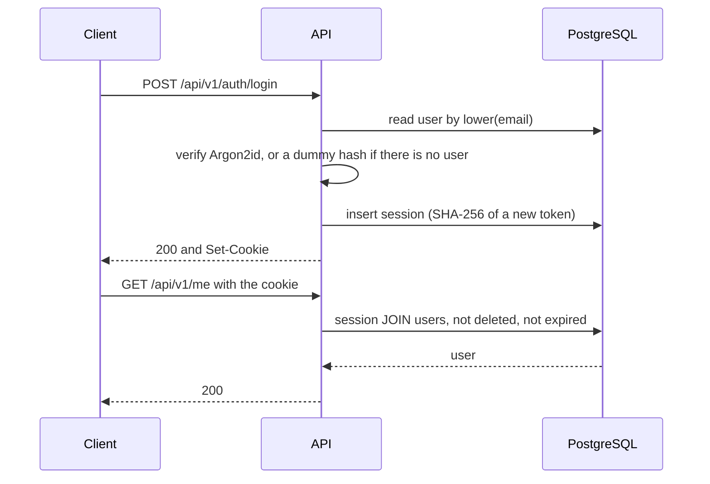

# API: Authentication and authorization

> **Covers:** Session tokens and cookies, CSRF, registration and login, deferred email flows, passwords and brute-force protection (8); 404 versus 403 and the authorization matrix (9).
> **Read when:** working on login, sessions, CSRF or who can see what.
> **Related:** [../classes/flows-identity-social.md](../classes/flows-identity-social.md), [errors-and-concurrency.md](errors-and-concurrency.md), [limits-security-observability.md](limits-security-observability.md)

## 8. Authentication

### 8.1 Opaque session tokens in a cookie (D43)

An **opaque token** is a random string with no meaning, checked against the database on each request.

**Why:** revocation is immediate, and that is a requirement (logout, account deletion, D29). R1 becomes one primary-key lookup, predicted at under 5 ms.

**Rejected:**

| Alternative | Why |
|---|---|
| JWT | Verified without a lookup, so it can't be revoked without adding a lookup back, which removes its advantage. Its real strength is many services verifying tokens independently, and we have one |
| Refresh tokens | Complexity for a problem that sessions don't have |
| Spring Session with Redis | A new component, and the project rule is to measure before adding one (D8) |
| Bearer token now, alongside the cookie | No client needs it, since a native app is only "if the product succeeds" (D2). It adds token delivery, CSRF exemptions and XSS exposure to design and test |

**A bearer token stays possible.** It would use the same table, and adding it is non-breaking.

**Why cookie rather than `localStorage`:** an `HttpOnly` cookie can't be read by JavaScript, so an XSS bug can't steal the token. It can still act as the user while the page is open, which is why CSP matters too (section 15).

### 8.2 Token and cookie details

- 256 random bits from a secure generator, encoded as base64url.
- The database stores **the SHA-256 of the token** (API-1), so a database leak doesn't give an attacker working sessions.
- **SHA-256 rather than Argon2:** slow hashes protect low-entropy secrets such as passwords. A 256-bit random value can't be brute-forced, and this hash runs on every request.

```
Set-Cookie: __Host-pace_session=<token>; HttpOnly; Secure; SameSite=Strict; Path=/; Max-Age=<seconds>
```

The `__Host-` prefix makes the browser enforce `Secure`, `Path=/` and no `Domain`, so a sibling subdomain can't overwrite the cookie. The name and `Secure` are configurable for local development.

**Why `SameSite=Strict` has no downside here:** the usual cost is appearing logged out after following an external link. But the page itself is static, and its API calls come from our own origin, so the cookie is sent. Share links still work.

### 8.3 Session lifetime

| Rule | Value | Why |
|---|---|---|
| Sliding expiry | 30 days | Runners use the app a few times a week |
| Absolute maximum | 90 days | A stolen token can't live forever |
| Renewal | At most hourly | Ordinary reads shouldn't write |
| New token | On login and on password change | Prevents session fixation, where an attacker plants a known token |
| Password change | Revokes all other sessions | The expected "kick out an intruder" behavior |
| Account deletion | Deletes all sessions in the same transaction | D29 requires immediate effect |

**Renewal also refreshes the cookie.** The cookie's `Max-Age` has to slide with the session, or the browser would drop it 30 days after login, however active the user is. So any authenticated response may carry `Set-Cookie`, at most hourly, and the contract states this. *(Added by the class design, CLS-8.)*



### 8.4 CSRF (D44)

**CSRF** (Cross-Site Request Forgery) is when another site makes your browser send an authenticated request.

**Layer 1:** `SameSite=Strict`.

**Layer 2:** a filter on unsafe methods (`POST`, `PUT`, `PATCH`, `DELETE`), including login:
1. If `Sec-Fetch-Site` is present, it must be `same-origin`. (`none`, meaning the user acted directly, doesn't apply to `fetch` calls from our page, so it is refused.)
2. Otherwise, `Origin` must match the configured origin.
3. **If neither header is present, reject.**

Rejection returns 403 `csrf_rejected`. Test tools and load generators just set `Origin`.

**Why step 3:** OWASP says missing headers "are not evidence of a same-origin request". This is stricter than Go 1.25's `CrossOriginProtection`, which lets such requests through as non-browser clients. We can be stricter, because our only clients are our own PWA and our own tests.

**Rejected:** double-submit tokens, and Spring Security's default synchronizer tokens. They add client code and a contract rule to every write, and an XSS bug defeats them anyway.

**Being honest about the trade-off:**
- OWASP's general guidance still lists tokens as the default for stateful apps. It also accepts Fetch Metadata as a primary defense for modern-browser-only software, as long as `Origin` is the fallback, and that is the case we're relying on.
- Browsers that send neither header are refused rather than exposed, so very old browsers can't use the app at all. A PWA already has that limitation in practice.
- `Sec-Fetch-Site` is only sent to secure origins, which is one more reason HTTPS is required. HSTS closes the HTTP downgrade gap.
- Spring Security's built-in CSRF is turned off, so **this filter needs its own tests.** A mistake here fails silently.

### 8.5 Registration and login

**Registration** creates the account, and logs the user in immediately.

**Login is enumeration-resistant.** **Enumeration** means learning which accounts exist by watching responses. An unknown email and a wrong password return the same 401, and the server does a dummy hash check for unknown emails so the timing matches too.

**Registration is not, and can't be without email.** Real enumeration resistance needs "we've sent you an email", in which case the response doesn't change. Without email, `email_taken` must be returned, or nobody could tell why registration failed. **Strict per-IP limits are the only mitigation until D50 ends.**

### 8.6 Email flows deferred, with a hard gate (D50)

Email verification and password reset aren't in this version of the API.

**Consequences, which must be accepted knowingly:**
- **A forgotten password means a lost account.** An admin couldn't safely reset it, since nothing proves who is asking.
- Anyone can register using someone else's address, locking the real owner out.
- A typo in an email can't be corrected.
- Registration stays enumerable (section 8.5).

**"Email costs money" is mostly not the blocker.** Free tiers exist, as section 22 shows, though the limits differ between sources and need checking when one is chosen. **The real dependency is a domain**, which most providers require for good deliverability, and that is open question 10.

**Decision:** acceptable for local development and a closed beta with friends. **It must ship before opening to the public.** No schema is added now, and `emailVerifiedAt` will be an additive field.

### 8.7 Passwords

| Rule | Value | Why |
|---|---|---|
| Length | 10 to 128 characters | Length matters more than symbols. The maximum stops very long inputs being used for DoS |
| Composition rules | None | They push people to predictable patterns such as `Password1!` |
| Common passwords | Rejected, from a bundled list | The attacks that actually work use these lists |
| Hash | Argon2id, `m=19456 KiB, t=2, p=1` | OWASP's stated minimum, confirmed on its page. It is memory-hard, which makes GPU cracking expensive |
| Parameter changes | Rehash on next login | The hash string records its own parameters |

**Rejected:** bcrypt. The NFR allows it, but it accepts at most 72 bytes in most implementations. Spring's built-in Argon2 defaults are slightly lower than OWASP's minimum, so the parameters should be set explicitly.

**A semaphore caps concurrent hashes** (4 to start). Each one uses 19 MiB, and a login burst shouldn't exhaust memory on a small server.

### 8.8 Brute-force protection

Limit by email and by IP (section 14). **There is no hard account lockout**, because it would let anyone lock out a victim just by failing logins on purpose.

---

## 9. Authorization

### 9.1 404 versus 403 (D46)

**Can't see it: 404. Can see it, can't do this: 403.**

The server answers the same way for "doesn't exist" and "exists, but it's hidden from you", so private resources can't be discovered by probing. Where one module owns all the data, the implementation should use one query for both, such as `WHERE id = $1 AND (visibility = 'public' OR ...)`, so that timing doesn't differ either. **The one accepted exception:** a private competition tied to a group needs a second statement into `social` (D35, D58), so a hidden one can take about one query longer than a missing one. IDs can't be enumerated, so this isn't worth another cross-module read.

| Case | Status | Why |
|---|---|---|
| Stranger opens a private competition | 404 | Must not learn that it exists |
| Logged-out visitor opens a private competition | 404 | Same. The client can suggest logging in |
| Group member calls `DELETE /groups/{groupId}` | 403 | Already knows the group exists |
| Non-member lists a public group's members | 403 | The group is public |
| Non-member lists a private group's members | 404 | The group is hidden |
| Viewing a user whose runs are private: the list | 403 `runs_not_visible` | The user's existence is already visible, and the UI can explain why |
| Viewing that user's single run by ID | 404 | Must not confirm a specific run exists |

**IDs aren't secrets.** UUIDv7s are hard to guess but not meant to be private, so every endpoint checks authorization.

**"See" for a private resource** means: member or participant, creator, invitee, or, for a group's private competition, a member of that group.

### 9.2 Matrix

Each column adds to what its role can do. Blank means no access.

| Resource and action | Anonymous | Logged in | Friend | Member / participant | Admin / creator | Owner |
|---|---|---|---|---|---|---|
| Own profile, stats, email, birth date | | | | | | Yes |
| `UserCard` | | Yes | + `city` | | | Yes |
| Runs, by `run_privacy` | | `public` only | + `friends` | | | All, incl. invalid |
| Upload a run | | Yes | | | | |
| Search users, groups, competitions | | Yes | | | | |
| Public group: details | | Yes | | | | |
| Public group: members | | 403 | | Yes | Yes | |
| Public group: join | | Yes | | | | |
| Private group: details | | 404 (invitee: yes) | | Yes | Yes | |
| Private group: members | | 404 (invitee: 403) | | Yes | Yes | |
| Private group: join | | 404 (invitee: yes) | | | | |
| A group's competitions | | Public ones, of a public group | | All | All | |
| Invite to a group, kick, change role, delete group | | | | 403 | Admin | |
| Create a competition | | Yes | | Group-tied: 403 | Group admin | |
| Public competition: details, top N | Yes | Yes | | Yes | Yes | |
| Public competition: full board, participants | | 403 | | Participant | Only if participating | |
| Public competition: join (with consent) | | Yes | | | | |
| Private competition: details, top N | 404 | 404 (invitee: yes) | | Yes | Yes | |
| Private competition: full board, participants | 404 | 404 (invitee: 403) | | Participant | Only if participating | |
| Private competition: join | | 404 (invitee: yes) | | Group member: yes | | |
| Invite to a competition | | | | 403 | Creator, group admin | |
| Delete a competition | | | | 403 | Creator, before it starts, if alone in it | |

**Rules behind the table:**
- **Anonymous top N follows D16's "anyone".** Since registration is free and unverified, requiring login would add little privacy, but it would break share links. Search still requires login.
- **Top N responses contain rank, display name and score only.** No `userId` or photo, which also settles database 12.1: a UUIDv7 reveals its creation time, so public responses don't expose it.
- **Full access means being a participant**, with no special case for creators or admins. One rule is easier to test and to explain.
- **`group` on a competition is `null` if the viewer can't see that group**, otherwise a public competition would reveal a private group's name.
- **Starting strict is deliberate.** Only admins create group competitions, and only creators and group admins invite. Loosening later is non-breaking, while tightening is breaking (section 3.7).
- **Invitations apply only to private groups and competitions**, as in database 3.5. Otherwise: 409 `invitation_not_applicable`.

---

