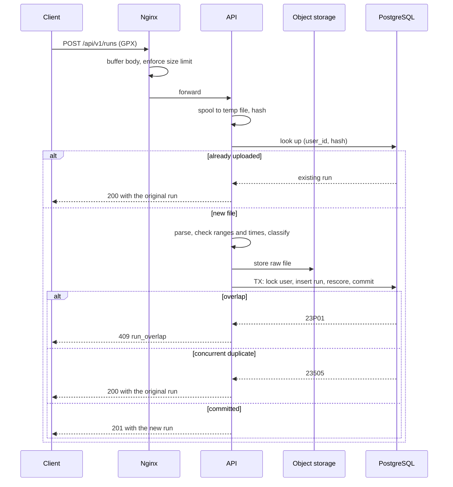

# API: Run upload

> **Covers:** The GPX upload: format, order of validation, size and timing, responses, plausibility thresholds, safe parsing and profile photos.
> **Read when:** working on run ingest, GPX parsing or photo upload.
> **Related:** [../database/transactions.md](../database/transactions.md), [../classes/flows-runs-competitions.md](../classes/flows-runs-competitions.md), [../../api/paths/runs.yaml](../../api/paths/runs.yaml)

## 7. Run upload

### 7.1 Format (D48)

`POST /runs` with a raw body, `Content-Type: application/gpx+xml`.

**Why raw:** there is no other metadata, so multipart would add a parsing layer for no benefit. Browsers also can't send this type cross-site without a preflight, which is a small extra CSRF barrier.

**A trap for the client:** browsers often leave `File.type` empty for `.gpx` files, so **the client must set the header explicitly**. Anything else gets 415.

Compressed request bodies (`Content-Encoding: gzip`) are refused with 415, because of decompression bombs: small files that expand enormously.

### 7.2 Order of validation

Cheap and retry-safe checks come first.

| # | Step | On failure |
|---|---|---|
| 1 | Session, CSRF, rate limit | 401, 403 `csrf_rejected`, 429 |
| 2 | Content type | 415 `unsupported_media_type` |
| 3 | `Content-Length` over the limit, if declared | 413 `payload_too_large` |
| 4 | Spool to a temp file, counting bytes and hashing with SHA-256 | 413 if the count passes the limit |
| 5 | **Look up `(user_id, hash)`** | Found: **200 with the existing run** |
| 6 | Secure streaming parse | 422 `gpx_malformed` |
| 7 | Distance under 1 m, or duration over 7 days | 422 `gpx_out_of_range` |
| 8 | Start or end in the future, with 2 minutes of tolerance | 422 `run_in_future` |
| 9 | Started over 30 days ago (configurable) | 422 `run_too_old` |
| 10 | Plausibility thresholds (section 7.5) | Continues, marked invalid |
| 11 | Store the file | 503 `storage_unavailable` with `Retry-After` |
| 12 | Transaction (database 6.3) | `23505`: 200 existing. `23P01`: 409 `run_overlap` |
| 13 | Commit | **201** with `Location`, whether the run is valid or invalid |

**Step 5 moved earlier than database 6.3 had it** (API-2). The original order had a defect: a client retrying an accepted upload after its `started_at` passed the 30-day limit got "too old" rather than its own run.

**The 2-minute tolerance is a small deviation from D36's wording.** Device clocks drift slightly, and without it, a just-finished run could be refused. It is configurable, and 0 restores the strict rule. D36 was amended to record this.

### 7.3 Size, buffering and timing

**Limit: 20 MB**, enforced by both Nginx and the API. The average file is 350 KB. A 24-hour ultra recorded once per second is about 17 MB, by my estimate of 200 bytes per trackpoint.

**Nginx buffers the body before forwarding it**, so a slow phone connection doesn't hold an application thread.

**The API spools to a temp file and never holds a file in the heap.** It then parses from disk and uploads from disk, and deletes the temp file in `finally`.

**Rejected:**
- **DOM parsing,** which builds a tree using many times the file size in memory.
- **A `byte[]` in memory,** which has a similar problem, multiplied by concurrent uploads.
- **Streaming straight into object storage while parsing,** which would store files we're about to reject.

**The 1-second target is measured from body received to response**, excluding mobile network time, which is outside our control. D22 says "completed", and this defines what that means.

### 7.4 Response

| Case | Status | Body |
|---|---|---|
| New run, valid | 201 + `Location` | `OwnRun`, `status: valid` |
| New run, implausible | 201 + `Location` | `OwnRun`, `status: invalid`, with `invalidReason` |
| This file was already uploaded | 200 | The original `OwnRun`, with its original status |

**How a client distinguishes "new" from "already existed" on a retry:** the status code. The body is the same shape, so the same code can render both.

**Rejected:**
- **409 on duplicates:** a retry after a lost response should look like success, not an error.
- **303 See Other:** `fetch` follows it automatically, hiding the distinction.

**The response deliberately doesn't list affected competitions.** It would be useful, but it would stop being available in the deferred async milestone (database 9), and removing it then would be a breaking change. The client refreshes leaderboards instead.

### 7.5 Plausibility thresholds (D49)

These are **starting values, all configurable.** They narrow open question 6, and don't close it. They are my estimates, not yet tested on real GPX files. Moving versus elapsed time stays open.

| `invalidReason` | Rule | Why |
|---|---|---|
| `pace_too_fast` | Average under 150 s/km | About the 5K world-record pace (roughly 151 s/km) |
| `pace_too_slow` | Average over 1,800 s/km | Slower than walking, likely a forgotten recorder |
| `gps_speed_jump` | A segment over 15 m/s, for at least 50 m | Above human sprint speed, with a floor for GPS noise |
| `duration_too_long` | Over 48 hours | Stricter than the 7-day schema backstop |

**A too-strict threshold is cheap to correct in one way only.** A wrongly invalid run can't be revalidated in Phase 1, because status never changes after insert (database 3.2). So thresholds should stay permissive until real data arrives, and these are set near the edge of the humanly possible rather than near typical values.

### 7.6 Safe parsing

**XXE** (XML External Entity) is an attack where an XML file tells the parser to read a server file or call a URL. This is an API-level requirement, not a parser detail.

- Use StAX, a streaming parser, with `SUPPORT_DTD=false` and `IS_SUPPORTING_EXTERNAL_ENTITIES=false`.
- Any `DOCTYPE` gets 422 `gpx_malformed`. A GPX file never needs one.
- Cap trackpoints at 200,000.
- Malformed: not XML, no trackpoints, missing timestamps, non-increasing times, or out-of-range coordinates.

**How metrics are computed:**
- Distance sums within track segments, not across gaps.
- Duration is the last timestamp minus the first, so elapsed time, as database 3.2 states.

Hostile fixtures are required tests: XXE, "billion laughs" (nested entities that expand enormously) and truncated files.

### 7.7 Profile photos

`PUT /me/photo`: raw JPEG or PNG, up to 2 MB, checked by magic bytes (the file's real signature, not its declared type) and pixel dimensions before decoding.

**Always re-encoded**, to a 512x512 JPEG. **Photos carry GPS coordinates in EXIF data**, which would contradict the privacy goals, and re-encoding removes that along with any hostile payload.

Each upload gets a new `photoId` in the URL, so the image can be cached as immutable. WebP isn't accepted, because Java's standard image library doesn't read it.

---

