# Class Design (Phase 1 backend)

> **Status:** Design approved by the project owner. **No code exists, so nothing in this document has been compiled or run.** The design is checked for consistency against the other documents (section 18), and that says nothing about whether it works. The race tests in [`database.md`](database.md) section 11.3 remain the real proof.
>
> **What's firm and what isn't:** module boundaries, callback interfaces, `TransactionRunner`, `RowLocks`, the policy approach and the persistence choice are decisions. Method names, parameter lists, how repository methods are grouped, DTO factory details and job batch sizes are **expected to change during implementation**, and changing them needs no new decision.

The decision IDs (D-numbers) refer to the log in section 10 of [`ARCHITECTURE.md`](../../ARCHITECTURE.md). "Database 6.3" means section 6.3 of [`database.md`](database.md), and "api 7.2" means section 7.2 of [`api.md`](api.md). CLS-1 to CLS-8 are the amendments in database 14.8.

## Contents

1. [Summary and disagreements](#1-summary-and-disagreements)
2. [Module map](#2-module-map)
3. [Class inventory](#3-class-inventory)
4. [Class diagrams](#4-class-diagrams)
5. [Domain model](#5-domain-model)
6. [Design patterns](#6-design-patterns)
7. [Persistence design](#7-persistence-design)
8. [Critical flows](#8-critical-flows)
9. [Cross-cutting design](#9-cross-cutting-design)
10. [Scheduled jobs](#10-scheduled-jobs)
11. [Time](#11-time)
12. [Extension points](#12-extension-points)
13. [Package and file layout](#13-package-and-file-layout)
14. [Traceability](#14-traceability)
15. [Library facts to verify](#15-library-facts-to-verify)
16. [Consistency with the API contract](#16-consistency-with-the-api-contract)
17. [Small decisions](#17-small-decisions)
18. [Verification](#18-verification)

**Terms used in this document**

| Term | Meaning |
|---|---|
| **Module** | A top-level feature package, such as `runs`. Inside one running application, but with enforced boundaries |
| **Layer** | A sub-package inside a module, such as `web` or `persistence` |
| **Port** | An interface at a boundary with something external, such as object storage |
| **SPI** (service provider interface) | An interface that a lower module defines and a higher module implements |
| **Dependency inversion** | Making a high-level and a low-level part both depend on an abstraction, instead of one on the other. The D in SOLID |
| **Execute-around** | A method that does setup and teardown around a function you pass in |
| **Value object** | An immutable type defined only by its values, such as `RunMetrics` |
| **Typed ID** | A small record that wraps a UUID, so the compiler can tell a `UserId` from a `RunId` |
| **DTO** (data transfer object) | A record whose only purpose is to carry data across the HTTP boundary |
| **Persistence context** | Hibernate's per-transaction cache of loaded objects |

---

## 1. Summary and disagreements

### 1.1 The design in one screen

| Topic | Decision | ID |
|---|---|---|
| Data access | `JdbcClient` with plain SQL. No ORM | D57 |
| Modules | A strict chain: `leaderboards -> competitions -> runs -> social -> identity -> platform` | D58 |
| Inside a module | `api`, `web`, `service`, `persistence`, `domain` | D58 |
| Upward calls | Callback interfaces owned by the lower module | D59 |
| Transactions | `TransactionRunner`, an execute-around helper in the service layer | D60 |
| Locks | Every row lock goes through `RowLocks`, which checks the order at run time | D61 |
| Domain | Rich where invariants exist, plain records elsewhere | D62 |
| Time | The database clock for stored times, `java.time.Clock` for input validation | D63 |
| Errors | One `ErrorCode` enum, one `ApiException`, one `ProblemFactory` | D64 |
| Response shapes | Separate records per shape, `JsonNullable` for three-state fields | D65 |

### 1.2 Where this design disagrees with earlier decisions or leanings

| # | Decision or leaning | Position | Why |
|---|---|---|---|
| A | Package-private by default, so the compiler enforces module boundaries | **Can't work with D40's sub-packages** | Java package-private doesn't cross sub-packages, so a `service` class used by `web` has to be `public`. ArchUnit enforces boundaries instead. Package-private still applies inside one layer |
| B | D40's layout: `web`, `service`, `persistence` | **Incomplete, so extended by D58** | Repositories must return domain types, but `persistence` can't depend on `service`. Other modules also need a visible public surface. So `domain/` and `api/` are added |
| C | Modules call each other only through public service interfaces | **Holds, but four calls must go up the chain** | Those would create cycles, so they use callback interfaces (section 2.3) |
| D | D35 lists two read exceptions | **Two more were needed** | Hiding deleted users from `participantCount` requires `competitions` to read `users`. `RowLocks` also touches other modules' tables, for locks only |
| E | Ports for clock, password hasher, and maybe the GPX parser | **Only one new port: `FileStore`** | `java.time.Clock` and Spring's `PasswordEncoder` already are interfaces. The parser is pure, so tests use the real one, including with hostile files |
| F | D11's "source adapter abstraction" | **The seam is the `ParsedRun` record** | Live recording won't parse a file at all. An interface with one implementation and no second caller is speculation, and extracting one later takes minutes |
| G | The rich domain covers eligibility | **No Java `isEligible` method** | Eligibility is a SQL `WHERE` clause over an aggregate. A Java copy would be unused, or could disagree with it |
| H | Value objects for distance, duration and pace | **Overkill, except `RunMetrics`** | Field names already carry units. Typed IDs do earn their place, since most methods take two UUIDs and swapping them compiles silently |
| I | Repository "interfaces" | **Concrete classes** | Each has one implementation, and tests run them against real PostgreSQL. An interface here protects against a swap we don't expect, which is D40's own argument against Hexagonal |
| J | `@Transactional` (implied by "transaction boundaries in the service layer") | **`TransactionRunner` for writes** | Retry has to wrap the transaction, and `SET LOCAL` has to run inside it. The boundary is still in the service layer |
| K | A lock helper that makes violations impossible | **A run-time guard plus a source-scan test** | A compile-time staged builder can't check sort order inside a loop, and it would have to pass a token across modules |
| L | D33: "competitions sorted, then participants" | **The wording didn't match the design** | Database 6.3 alternates c1, p1, c2, p2. D33 is restated, including groups (CLS-2) |
| M | api 9.1: one query for "missing" and "hidden" | **Softened** | A private competition tied to a group needs a second statement into `social` |
| N | api 12.1: `state` is computed in SQL | **Computed in Java, from a database-supplied `now()`** | SQL `CASE` plus Java would be two copies of the rule. State filters still need SQL, and a test keeps the two in agreement |
| O | Three scheduled jobs | **Four** | API-4 added daily session cleanup |

**Accepted without changes:** separate DTOs, constructor injection only, immutability by default, one policy per module, one error-mapping point, one lock helper, and Strategy for scoring.

---

## 2. Module map

### 2.1 Responsibilities

| Module | Responsibility | Owns tables |
|---|---|---|
| `platform` | Cross-cutting infrastructure: errors, transactions, locks, security filters, rate limiting, file storage, jobs | None |
| `identity` | Accounts, sessions, profile, privacy settings, account deletion | `users`, `sessions` |
| `social` | Friendships, groups, memberships, group invitations | `friendships`, `groups`, `group_members`, `group_invitations` |
| `runs` | Upload, parsing, validation, history, personal stats | `runs` |
| `competitions` | Lifecycle, participation, scoring, closure, competition invitations | `competitions`, `competition_participants`, `competition_invitations` |
| `leaderboards` | Ranked reads | None (reads only, D35) |

### 2.2 Allowed dependencies

Every module may also use `platform`. The list below is what `check_classes.mjs` reads to prove the graph has no cycles.

| Module | May depend on |
|---|---|
| `platform` | none |
| `identity` | none |
| `social` | `identity` |
| `runs` | `identity`, `social` |
| `competitions` | `identity`, `social`, `runs` |
| `leaderboards` | `competitions` |

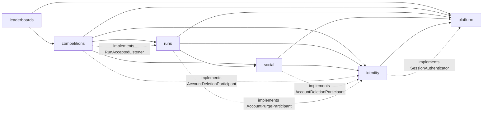

Solid lines are ordinary calls, and dashed lines mark a module implementing a callback that the lower module owns. **Every arrow, solid or dashed, points down the chain**, because implementing an interface is a compile-time dependency on it. At run time, the lower module calls up.

**Why a chain:** a total order makes a cycle impossible, instead of something we have to keep checking for. ArchUnit still checks it, because a rule that isn't enforced erodes.

**Consequences for where endpoints live:**

| Endpoint | Module | Why |
|---|---|---|
| `GET /users/{userId}` | `social` | `city` depends on friendship, and `identity` can't depend on `social` |
| `GET /users/{userId}/runs` | `runs` | Reads runs, and needs both privacy and friendship |
| `GET /groups/{groupId}/competitions` | `competitions` | Reads competitions, and asks `social` about the group |
| `GET /me/invitations` | `competitions` | The higher of the two modules whose data it merges |

### 2.3 Calls that go up the chain (D59)

| The lower module needs | Interface | Owned by | Implemented by | Runs in |
|---|---|---|---|---|
| The filter validates a session | `SessionAuthenticator` | `platform` | `SessionService` in `identity` | Autocommit |
| Deletion cleans other modules' rows | `AccountDeletionParticipant` | `identity` | `SocialAccountDeletion`, `CompetitionsAccountDeletion` | The caller's transaction |
| The purge deletes other modules' files | `AccountPurgeParticipant` | `identity` | `RunsAccountPurge` | The caller's transaction |
| Ingest triggers scoring | `RunAcceptedListener` | `runs` | `ScoringService` in `competitions` | The caller's transaction |

**Why not Spring application events:** they work synchronously, but which listener runs, in what order, and what a failure means all become invisible at the call site. Lock order depends on that order. An injected `List<AccountDeletionParticipant>` with `@Order` says it plainly. `SocialAccountDeletion` must run first, because it takes group locks.

**Rejected:** a shared `common` module holding this logic (it would collect everything), and merging modules to remove the edges (it would give up D5's extraction path).

### 2.4 Public interfaces

These are the only types another module may touch, apart from `platform`. `Optional` means absent or not visible to this viewer. **Method lists are expected to grow a little during implementation.**

```java
// platform: shared kernel. IDs live here so RowLocks and security can use them.
record UserId(UUID value)  record GroupId(UUID value)  record CompetitionId(UUID value)  record RunId(UUID value)
sealed interface Viewer permits Viewer.Anonymous, Viewer.Authenticated   // Authenticated(UserId id)
interface SessionAuthenticator { Optional<AuthenticatedSession> authenticate(byte[] tokenHash); }

// identity.api
interface UserDirectory {
    Optional<UserCard> findCard(UserId id);                       // active users only
    Map<UserId, UserCard> findCards(Collection<UserId> ids);      // active users only, missing ones left out
    Optional<UserFacts> findFacts(UserId id);                     // runPrivacy, timeZone, city
}
interface AccountDeletionParticipant { void onAccountDeleted(UserId id); }   // inside the caller's transaction
interface AccountPurgeParticipant    { void purgeFiles(UserId id); }         // inside the purge transaction

// social.api
interface FriendshipLookup      { boolean areFriends(UserId a, UserId b); }
interface GroupLookup           { Optional<GroupFacts> findForViewer(GroupId id, Viewer viewer); }
interface GroupInvitationLookup { List<GroupInvitationView> newestFor(UserId invitee, int limit); }

// runs.api
interface RunAcceptedListener { void onRunAccepted(AcceptedRun run); }       // inside the ingest transaction

// competitions.api
interface CompetitionLookup {
    Optional<CompetitionFacts> findForViewer(CompetitionId id, Viewer viewer);
}
// leaderboards has no public interface. Nothing depends on it.
```

### 2.5 Documented read-only exceptions (D35)

Each one lives in exactly one class, so the cost of a future service split stays visible.

| Reader class | Reads | Why |
|---|---|---|
| `LeaderboardReader` | `competition_participants`, `competitions`, `users` | Ranking needs joins and a read-time filter |
| `EligibleRunsReader` | `runs` | Score recalculation aggregates a user's runs |
| `ParticipantUsersReader` | `users` | The participant count and list must hide deleted users, because their rows survive until the purge |
| `RowLocks` | Lock statements on `users`, `groups`, `competitions`, `competition_participants` | One place enforces the lock order. It returns only what's listed in section 7.4 |

Foreign-key cascades also cross modules, for example `SET NULL` on `competitions.group_id`. They're declared schema behavior rather than application writes, so they aren't exceptions.

### 2.6 Inside a module (D58)

```text
com.pace.<module>/
    api/          public contract for other modules: interfaces, facts records, enums
    web/          controllers and request/response records. No business logic
    service/      business rules, transaction boundaries, policies, strategies, jobs
    persistence/  repositories and SQL
    domain/       plain types with no Spring or JDBC imports
```

Dependencies point downward only: `web -> service -> persistence -> domain`. Each layer may also use its own module's `api`.

**Visibility.** A class is `public` only if another package needs it. Controllers, policies, strategies and jobs can be package-private. Services and repositories can't, because they're called from another layer, and that's the honest limit of what the compiler gives us here.

**ArchUnit rules**, which arrive with the first code:

1. Another module may touch only `..<module>.api..`, plus the callback interfaces it implements.
2. The layer direction above.
3. `web` never imports `persistence`.
4. `domain` has no Spring or JDBC imports.
5. No cycles between modules.
6. `platform` depends on no other module.

**Rejected:**

| Alternative | Why |
|---|---|
| Flat module packages, with everything package-private | Real compiler enforcement, but it contradicts D40, and layers would then rest on naming conventions |
| JPMS (Java modules) | Too heavy at this scale, and it fights with Spring's reflection |
| Spring Modulith | A plausible later addition, but D40 chose ArchUnit, and six rules already do this |

`platform` isn't a business feature, so it's organized by concern: `error`, `tx`, `security`, `web`, `ratelimit`, `storage`, `jobs`, `id`.

---

## 3. Class inventory

**How to read these tables.** "pub" means `public`, and "pp" means package-private. The Tx column names a transaction boundary, with locks in order. Section 8 has each flow in full. "Errors" lists `ErrorCode` values a method can raise, and every method can also fail with `temporarily_unavailable` or `internal_error`. Trivial getters aren't listed, and neither are method bodies, because there aren't any yet.

### 3.1 `platform`

| Class | Kind, visibility | Responsibility | Key fields | Key methods and errors | Tx, locks | Collaborators |
|---|---|---|---|---|---|---|
| `ErrorCode` | enum, pub | Lists the 34 catalog codes with their status and title | `String code`, `int status`, `String title` | `String typeUri()` | | |
| `ApiException` | class, pub | Represents any expected failure, as a code with optional detail and extensions | `ErrorCode code`, `String detail`, `Map<String,Object> extensions`, `Duration retryAfter` | `static notFound()`, `static forbidden()`, `static validation(List<FieldError>)` | | `ErrorCode` |
| `FieldError` | record, pub | Holds one entry of a Problem's `errors` array | `String field`, `String code`, `String message` | | | |
| `ProblemFactory` | class, pub | Builds every Problem Details body in one place | `Clock clock` | `ProblemDetail build(ErrorCode, String detail, Map ext, String instance)`, `void write(HttpServletResponse, ApiException)` | | MDC |
| `ProblemExceptionHandler` | `@RestControllerAdvice`, pp | Maps every exception that reaches Spring MVC to a Problem | `ProblemFactory factory`, `DbErrors dbErrors` | `@ExceptionHandler` methods for `ApiException`, validation, unreadable body, type mismatch, method not allowed, unsupported media type, `DataAccessException`, `Exception` | | `ProblemFactory`, `DbErrors` |
| `DbErrors` | class, pub | Reads the SQLSTATE and constraint name from a database exception | | `Optional<DbFailure> classify(DataAccessException)`, `boolean isConstraint(DataAccessException, String name)`, `boolean isRetryable(DataAccessException)` | | pgjdbc `PSQLException` |
| `DbFailure` | record, pub | Holds what a failure was | `String sqlState`, `String constraint` | | | |
| `TransactionRunner` | class, pub | Runs a write in a transaction, with a timeout and bounded deadlock retry | `TransactionTemplate template`, `JdbcClient jdbc`, `TxProperties props` | `<T> T write(Supplier<T> body)`, `<T> T write(Duration timeout, Supplier<T> body)`. Errors: `temporarily_unavailable` after retries | Starts or joins | `DbErrors` |
| `RowLocks` | class, pub | Holds every row-lock statement, and enforces the global lock order | `JdbcClient jdbc` | `boolean lockActiveUser(UserId, LockMode)`, `boolean lockGroup(GroupId, LockMode)`, `Optional<LockedCompetition> lockCompetition(CompetitionId, LockMode)`, `boolean lockParticipant(CompetitionId, UserId)` | Requires a running transaction. Takes the lock asked for | `Ids` |
| `LockMode` | enum, pub | Names the three lock strengths used by the design | `SHARE`, `NO_KEY_UPDATE`, `UPDATE` | `String sql()` | | |
| `LockedCompetition` | record, pub | Reports what a competition lock found | `Instant closedAt` (nullable) | | | |
| `TxProperties` | record, pub | Holds the transaction timeout and retry settings | `Duration defaultTimeout`, `int maxRetries`, `Duration minJitter`, `Duration maxJitter` | | | |
| `SecurityConfig` | config, pp | Defines the filter chain, deny-by-default rules and security headers | | `SecurityFilterChain chain(HttpSecurity)` | | Filters below |
| `CsrfOriginFilter` | filter, pp | Rejects unsafe requests that aren't same-origin (D44) | `String allowedOrigin` | `doFilterInternal(...)`. Errors: `csrf_rejected` | | `ProblemFactory` |
| `SessionAuthenticationFilter` | filter, pp | Turns a session cookie into a `Viewer`, and refreshes the cookie when renewed | `SessionAuthenticator authenticator`, `SessionCookies cookies` | `doFilterInternal(...)`. An invalid cookie leaves the viewer anonymous | Autocommit | `SessionAuthenticator`, `SessionCookies`, `TokenHash` |
| `SessionAuthenticator` | interface, pub | Validates a session for the filter (SPI, section 2.3) | | `Optional<AuthenticatedSession> authenticate(byte[] tokenHash)` | | |
| `AuthenticatedSession` | record, pub | Holds who was authenticated, and how long a refreshed cookie should last | `UserId userId`, `Optional<Duration> refreshCookieFor` | | | |
| `TokenHash` | class, pub | Computes the SHA-256 of a raw session token | | `static byte[] of(String rawToken)` | | |
| `SessionCookies` | class, pub | Writes and clears the session cookie | `String name`, `boolean secure` | `void write(HttpServletResponse, String rawToken, Duration maxAge)`, `void clear(HttpServletResponse)`, `Optional<String> read(HttpServletRequest)` | | |
| `ProblemSecurityHandlers` | class, pp | Writes Problems for 401 and 403 raised by Spring Security | `ProblemFactory factory` | `commence(...)`, `handle(...)`. Errors: `unauthenticated` | | `ProblemFactory` |
| `Viewer` | sealed interface, pub | Says who is asking | `Anonymous`, `Authenticated(UserId id)` | `Optional<UserId> userId()` | | |
| `ViewerArgumentResolver` | class, pp | Injects `Viewer` or `Viewer.Authenticated` into controller methods | | `resolveArgument(...)` | | |
| `AccessDecision` | enum, pub | Holds a policy's answer | `ALLOWED`, `HIDDEN`, `FORBIDDEN` | `void enforce()`, `void enforce(ErrorCode forbiddenCode)`. Errors: `not_found`, `forbidden` | | |
| `RequestIdFilter` | filter, pp | Accepts or generates `X-Request-Id`, and sets MDC and the response header | | `doFilterInternal(...)` | | MDC |
| `RequestLogFilter` | filter, pp | Writes one structured log line per request, using the route template | | `doFilterInternal(...)` | | MDC |
| `BodyLimitFilter` | filter, pp | Wraps the request body with a per-route byte limit, and refuses compressed bodies | `Map` of route to limit | `doFilterInternal(...)`. Errors: `payload_too_large`, `unsupported_media_type` | | |
| `Page` | record, pub | Holds one page of results | `List<T> items`, `String nextCursor` | `static <T,C> Page<T> of(List<T> rows, int limit, Function<T,C> cursorOf, CursorCodec)` | | `CursorCodec` |
| `PageRequest` | record, pub | Holds a validated limit and a decoded cursor | `int limit`, `C cursor` | `int fetchSize()` (limit plus one) | | |
| `CursorCodec` | class, pub | Encodes and decodes opaque versioned cursors | `ObjectMapper mapper` | `String encode(C cursor)`, `<C> C decode(String, Class<C>)`. Errors: `invalid_cursor` | | |
| `ClientIpResolver` | class, pub | Finds the client IP, trusting only the configured proxy header | `String trustedHeader` | `String resolve(HttpServletRequest)` | | |
| `JacksonConfig` | config, pp | Sets strict unknown-field rejection and the merge-patch media type | | `@Bean` customizer | | |
| `RateLimiter` | class, pub | Applies a limit through Bucket4j, and fails open | `Map` of class to bandwidths, `Cache` of buckets | `void check(RateLimitClass, String key)`. Errors: `rate_limited` | | Bucket4j |
| `RateLimitClass` | enum, pub | Names the nine classes in api 14.1 | `LOGIN`, `REGISTER`, `UPLOAD`, `FRIEND_INVITE`, `PHOTO_PASSWORD`, `SEARCH`, `OTHER_WRITE`, `OTHER_READ`, `ANONYMOUS_READ` | | | |
| `RateLimit` | annotation, pub | Overrides a controller method's default rate-limit class | `RateLimitClass value` | | | |
| `RateLimitInterceptor` | interceptor, pp | Applies the right limit before the controller method runs | `RateLimiter limiter`, `ClientIpResolver ips` | `preHandle(...)`. Errors: `rate_limited` | | `RateLimiter` |
| `FileStore` | interface, pub | **The one new port:** stores and removes objects | | `void put(String key, Path file, String contentType)`, `InputStream open(String key)`, `void delete(String key)`, `void deletePrefix(String prefix)`, `Stream<StoredObject> listOlderThan(String prefix, Instant cutoff)`. Errors: `storage_unavailable` | | |
| `StoredObject` | record, pub | Describes one stored object | `String key`, `Instant lastModified` | | | |
| `S3FileStore` | class, pp | Implements `FileStore` over the S3 protocol | S3 client, `String bucket` | As `FileStore` | | S3 SDK |
| `JobRunner` | class, pub | Runs a job with logging context, a timer and error capture | `MeterRegistry registry` | `void run(String jobName, Runnable body)` | | MDC |
| `UserId`, `GroupId`, `CompetitionId`, `RunId` | records, pub | Give each kind of ID its own type | `UUID value` | | | |
| `Ids` | class, pub | Compares UUIDs in PostgreSQL's order | | `static int compare(UUID, UUID)` | | |
| `PlatformProperties` | record, pub | Holds origin, body limits, trusted proxy and rate limits | See section 9.9 | | | |

**Test double:** `InMemoryFileStore` lives in test sources. Integration tests use real MinIO through Testcontainers, and service tests use the in-memory version.

### 3.2 `identity`

| Class | Kind, visibility | Responsibility | Key fields | Key methods and errors | Tx, locks | Collaborators |
|---|---|---|---|---|---|---|
| `UserDirectory` | interface, pub (`api`) | Lets other modules read public user data | | Section 2.4 | | |
| `AccountDeletionParticipant` | interface, pub (`api`) | Lets other modules clean up their rows in the deletion transaction | | `void onAccountDeleted(UserId)` | Caller's | |
| `AccountPurgeParticipant` | interface, pub (`api`) | Lets other modules remove their files during the purge | | `void purgeFiles(UserId)` | Caller's | |
| `UserCard` | record, pub (`api`) | Holds what other users may see of someone | `UserId id`, `String displayName`, `String photoUrl` | `static String photoUrl(UserId, String photoKey)` | | |
| `UserFacts` | record, pub (`api`) | Holds the settings other modules need | `UserId id`, `RunPrivacy runPrivacy`, `ZoneId timeZone`, `String city` | | | |
| `RunPrivacy` | enum, pub (`api`) | Mirrors `ck_users_run_privacy` | `PRIVATE`, `FRIENDS`, `PUBLIC` | | | |
| `AuthController` | controller, pp | Handles registration, login and logout | Services | `register(RegisterRequest, response)`, `login(LoginRequest, request, response)`, `logout(Viewer.Authenticated, request, response)` | | `AccountService`, `AuthService`, `SessionCookies` |
| `MeController` | controller, pp | Handles the current user's account, password, photo and deletion | Services | `get`, `update(UpdateMeRequest)`, `changePassword(ChangePasswordRequest)`, `delete(DeleteAccountRequest)`, `putPhoto(request)`, `deletePhoto()` | | `AccountService`, `PhotoService`, `AccountDeletionService` |
| `UserController` | controller, pp | Handles user search and serving photos | Services | `search(q, limit)`, `photo(userId, photoId)` | | `UserDirectoryService`, `PhotoService` |
| `AccountService` | class, pub | Registers accounts, and edits profile and password | Repositories, `PasswordService` | `RegisteredAccount register(Registration)`. Errors: `email_taken`, `weak_password`, `validation_failed`. `User get(UserId)`, `User update(UserId, ProfilePatch)`. `String changePassword(UserId, byte[] currentSession, String current, String next)`. Errors: `password_incorrect`, `weak_password` | `register`, `changePassword`: no locks, relies on `uq_users_email_lower` and last write wins | `UserRepository`, `SessionService`, `PasswordService` |
| `AuthService` | class, pub | Logs in and out without revealing which accounts exist | Repositories | `LoginResult login(String email, String password, String ip)`. Errors: `invalid_credentials`, `rate_limited`. `void logout(byte[] tokenHash)` | One insert | `UserRepository`, `SessionService`, `PasswordService`, `RateLimiter` |
| `SessionService` | class, pub | Implements `SessionAuthenticator`, and issues and revokes sessions | `SessionRepository`, `IdentityProperties` | `authenticate(byte[])`, `SessionToken issue(UserId)`, `void revokeAll(UserId)`, `void revokeOthers(UserId, byte[] keep)` | Joins the caller's | `SessionRepository` |
| `PasswordService` | class, pub | Hashes under a semaphore, rejects weak passwords, and verifies with a dummy hash when there's no user | `PasswordEncoder encoder`, `Semaphore permits`, `Set<String> commonPasswords` | `String hash(String)`, `boolean verify(String raw, String hash)`, `boolean verifyDummy(String raw)`, `boolean needsRehash(String)`, `void requireStrong(String field, String raw)`. Errors: `weak_password` | Never inside a transaction | Spring `Argon2PasswordEncoder` |
| `PhotoService` | class, pub | Validates and re-encodes photos, stores them, and removes the old file | `FileStore`, `UserRepository` | `String put(UserId, InputStream, String contentType)`. Errors: `image_invalid`, `storage_unavailable`. `void delete(UserId)`, `InputStream open(UserId, UUID photoId)`. Errors: `not_found` | One update, after the store call | `FileStore`, `UserRepository` |
| `UserDirectoryService` | class, pub | Implements `UserDirectory`, and searches by display name | `UserRepository` | `List<UserCard> search(String q, int limit)` | | `UserRepository` |
| `AccountDeletionService` | class, pub | Runs phase 1 of account deletion in one transaction | Repositories, `List<AccountDeletionParticipant>` | `void deletePhase1(UserId, String password)`. Errors: `password_incorrect` | `NO_KEY_UPDATE` user, then participants | `RowLocks`, `TransactionRunner`, `PasswordService` |
| `AccountPurgeJob` | class, pp | Runs phase 2: purges deleted users' files and rows | `UserRepository`, `FileStore`, `List<AccountPurgeParticipant>` | `void runOnce()` | `SKIP LOCKED` claim, one transaction per user, longer timeout | `TransactionRunner`, `JobRunner` |
| `SessionCleanupJob` | class, pp | Deletes expired sessions daily | `SessionRepository` | `void runOnce()` | No explicit lock | `JobRunner` |
| `User` | record, pub (`domain`) | Holds a stored user | `UserId id`, `String email`, `String passwordHash`, `String displayName`, `LocalDate birthDate`, `String city`, `String photoKey`, `RunPrivacy runPrivacy`, `ZoneId timeZone`, `Instant createdAt` | | | |
| `ProfilePatch` | record, pub (`domain`) | Holds which profile fields to change | `Optional` per field, with an inner `Optional` for nullable ones | `static of(UpdateMeRequest fields)`. Errors: `validation_failed` | | |
| `SessionToken` | record, pub (`domain`) | Pairs a raw token with its SHA-256 hash | `String raw`, `byte[] hash` | `static SessionToken generate(SecureRandom)` | | `TokenHash` |
| `UserRepository` | class, pub | Holds the SQL for `users` | `JdbcClient jdbc` | Section 7.2 | | |
| `SessionRepository` | class, pub | Holds the SQL for `sessions` | `JdbcClient jdbc` | Section 7.2 | | |
| `IdentityProperties` | record, pub | Holds session lifetimes, Argon2 parameters and photo limits | See section 9.9 | | | |

### 3.3 `social`

| Class | Kind, visibility | Responsibility | Key fields | Key methods and errors | Tx, locks | Collaborators |
|---|---|---|---|---|---|---|
| `FriendshipLookup` | interface, pub (`api`) | Answers whether two users are friends | | Section 2.4 | | |
| `GroupLookup` | interface, pub (`api`) | Gives other modules a group as this viewer may see it | | Section 2.4 | | |
| `GroupInvitationLookup` | interface, pub (`api`) | Gives `competitions` a user's group invitations, for the merged list | | Section 2.4 | | |
| `GroupFacts` | record, pub (`api`) | Holds a group as one viewer sees it | `GroupId id`, `String name`, `GroupVisibility visibility`, `GroupRole viewerRole` (nullable), `boolean viewerInvited` | | | |
| `GroupInvitationView` | record, pub (`api`) | Holds one group invitation for display | `GroupId groupId`, `String groupName`, `UserId invitedBy`, `Instant createdAt` | | | |
| `GroupRole` | enum, pub (`api`) | Mirrors `ck_group_members_role` | `ADMIN`, `MEMBER` | | | |
| `GroupVisibility` | enum, pub (`api`) | Mirrors `ck_groups_visibility` | `PUBLIC`, `PRIVATE` | | | |
| `FriendController` | controller, pp | Handles friends and friend requests | `FriendshipService` | `list(status, limit, cursor)`, `put(userId)`, `delete(userId)` | | `FriendshipService` |
| `GroupController` | controller, pp | Handles creating, reading, searching and deleting groups | `GroupService` | `create`, `search`, `listMine`, `get`, `delete` | | `GroupService` |
| `GroupMemberController` | controller, pp | Handles joining, leaving, roles, kicks, invitations and declines | `GroupMembershipService` | `list`, `join`, `leave`, `changeRole`, `remove`, `invite`, `decline` | | `GroupMembershipService` |
| `UserCardController` | controller, pp | Handles `GET /users/{userId}`, including `city` for friends | `FriendshipService` | `get(viewer, userId)` | | `FriendshipService` |
| `FriendshipService` | class, pub | Implements `FriendshipLookup`, and applies request, accept and remove | `FriendshipRepository`, `UserDirectory`, `TransactionRunner`, `RowLocks` | `FriendshipResult request(UserId me, UserId other)`. Errors: `not_found`, `friend_self`. `void remove(UserId me, UserId other)`. `Page<Friendship> list(...)`. `UserCardWithCity cardFor(UserId viewer, UserId target)`. Errors: `not_found` | `request`: `SHARE` user (CLS-6), then a locked read of the row | `FriendshipRepository`, `UserDirectory`, `RowLocks` |
| `GroupService` | class, pub | Implements `GroupLookup`, and creates, reads, searches and deletes groups | Repositories, `GroupPolicy` | `GroupDetails create(UserId, NewGroup)`, `GroupDetails get(GroupId, UserId)`. Errors: `not_found`. `void delete(GroupId, UserId)`. Errors: `forbidden`, `not_found`. `Page<Group> search(...)`, `Page<MyGroupRow> listMine(...)` | `create`: `SHARE` user. `delete`: `UPDATE` group | `GroupRepository`, `GroupMemberRepository`, `RowLocks` |
| `GroupMembershipService` | class, pub | Implements `GroupInvitationLookup`, and runs all membership transactions | Repositories, `GroupPolicy` | `JoinResult join(GroupId, UserId)`. Errors: `not_found`. `void leave(GroupId, UserId)`, `Membership changeRole(GroupId, UserId actor, UserId target, GroupRole)`, `void remove(GroupId, UserId actor, UserId target)`. Errors: `forbidden`, `not_found`, `last_admin`. `void invite(GroupId, UserId actor, UserId invitee)`. Errors: `forbidden`, `not_found`, `invitation_not_applicable`. `void decline(GroupId, UserId)`, `Page<MemberRow> list(...)`. Errors: `forbidden`, `not_found` | `join`: `SHARE` user. `leave`, `changeRole`, `remove`: `UPDATE` group | `GroupMemberRepository`, `GroupInvitationRepository`, `RowLocks`, `UserDirectory` |
| `GroupPolicy` | class, pp | Applies the group rows of the matrix in api 9.2, as pure functions | | `AccessDecision see(GroupFacts)`, `seeMembers`, `join`, `manage`, `invite`. `GroupCapabilities capabilities(GroupFacts)` | | |
| `SocialAccountDeletion` | class, pp | Removes a deleted user's friendships, memberships and invitations, and hands over admin | Repositories, `@Order(1)` | `void onAccountDeleted(UserId)` | Caller's. `UPDATE` groups ascending | `RowLocks`, `GroupMemberRepository`, `FriendshipRepository`, `GroupInvitationRepository` |
| `FriendPair` | record, pub (`domain`) | Holds two users in the database's order | `UserId a`, `UserId b` | `static FriendPair of(UserId, UserId)` | | `Ids` |
| `Friendship` | record, pub (`domain`) | Holds a stored friendship, and describes it from one side | `FriendPair pair`, `UserId requestedBy`, `boolean accepted`, `Instant createdAt`, `Instant acceptedAt` | `Direction directionFor(UserId)`, `UserId other(UserId)` | | |
| `Group` | record, pub (`domain`) | Holds a stored group | `GroupId id`, `String name`, `GroupVisibility visibility`, `String city`, `Instant createdAt` | | | |
| `Membership` | record, pub (`domain`) | Holds a stored membership | `GroupId groupId`, `UserId userId`, `GroupRole role`, `Instant joinedAt` | | | |
| `FriendshipRepository`, `GroupRepository`, `GroupMemberRepository`, `GroupInvitationRepository` | classes, pub | Hold the SQL for the social tables | `JdbcClient jdbc` | Section 7.2 | | |

### 3.4 `runs`

| Class | Kind, visibility | Responsibility | Key fields | Key methods and errors | Tx, locks | Collaborators |
|---|---|---|---|---|---|---|
| `RunAcceptedListener` | interface, pub (`api`) | Tells interested modules a valid run was stored: **the Outbox seam** | | `void onRunAccepted(AcceptedRun)` | Caller's | |
| `AcceptedRun` | record, pub (`api`) | Holds what scoring needs from a run | `RunId id`, `UserId userId`, `Instant startedAt`, `Instant receivedAt` | | | |
| `RunController` | controller, pp | Handles upload, history and single-run reads | Services | `upload(viewer, request)`, `listMine`, `get(viewer, runId)`, `listForUser(viewer, userId, limit, cursor)` | | `RunIngestService`, `RunQueryService` |
| `StatsController` | controller, pp | Handles personal stats | `StatsService` | `get(viewer, weeks, months, weekStart)` | | `StatsService` |
| `RunIngestService` | class, pub | Runs the upload pipeline in api 7.2 | `RunRepository`, `FileStore`, `GpxParser`, `TransactionRunner`, `RowLocks`, `RunAcceptedListener`, `Clock`, `RunsProperties` | `IngestResult ingest(UserId, InputStream, long declaredLength)`. Errors: `gpx_malformed`, `gpx_out_of_range`, `run_in_future`, `run_too_old`, `run_overlap`, `storage_unavailable`, `payload_too_large` | `SHARE` user, insert, then the listener's locks | `UploadSpool`, `RunSanityRules`, `PlausibilityRules` |
| `RunQueryService` | class, pub | Reads runs and applies visibility | `RunRepository`, `UserDirectory`, `FriendshipLookup`, `RunVisibilityPolicy` | `Page<Run> listMine(...)`, `RunView get(RunId, UserId viewer)`. Errors: `not_found`. `Page<Run> listForUser(UserId viewer, UserId target, ...)`. Errors: `not_found`, `runs_not_visible` | Autocommit | Listed |
| `StatsService` | class, pub | Builds weekly, monthly and personal-best stats, including empty periods | `RunStatsRepository`, `UserDirectory`, `RunsProperties` | `Stats get(UserId, int weeks, int months, DayOfWeek weekStart)` | Autocommit | Listed |
| `RunVisibilityPolicy` | class, pp | Decides who sees a run or a run list (D54) | | `AccessDecision seeList(RunPrivacy, boolean self, boolean friends)`, `AccessDecision seeRun(Run, RunPrivacy, boolean self, boolean friends)` | | |
| `GpxParser` | class, pp | Streams a GPX file into a `ParsedRun` safely, with StAX | `RunsProperties props` | `ParsedRun parse(Path)`. Errors: `gpx_malformed` | | |
| `UploadSpool` | class, `AutoCloseable`, pp | Spools a body to a temp file while counting and hashing, and deletes it on close | `Path file`, `byte[] sha256`, `long bytes` | `static UploadSpool from(InputStream, long maxBytes)`. Errors: `payload_too_large`. `void close()` | | |
| `OrphanFileCleanupJob` | class, pp | Deletes run files with no matching run | `FileStore`, `RunRepository`, `Clock` | `void runOnce()` | No lock (database 8.3) | `JobRunner`, `RunFileKey` |
| `RunsAccountPurge` | class, pp | Deletes a purged user's run files | `FileStore` | `void purgeFiles(UserId)` | Caller's | `FileStore` |
| `ParsedRun` | record, pub (`domain`) | Holds source-neutral output of parsing: **the D11 seam** | `Instant startedAt`, `Instant endedAt`, `RunMetrics metrics`, `boolean hasSpeedJump` | | | |
| `RunMetrics` | record, pub (`domain`) | Holds distance and duration, and computes pace by the database's rounding | `int distanceMeters`, `int durationSeconds` | `int paceSecondsPerKm()` | | |
| `RunSanityRules` | class, pub (`domain`) | Rejects out-of-range, future and too-old runs (D36) | Limits | `void check(ParsedRun, Instant now)`. Errors: `gpx_out_of_range`, `run_in_future`, `run_too_old` | | |
| `PlausibilityRules` | class, pub (`domain`) | Classifies a run as valid or invalid (D49) | Thresholds | `RunVerdict classify(ParsedRun)` | | |
| `RunVerdict` | sealed interface, pub (`domain`) | Holds the classification | `Valid`, `Invalid(InvalidReason reason)` | | | |
| `Run` | record, pub (`domain`) | Holds a stored run | `RunId id`, `UserId userId`, `RunSource source`, `Instant startedAt`, `Instant endedAt`, `int distanceMeters`, `int durationSeconds`, `int paceSecondsPerKm`, `RunStatus status`, `String invalidReason`, `Instant receivedAt` | | | |
| `NewRun` | record, pub (`domain`) | Holds what's inserted for a new run | `UserId userId`, `ParsedRun parsed`, `RunVerdict verdict`, `RunFileKey fileKey`, `byte[] fileHash` | | | |
| `RunStatus`, `RunSource`, `InvalidReason` | enums, pub (`domain`) | Mirror the schema's text values | | | | |
| `RunFileKey` | record, pub (`domain`) | Builds and parses `runs/{user_id}/{sha256}/{attempt_uuid}.gpx` | `UserId userId`, `byte[] sha256`, `UUID attempt` | `String value()`, `static Optional<RunFileKey> parse(String)` | | |
| `IngestResult` | record, pub (`domain`) | Holds the run, and whether it's new, which decides 201 or 200 | `Run run`, `boolean created` | | | |
| `RunRepository`, `RunStatsRepository` | classes, pub | Hold the SQL for `runs` | `JdbcClient jdbc` | Section 7.2 | | |
| `RunsProperties` | record, pub | Holds size limit, trackpoint cap, age limit, tolerance and thresholds | See section 9.9 | | | |

### 3.5 `competitions`

| Class | Kind, visibility | Responsibility | Key fields | Key methods and errors | Tx, locks | Collaborators |
|---|---|---|---|---|---|---|
| `CompetitionLookup` | interface, pub (`api`) | Gives `leaderboards` a competition as this viewer may see it | | Section 2.4 | | |
| `CompetitionFacts` | record, pub (`api`) | Holds what a leaderboard needs to know | `CompetitionId id`, `Rule rule`, `CompetitionVisibility visibility`, `CompetitionState state`, `Instant asOf`, `boolean viewerIsParticipant` | | | |
| `CompetitionState` | enum, pub (`api`) | Names the four derived states | `UPCOMING`, `RUNNING`, `FINALIZING`, `CLOSED` | | | |
| `CompetitionVisibility` | enum, pub (`api`) | Mirrors `ck_competitions_visibility` | `PRIVATE`, `PUBLIC` | | | |
| `RuleType` | enum, pub (`api`) | Mirrors `ck_competitions_rule_type`, and says how scores compare | `TOTAL_DISTANCE`, `LONGEST_RUN`, `FASTEST_PACE`, each with `ScoreDirection`, `ScoreUnit` | | | |
| `ScoreDirection` | enum, pub (`api`) | Says whether higher or lower is better | `HIGHER_IS_BETTER`, `LOWER_IS_BETTER` | `String sqlOrder()` | | |
| `ScoreUnit` | enum, pub (`api`) | Names the unit of a score | `METERS`, `SECONDS_PER_KM` | | | |
| `Rule` | record, pub (`api`) | Holds a rule and its parameter, and enforces that the two match | `RuleType type`, `Integer minDistanceMeters` | Compact constructor. Errors: `validation_failed` | | |
| `CompetitionController` | controller, pp | Handles creating, reading, searching, deleting, and a group's competitions | `CompetitionService` | `create`, `search`, `listMine`, `get`, `delete`, `listForGroup` | | `CompetitionService` |
| `ParticipationController` | controller, pp | Handles join, leave and the participant list | `ParticipationService` | `join`, `leave`, `list` | | `ParticipationService` |
| `InvitationController` | controller, pp | Handles invite, decline, and the merged `/me/invitations` | `CompetitionInvitationService` | `invite`, `decline`, `listMine` | | `CompetitionInvitationService` |
| `CompetitionService` | class, pub | Implements `CompetitionLookup`, and creates, reads, searches and deletes competitions | Repositories, `CompetitionPolicy`, `GroupLookup`, `UserDirectory`, `ParticipationService` | `CompetitionDetails create(UserId, NewCompetition, boolean consent)`. Errors: `consent_required`, `forbidden`, `not_found`, `competition_limit_reached`. `CompetitionDetails get(CompetitionId, Viewer)`. Errors: `not_found`. `void delete(CompetitionId, UserId)`. Errors: `forbidden`, `not_found`, `competition_not_deletable`. `Page<...> search`, `listMine`, `listForGroup` | `create`: `NO_KEY_UPDATE` user, optional `SHARE` group. `delete`: `UPDATE` competition | `RowLocks`, `TransactionRunner` |
| `ParticipationService` | class, pub | Runs the join and leave transactions | Repositories, `CompetitionPolicy`, `ScoringService`, `GroupLookup` | `JoinResult join(CompetitionId, UserId, boolean consent)`. Errors: `not_found`, `consent_required`, `competition_join_closed`, `competition_limit_reached`. `void leave(CompetitionId, UserId)`. Errors: `not_found`, `competition_leave_closed`. `Page<ParticipantRow> list(...)`. Errors: `forbidden`, `not_found`. Package-private `Participant joinLocked(...)`, shared with `create` | `NO_KEY_UPDATE` user, `SHARE` competition | `RowLocks`, `TransactionRunner` |
| `CompetitionInvitationService` | class, pub | Handles invites and declines, and merges both kinds of invitation | `CompetitionInvitationRepository`, `GroupInvitationLookup`, `UserDirectory` | `void invite(CompetitionId, UserId actor, UserId invitee)`. Errors: `forbidden`, `not_found`, `invitation_not_applicable`. `void decline(CompetitionId, UserId)`. `List<InvitationView> listMine(UserId)` | One insert | Listed |
| `CompetitionPolicy` | class, pp | Applies the competition rows of the matrix, and viewer capabilities, as pure functions | | `AccessDecision see(CompetitionViewerRow, GroupFacts)`, `seeParticipants`, `join`, `invite`, `delete`. `CompetitionCapabilities capabilities(...)` | | `Competition` |
| `ScoringService` | class, pub | Implements `RunAcceptedListener`, and recalculates and stores a participant's score | `CompetitionRepository`, `ParticipantRepository`, `EligibleRunsReader`, `ScoringStrategies`, `RowLocks` | `void onRunAccepted(AcceptedRun)`, `Integer recalculate(Competition, UserId)` | Caller's. Per competition, ascending: `SHARE` competition, then `UPDATE` participant | Listed |
| `ScoringStrategy` | interface, pp | Calculates one rule type's score | | `RuleType ruleType()`, `Integer score(EligibleRunsReader, Competition, UserId)` | | |
| `TotalDistanceStrategy` | class, pp | Scores the sum of eligible distances | | As `ScoringStrategy` | | `EligibleRunsReader.sumDistance` |
| `LongestRunStrategy` | class, pp | Scores the longest eligible distance | | As `ScoringStrategy` | | `EligibleRunsReader.maxDistance` |
| `FastestPaceStrategy` | class, pp | Scores the best pace among eligible runs of at least X km | | As `ScoringStrategy` | | `EligibleRunsReader.minPace` |
| `ScoringStrategies` | class, pp | Chooses the strategy for a rule, and fails at startup if one is missing | `Map<RuleType, ScoringStrategy> byType` | `ScoringStrategy forType(RuleType)` | | |
| `CompetitionClosureJob` | class, pp | Finds due competitions, and closes each in its own transaction | `CompetitionRepository`, `RowLocks`, `TransactionRunner`, `CompetitionProperties` | `void runOnce()` | `UPDATE` competition, one transaction each | `JobRunner` |
| `CompetitionsAccountDeletion` | class, pp | Removes a deleted user's competition invitations | `CompetitionInvitationRepository`, `@Order(2)` | `void onAccountDeleted(UserId)` | Caller's | |
| `Competition` | record, rich, pub (`domain`) | Holds the window, and answers state, join and leave questions for a given time | `CompetitionId id`, `UserId creatorId`, `GroupId groupId`, `String name`, `String city`, `Rule rule`, `CompetitionVisibility visibility`, `Instant startsAt`, `endsAt`, `closesAt`, `closedAt`, `createdAt` | `CompetitionState stateAt(Instant)`, `boolean canJoinAt(Instant)`, `boolean canLeaveAt(Instant)`, `boolean isDeletableAt(Instant, int participants)`, `EligibilityWindow window()` | | |
| `EligibilityWindow` | record, pub (`domain`) | Holds the three times the eligibility SQL needs | `Instant startsAt`, `endsAt`, `closesAt` | | | |
| `NewCompetition` | record, rich, pub (`domain`) | Validates creation input, and calculates `closes_at` | Inputs, plus `Instant closesAt` | `static NewCompetition of(..., Duration grace, Instant now, CompetitionProperties limits)`. Errors: `validation_failed` | | |
| `Participant` | record, pub (`domain`) | Holds a participant row | `CompetitionId competitionId`, `UserId userId`, `Integer score`, `Instant joinedAt` | | | |
| `CompetitionRepository`, `ParticipantRepository`, `CompetitionInvitationRepository` | classes, pub | Hold the SQL for the competition tables | `JdbcClient jdbc` | Section 7.2 | | |
| `EligibleRunsReader` | class, pub | Performs the D35 read of `runs`: one aggregate per rule, with one eligibility fragment | `JdbcClient jdbc` | Section 7.2 | | |
| `ParticipantUsersReader` | class, pub | Performs the D35 read of `users`: participant count and list, without deleted users | `JdbcClient jdbc` | Section 7.2 | | |
| `CompetitionStateSql` | class, pub | Holds the SQL form of state filters | | `String predicateFor(Set<CompetitionState>)` | | |
| `CompetitionProperties` | record, pub | Holds grace default and maximum, open limit, closure delay and window limits | See section 9.9 | | | |

### 3.6 `leaderboards`

| Class | Kind, visibility | Responsibility | Key fields | Key methods and errors | Tx, locks | Collaborators |
|---|---|---|---|---|---|---|
| `LeaderboardController` | controller, pp | Handles the endpoint, including ETag and 304 | `LeaderboardService`, `LeaderboardEtag` | `get(viewer, competitionId, limit, cursor, ifNoneMatch)` | | `LeaderboardService`, `LeaderboardEtag` |
| `LeaderboardService` | class, pub | Builds one screen: entries, `me`, state and paging | `CompetitionLookup`, `LeaderboardReader`, `RankAssigner`, `LeaderboardProperties` | `LeaderboardView read(CompetitionId, Viewer, int limit, String cursor)`. Errors: `not_found`, `full_leaderboard_forbidden`, `invalid_cursor` | Autocommit (database 7.3) | Listed |
| `RankAssigner` | class, pp | Assigns tied ranks across a page, given the first row's rank | | `List<RankedEntry> assign(List<EntryRow>, int firstRowRank)` | | |
| `LeaderboardEtag` | class, pp | Hashes state, entries, `me` and `nextCursor`, and never `asOf` | | `String of(LeaderboardView)` | | |
| `LeaderboardView` | record, pub (`service`) | Holds one leaderboard screen | `CompetitionFacts facts`, `ViewerAccess access`, `List<RankedEntry> entries`, `MyStanding me`, `String nextCursor`, `boolean firstPage`, `Integer pollIntervalSeconds` | | | |
| `LeaderboardReader` | class, pub | Performs the D35 reads: top N, deep page, my score, count of better scores | `JdbcClient jdbc` | Section 7.2 | | |
| `LeaderboardProperties` | record, pub | Holds top N and poll interval | See section 9.9 | | | |

`leaderboards` has no policy class. Access comes entirely from `CompetitionLookup`, and the only rule of its own, "a cursor requires full access", is one line in the service.

### 3.7 DTOs and small service records

**DTOs** are records in each module's `web` package, with a static `from(...)` factory. Section 16.1 maps each to its schema. They're public because Jackson and controllers need them.

| Module | Request records | Response records |
|---|---|---|
| `identity` | `RegisterRequest`, `LoginRequest`, `UpdateMeRequest`, `ChangePasswordRequest`, `DeleteAccountRequest` | `CurrentUserDto`, `UserCardDto`, `PhotoResponse` |
| `social` | `CreateGroupRequest`, `ChangeRoleRequest` | `UserCardWithCityDto`, `FriendshipDto`, `GroupSummaryDto`, `MyGroupDto`, `GroupDto`, `MemberDto` |
| `runs` | none | `RunDto`, `OwnRunDto`, `StatsDto`, `StatsPeriodDto` |
| `competitions` | `RuleRequest`, `CreateCompetitionRequest`, `JoinCompetitionRequest` | `RuleDto`, `CompetitionSummaryDto`, `MyCompetitionDto`, `CompetitionDto`, `ParticipationDto`, `ParticipantDto`, `InvitationDto` |
| `leaderboards` | none | `LeaderboardDto`, `TopNEntryDto`, `FullEntryDto` |

**Small records returned by services** (in `service`, or `domain` where a repository produces them): `RegisteredAccount`, `LoginResult`, `Registration`, `FriendshipResult`, `GroupDetails`, `GroupCapabilities`, `NewGroup`, `MyGroupRow`, `MemberRow`, `JoinResult`, `RunView`, `Stats`, `CompetitionDetails`, `CompetitionCapabilities`, `CompetitionViewerRow`, `ParticipantRow`, `MyCompetitionRow`, `InvitationView`, `RankedEntry`, `EntryRow`, `MyStanding`, `ViewerAccess`. Each one exists to carry one method's result, so they aren't listed separately. **A boolean `created` on `JoinResult`, `FriendshipResult` and `IngestResult` is what decides 201 or 200**, so controllers hold no logic for it.

**Cursor records** (one per list, private to the repository that uses it): `RunCursor(Instant startedAt, UUID id)`, `LeaderboardCursor(int score, UUID userId)`, and `IdCursor(UUID id)` for lists ordered by one ID.

---

## 4. Class diagrams

These show relationships only. Section 3 has the fields and methods.

### 4.1 Overview

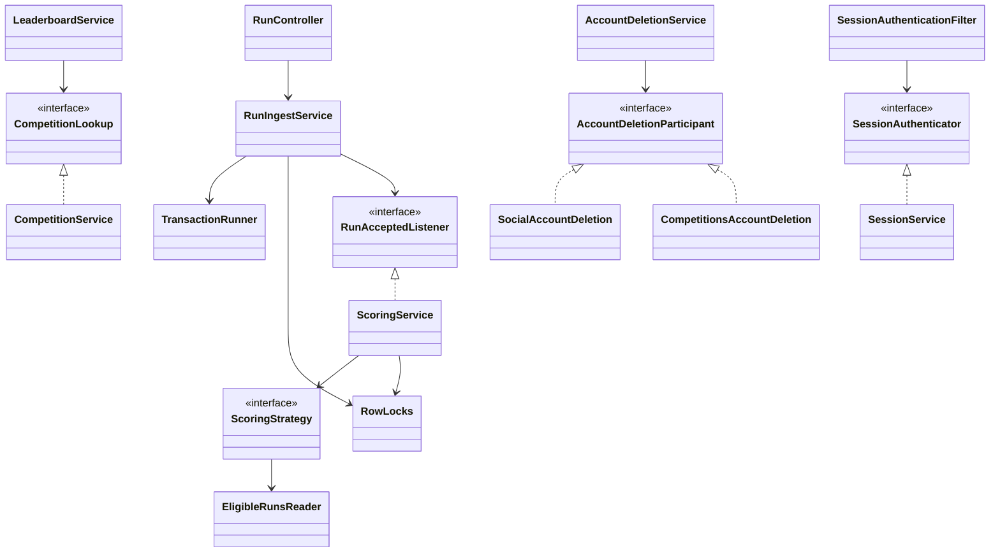

### 4.2 `platform`

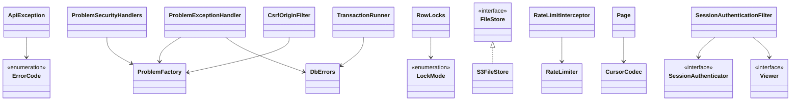

### 4.3 `identity`

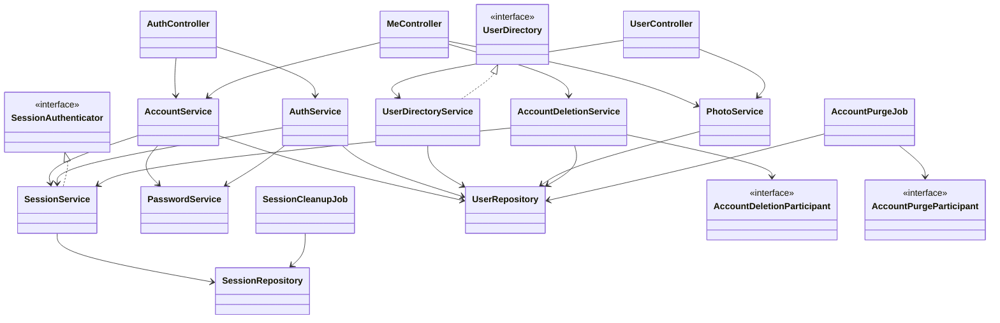

### 4.4 `social`

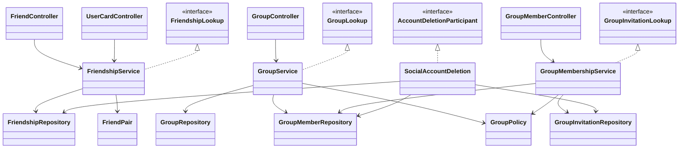

### 4.5 `runs`

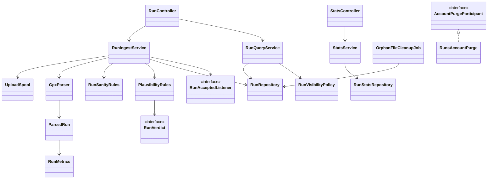

### 4.6 `competitions`

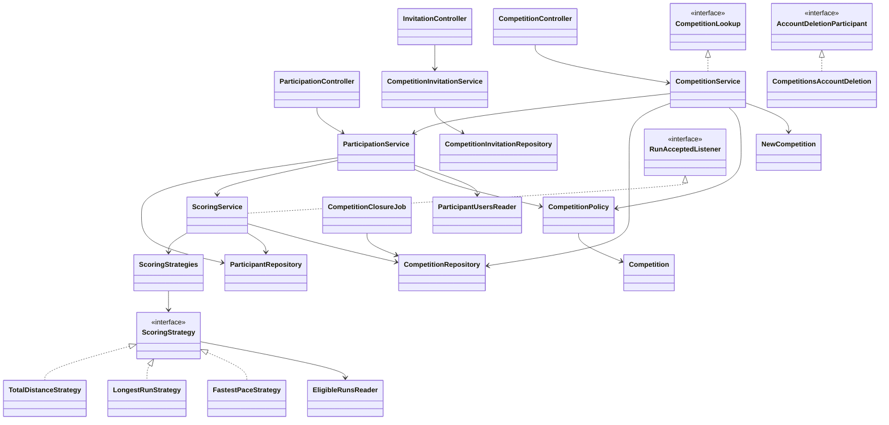

### 4.7 `leaderboards`

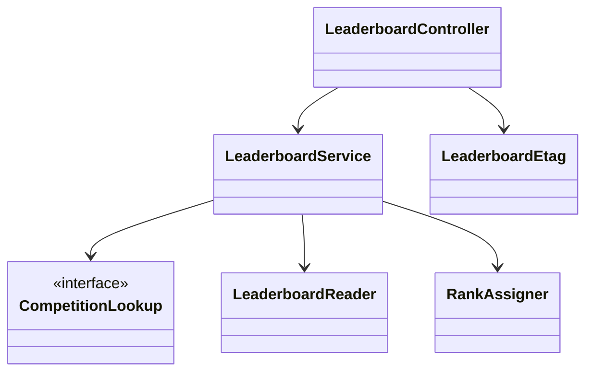

---

## 5. Domain model

### 5.1 What's rich and what isn't

**A rich domain object** holds rules as well as data, instead of leaving them to services. It's worth doing only where a rule must always hold, because otherwise it's ceremony.

| Type | Treatment | Why |
|---|---|---|
| `Competition` | **Rich** | Real invariants, used in many flows. Methods take time as a parameter, so tests need no clock |
| `NewCompetition` | **Rich.** Static factory enforces window, grace and rule rules | An invalid object can't exist |
| `Rule` | **Rich, small.** Constructor enforces "`minDistanceMeters` only for `fastest_pace`" | Mirrors `ck_competitions_rule_params` |
| `RunVerdict`, `PlausibilityRules`, `RunSanityRules` | **Rich.** Pure functions | The core of the validation outcome, and easy to test exhaustively |
| `FriendPair` | **Rich, small.** Orders the two IDs | Mirrors `ck_friendships_order` |
| `RunMetrics` | **Value object.** `paceSecondsPerKm()` | Must match the generated column |
| `User`, `Group`, `Run`, `Membership`, `Participant` | **Data only** | No rule to protect. Methods on these would be overkill |

**A rich `User` was considered and rejected.** Its rules (password strength, weak-password list, deletion) all need outside collaborators, and a domain type with injected services is the wrong shape. Those rules belong in `PasswordService` and `AccountDeletionService`.

### 5.2 `Competition`

```java
public CompetitionState stateAt(Instant now) {...}          // closed_at set -> CLOSED; now < startsAt -> UPCOMING;
                                                            // now < endsAt -> RUNNING; otherwise FINALIZING
public boolean canJoinAt(Instant now)  { /* closedAt == null && now < endsAt */ }
public boolean canLeaveAt(Instant now) { /* now < endsAt */ }                    // D39
public boolean isDeletableAt(Instant now, int participants) { /* now < startsAt && participants == 1 */ }
public EligibilityWindow window() {...}
```

**The rules come from database 3.3, D39 and API-6.** `now` always comes from the database (section 11).

**Why eligibility isn't here.** The rule is "`valid`, started inside `[starts_at, ends_at)`, received before `closes_at`" (D27). It's applied by SQL to an aggregate, so a Java method would have no caller. It appears in exactly two statements, one in each direction:

- `EligibleRunsReader`: which runs count for this competition?
- `CompetitionRepository.findEligibleForRun`: which competitions does this run count for?

A test runs the same boundary cases through both, so they can't quietly disagree.

**Close rules** aren't methods either. Closure is `SELECT ... FOR UPDATE`, `closed_at` check and update (database 6.5), so the rule is in `CompetitionClosureJob`.

### 5.3 Run validation outcome

```java
sealed interface RunVerdict permits Valid, Invalid {}
record Valid() implements RunVerdict {}
record Invalid(InvalidReason reason) implements RunVerdict {}
```

`RunSanityRules.check` **throws**, because a failure is a rejection with no stored row. `PlausibilityRules.classify` **returns**, because an implausible run is a legitimate outcome that gets stored. The two types make that difference visible.

**Order, from api 7.5:** `pace_too_fast`, `pace_too_slow`, `gps_speed_jump`, `duration_too_long`. Only one reason is stored, because `invalid_reason` holds one value, so the first match wins. **Expected to change** as open question 6 is tuned.

`gps_speed_jump` can't be judged after parsing without storing every point, which section 7.3 of the API design forbids in spirit. So `GpxParser` applies the speed and distance thresholds while streaming, and `ParsedRun.hasSpeedJump` carries the answer. It's the one threshold the parser has to know.

### 5.4 Scoring strategies

```java
interface ScoringStrategy {
    RuleType ruleType();
    Integer score(EligibleRunsReader runs, Competition competition, UserId user);   // null: no eligible run
}
class FastestPaceStrategy implements ScoringStrategy {
    public Integer score(EligibleRunsReader runs, Competition c, UserId user) {
        return runs.minPace(user, c.window(), c.rule().minDistanceMeters());
    }
}
```

**How the right strategy is chosen:** `ScoringStrategies` receives Spring's `List<ScoringStrategy>`, builds a `Map<RuleType, ScoringStrategy>`, and **fails at startup if any `RuleType` has none**. A missing strategy can't reach production.

**Why the strategy doesn't hold SQL:** D40 keeps SQL in persistence, and each `EligibleRunsReader` method is one statement. That matters, because under READ COMMITTED only a *new* statement sees data committed while the transaction waited for a lock (database 6.3). The strategies are small, and that's fine. Their job is to choose.

**`ScoreDirection` and `ScoreUnit` live on `RuleType`, not the strategy,** because `leaderboards` needs them and shouldn't depend on scoring.

**No write if unchanged** (D18) is the SQL's job: `updateScoreIfChanged` uses `score IS DISTINCT FROM`.

### 5.5 Ranked entries

`RankedEntry(int rank, UserId userId, String displayName, int score, String photoKey)`. `RankAssigner` receives ordered rows and the first row's rank, and applies: a tied row keeps the previous rank, and otherwise the rank is the row's position plus the first rank. This reproduces 1, 1, 3 across page boundaries, because `countBetter` counts strictly better scores.

### 5.6 Typed IDs

`UserId`, `GroupId`, `CompetitionId` and `RunId` are records wrapping a UUID. **They earn their place:** `lockParticipant(CompetitionId, UserId)` can't be called with the arguments swapped, and with bare UUIDs it would compile and quietly lock nothing.

They live in `platform.id`, because `RowLocks` and security need them, and `platform` can't depend on modules.

**Controllers take `UUID` path variables, and wrap them immediately.** Spring's type mismatch then gives the standard 400 `malformed_request`, with no custom converters. DTOs expose `UUID` too, so JSON stays plain.

### 5.7 Enums that map to `CHECK` values

Each enum implements `DbCode { String code(); }`, holding the exact schema text. `DbCodes.parse(Class, String)` converts on read.

**A test compares every enum to the schema's real `CHECK` list**, read from `pg_constraint` in Testcontainers. A migration that changes one without the other fails the build.

| Enum | Schema constraint | Open in the API? |
|---|---|---|
| `RunPrivacy` | `ck_users_run_privacy` | No |
| `RunSource` | `ck_runs_source` | Yes |
| `RunStatus` | `ck_runs_status` | No |
| `FriendshipStatus` (private to `FriendshipRepository`) | `ck_friendships_status` | Mapped to `accepted`, `incoming`, `outgoing` by viewer |
| `GroupVisibility` | `ck_groups_visibility` | No |
| `GroupRole` | `ck_group_members_role` | No |
| `CompetitionVisibility` | `ck_competitions_visibility` | No |
| `RuleType` | `ck_competitions_rule_type` | Yes |

**`invalid_reason` has no `CHECK`**, and reasons will be tuned. `InvalidReason` is used when writing, and reads keep a plain `String`, so old values survive renames, and the open enum in the API stays honest.

### 5.8 Three traps worth knowing

| Trap | What goes wrong | The design's answer |
|---|---|---|
| **Pace rounding** | PostgreSQL rounds exact `numeric`, and Java's `double` doesn't, so plausibility could judge a different pace from the stored one | `RunMetrics` uses integers: `(2000 * duration + distance) / (2 * distance)`. A test compares it against the generated column |
| **UUID order** | Java's `UUID.compareTo` compares *signed* longs, and PostgreSQL compares bytes. UUIDv7 happens to agree today, but relying on that is fragile. `FriendPair` would violate `ck_friendships_order`, and the lock guard would misorder | `Ids.compare` uses `Long.compareUnsigned` |
| **Generated pace and inserts** | A pace written by Java would be refused, since the column is `GENERATED ALWAYS` | `RunRepository.insert` omits it, and reads it back with `RETURNING` |

---

## 6. Design patterns

### 6.1 Used

| Pattern | Problem | Why this | Alternatives |
|---|---|---|---|
| **Strategy** (required, D18) | Each rule scores differently, and more are coming | **Open/Closed Principle:** a new rule is a new class, and no existing scoring code changes | `switch`, where every new rule edits old code. Enum with behavior, which can't take injected dependencies in Phase 2 |
| **Registry** (`ScoringStrategies`) | Choosing a strategy, safely | Startup fails if a rule has no strategy | Lookup at call time, which fails only when that rule's first run arrives |
| **Dependency inversion / SPI** | Upward calls with no cycles | The lower module states what it needs, and knows nothing about who provides it | Spring events, a shared module |
| **Execute-around** (`TransactionRunner`) | Setup, timeout and retry around a body | Can't be forgotten or misordered | `@Transactional` plus AOP retry, with fragile ordering |
| **Policy** (per module) | Matrix rules, used for both enforcement and viewer flags | Pure functions take facts and return `ALLOWED`, `HIDDEN` or `FORBIDDEN`, so the matrix in api 9.2 becomes a table-driven test without Spring. **Single Responsibility Principle:** services orchestrate, and policies decide | Checks inside services, which then drift from viewer flags |
| **Facade** (`api/` interfaces) | Keeping a module's surface small | **Interface Segregation Principle:** `FriendshipLookup` has one method, because `runs` needs one thing | One big module service |
| **Value object, static factory** | Invalid states | Plain Java, and records make it cheap | Builders, not needed with records |
| **Resource acquisition** (`UploadSpool`, `AutoCloseable`) | The temp file must always be deleted | `try-with-resources` makes it automatic (api 7.3) | `finally` in the service, which is easy to get wrong |

### 6.2 Considered and rejected as overkill

| Pattern | Why not |
|---|---|
| **State pattern for competitions** | The state is derived from timestamps, and behavior is a few conditionals. One enum and four methods are enough. State objects suit stored state with many transitions |
| **CQRS** (separate read and write models) | `LeaderboardReader` is simply a read-only class. Nothing here needs separate models or stores |
| **Domain events and a bus** | D26 defers asynchronous work, and direct calls show the order |
| **Generic `BaseRepository`** | Hides SQL, and no two tables share enough to justify it |
| **Mapper classes, MapStruct** | Static `from(...)` on each DTO is shorter, explicit, and has no annotation processor |
| **Command objects** | No queueing, undo or replay. Method calls do the job |
| **Specification** | Eligibility and search are SQL, so composable Java predicates would have nothing to act on |
| **Saga** | One database and one transaction. The file-before-commit order (database 6.3) plus cleanup jobs already covers object storage |
| **Decorator around `FileStore` for metrics** | A timer at the call site is one line |
| **Staged builder for locks** | See section 7.4 |

---

## 7. Persistence design

### 7.1 Technology: `JdbcClient` with plain SQL (D57)

Spring's `JdbcClient` (since Framework 6.1) with SQL in text blocks inside repository classes, and explicit row mappers to records.

| Option | Fit with our design | Jobs and learning | Verdict |
|---|---|---|---|
| **`JdbcClient`** | Exact. The statements in `database.md` were verified with `EXPLAIN`, and can be used word for word | Teaches SQL and transactions, the project's stated goals. Less visible on a CV | **Chosen** |
| JPA/Hibernate | Poor, see below | Very widely expected | Rejected for Phase 1 |
| Spring Data JDBC | Weak. Its aggregate model doesn't suit lock-then-recalculate flows, and composite IDs only arrived in 4.0 | Niche | Rejected |
| jOOQ open source | Technically good, with compile-time checked SQL. It's Apache-2.0, and the support matrix lists PostgreSQL 18 as its minimum | Niche. Needs code generation against a live database in the build, a toolchain that doesn't exist yet | Runner-up |
| Hybrid: JPA for CRUD, JDBC for the core | Two models in one transaction. JDBC doesn't see unflushed JPA changes, which causes subtle bugs | Teaches JPA only on the easy tables | Rejected |

**Why not JPA here specifically:**
- The core flow is `lock -> read fresh -> recalculate -> update if changed`. The persistence context can hand back a stale object, which is the exact bug database 6.3 designs against. *(From my knowledge. Section 15 marks it to verify.)*
- `FOR NO KEY UPDATE`, which the join lock needs, has no direct JPA lock mode that I could confirm.
- Keyset pagination, `RANK()`, `IS DISTINCT FROM` and `ON CONFLICT` would mostly be native queries, so we'd pay for an ORM and bypass it in the transactions that matter most.

**What you give up, plainly:**
1. **JPA on your CV.** A real cost. A suggested side exercise after the vertical slice: rewrite `social` with JPA on a throwaway branch and compare the two. You'd learn more from that comparison than from using JPA only on easy tables.
2. **Compile-time SQL checks.** A typo fails at test time, so every repository method needs a Testcontainers test. Database 11.3 requires those tests anyway.
3. **Convenience.** You write row mappers by hand.

### 7.2 Repositories

Concrete classes with text-block SQL and private row mappers. **They hold no business rules, and they never call each other.** Why no interfaces: see row I in section 1.2. Mockito can still mock a concrete class where a service test wants it.

**Names are expected to change. The mapping to `database.md` isn't.**

| Repository | Method signature | Database item |
|---|---|---|
| `UserRepository` | `User insert(NewUser)` | 3.1. `23505` on `uq_users_email_lower` |
| | `Optional<User> findActiveById(UserId)` | 3.1, R1 |
| | `Optional<User> findActiveByEmail(String)` | Login, 8.3 of api |
| | `int updateProfile(UserId, ProfilePatch)` | W6 |
| | `int updatePassword(UserId, String hash)` | W6 |
| | `Optional<String> updatePhotoKey(UserId, String newKey)`, returning the old key | 14.4 |
| | `int wipeForDeletion(UserId)` | 6.6 step 1 |
| | `List<UserCard> searchByDisplayName(String q, int limit)` | R7, 14.7 |
| | `List<UserCard> findCards(Collection<UserId>)` | R7, `users` PK |
| | `Optional<UserId> claimDeletedUser()` | **8.2, `FOR UPDATE SKIP LOCKED`** |
| | `int purge(UserId)` | 8.2, cascades |
| `SessionRepository` | `void insert(byte[] hash, UserId, Instant expiresAt)` | 14.1 |
| | `Optional<SessionRow> findValid(byte[] hash)`, with a `needsRenewal` flag | 14.1, R1, CLS-8 |
| | `Duration renew(byte[] hash)` | 14.1 |
| | `int delete(byte[] hash)`, `int deleteAllForUser(UserId)`, `int deleteAllExcept(UserId, byte[])` | 14.1, 14.4 |
| | `int deleteExpired()` | 14.4 |
| `RunRepository` | `Optional<Run> findByHash(UserId, byte[])` | 14.2 |
| | `Run insert(NewRun)` | 3.2, 6.3 step 2 |
| | `Optional<RunId> findOverlappingValid(UserId, Instant, Instant)` | 14.7 |
| | `Optional<Run> findById(RunId)` | R3 |
| | `List<Run> pageForOwner(UserId, PageRequest<RunCursor>)`, `pageValidForViewer(UserId, PageRequest<RunCursor>)` | 7.5, 14.7 |
| | `Optional<String> findFileKey(UserId, byte[] hash)` | 8.3 |
| `RunStatsRepository` | `periods(UserId, ZoneId, ChronoUnit, DayOfWeek, int)`, `totals(UserId)`, `longestRun(UserId)`, `fastestPaces(UserId, int[])` | R4, 14.7 |
| `CompetitionRepository` | `Competition insert(NewCompetition, UserId creator)` | 3.3, 14.6 |
| | `Optional<CompetitionViewerRow> findForViewer(CompetitionId, Optional<UserId>)`, with `now()` | 14.7, D46 |
| | `int deleteById(CompetitionId)` | 14.6 |
| | `List<CompetitionId> findEligibleForRun(UserId, Instant startedAt, Instant receivedAt)` | 6.3 step 4 |
| | `int countOpenForUser(UserId)` | 6.4 step 3 |
| | `List<CompetitionId> findDueForClosure(Duration delay)` | 6.5 |
| | `int markClosed(CompetitionId)` | 6.5 step 3 |
| | `searchPublic(q, city, states, page)`, `pageForGroup(GroupId, boolean all, page)`, `pageForUser(UserId, boolean active, page)` | R8, R5, R6, 14.7 |
| `ParticipantRepository` | `boolean insertIfAbsent(CompetitionId, UserId)` | 6.4 step 4 |
| | `Optional<Participant> find(CompetitionId, UserId)` | 14.3 |
| | `int delete(CompetitionId, UserId)` | 6.4 |
| | `int updateScoreIfChanged(CompetitionId, UserId, Integer)` | 6.2 |
| `EligibleRunsReader` | `Integer sumDistance(UserId, EligibilityWindow)`, `maxDistance(UserId, EligibilityWindow)`, `minPace(UserId, EligibilityWindow, int minDistance)` | 6.2 |
| `ParticipantUsersReader` | `int countActive(CompetitionId)`, `List<ParticipantRow> pageActive(CompetitionId, PageRequest<IdCursor>)` | R5, 14.7, CLS-1 |
| `CompetitionInvitationRepository` | `int insertIfAbsent(CompetitionId, UserId invitee, UserId by)`, `boolean exists(...)`, `int delete(...)`, `int deleteAllForUser(UserId)`, `List<InvitationRow> newestFor(UserId, int)` | 3.5, 6.4, 6.6, CLS-7 |
| `LeaderboardReader` | `List<EntryRow> topN(CompetitionId, ScoreDirection, int limit)` | **7.1, word for word** |
| | `List<EntryRow> pageAfter(CompetitionId, ScoreDirection, LeaderboardCursor, int)` | 14.7 |
| | `Optional<Integer> findMyScore(CompetitionId, UserId)` | 7.2 |
| | `int countBetter(CompetitionId, ScoreDirection, int score)` | 7.2, 14.7 |
| `FriendshipRepository` | `boolean insertIfAbsent(FriendPair, UserId requestedBy)`, `Optional<Friendship> findForUpdate(FriendPair)`, `int accept(FriendPair)`, `int delete(FriendPair)`, `int deleteAllForUser(UserId)`, `boolean exists(FriendPair)`, `page(UserId, status, page)` | 3.5, R7, 14.7 |
| `GroupRepository` | `Group insert(NewGroup, UserId)`, `Optional<GroupViewerRow> findForViewer(GroupId, Optional<UserId>)`, `int deleteById(GroupId)`, `searchPublic(q, city, page)` | 3.5, R7, R8 |
| `GroupMemberRepository` | `boolean insertIfAbsent(GroupId, UserId, GroupRole)`, `Optional<Membership> find(GroupId, UserId)`, `int delete(GroupId, UserId)`, `int updateRole(GroupId, UserId, GroupRole)`, `int countAdmins(GroupId)`, `int countMembers(GroupId)`, `Optional<UserId> findLongestStanding(GroupId)`, `pageMembers(GroupId, page)`, `pageForUser(UserId, page)`, `List<GroupId> groupsWhereAdmin(UserId)`, sorted ascending, `int deleteAllForUser(UserId)` | 14.6, 6.6, R7 |
| `GroupInvitationRepository` | `int insertIfAbsent(GroupId, UserId, UserId)`, `boolean exists(GroupId, UserId)`, `int delete(GroupId, UserId)`, `int deleteAllForUser(UserId)`, `List<GroupInvitationView> newestFor(UserId, int)` | 3.5, 6.6, CLS-7 |

### 7.3 Where the SQL lives

In a `private static final String` text block next to the method that uses it, with named parameters only. Database 7.1 and 6.2's statements are copied word for word, because they're what the plans verified. **Parameters are always bound, never concatenated** (api 15). The one exception to "no string building" is `ASC` or `DESC`, which comes only from `ScoreDirection.sqlOrder()`, an enum, and never from input.

**Eligibility has one fragment**, in `EligibleRunsReader`:

```sql
r.user_id = :userId AND r.status = 'valid'
  AND r.started_at >= :startsAt AND r.started_at < :endsAt
  AND r.received_at < :closesAt
```

### 7.4 `RowLocks`: the lock-order helper (D61)

```java
public class RowLocks {
    public boolean lockActiveUser(UserId id, LockMode mode);       // false: missing or deleted
    public boolean lockGroup(GroupId id, LockMode mode);           // false: missing
    public Optional<LockedCompetition> lockCompetition(CompetitionId id, LockMode mode);  // empty: missing
    public boolean lockParticipant(CompetitionId c, UserId u);     // FOR UPDATE. false: missing
}
```

**The global order** is a tuple compared lexicographically, using `Ids.compare`:

```text
(0, user) < (1, group ascending) < (2, competition ascending, 0) < (2, same competition, 1, participant)
```

**Each call compares against the last lock taken in this transaction**, stored as a Spring transaction resource, so it's discarded with the transaction. Going backward throws `IllegalStateException`, which is a 500 and a failed test. Taking the same row again is allowed. Skipping levels is allowed. **Every flow has an integration test, so a violation fails CI before it can deadlock in production.**

**Requires a transaction.** `RowLocks` refuses to run outside one, since an autocommit lock would be released at once and protect nothing.

**Beyond the guard:** a test scans the source tree and fails on `FOR SHARE`, `FOR UPDATE` or `FOR NO KEY UPDATE` outside `RowLocks`. The only allowed exception is `UserRepository.claimDeletedUser`, whose `SKIP LOCKED` never waits and so can't deadlock.

| Rejected | Why |
|---|---|
| **Staged builder** (`locks.user().group().competitions()`, where each step's return type offers only later steps) | Elegant and compile-time, but it can't check sort order inside a loop, and ingest would have to pass a token across a module boundary |
| **Locks in each module's repository, with only a guard** | Keeps SQL with its owner, but "one place" then becomes a convention |

**The cost:** `platform` knows four table names, and a lock returns only minimal facts, so the owning module reads the row in a following statement. That's a little more work per lock, and it's correct under READ COMMITTED, because the read sees what the lock waited for. It's documented as a D35 exception.

**`SKIP LOCKED`** appears only in the sweeper (database 8.2). Closure deliberately waits rather than skipping (database 6.5).

### 7.5 `TransactionRunner` (D60)

```java
public <T> T write(Supplier<T> body);                     // default timeout, 30 s
public <T> T write(Duration timeout, Supplier<T> body);   // jobs
```

| Situation | Behavior |
|---|---|
| **Outermost call** | Begins READ COMMITTED, runs `SET LOCAL transaction_timeout`, runs the body, commits. On `40P01` or `40001`, retries the **whole** transaction up to 2 times with 50 to 200 ms of jitter, then `temporarily_unavailable` |
| **Nested call** | Joins the running transaction, and never retries, because a retry must restart everything |
| **Reads** | Single-statement reads use autocommit and need no runner. Database 7.3 accepts this for leaderboards |

**Why not `@Transactional`.** It's what most Spring code uses, and you should know it. Three things make it wrong here:
1. Retry has to wrap the transaction, and that depends on the order of two AOP proxies.
2. Calling a `@Transactional` method from the same class silently skips the proxy, so there's no transaction. This is the most common Spring transaction bug.
3. `SET LOCAL` has to run first inside the transaction, in every flow.

**The critical rule:** the body can run more than once, so nothing non-transactional goes inside it. The file-store call happens before `write`, and the same key is used across retries.

**CLS-3 applies the timeout to every write transaction**, not only ingest, because the 30-second bound on lock waits should cover join and leave too.

### 7.6 Keyset pagination and rank queries

**Keyset:** a repository receives `PageRequest<C>` with a typed cursor record, fetches `limit + 1` rows and returns them. `Page.of(...)` trims the extra row, and encodes the last visible row's key as `nextCursor` only if there was an extra one. `CursorCodec` is the only code that knows the wire format (base64url JSON with a version).

**Leaderboards:**

| Case | Statements |
|---|---|
| First page | `LeaderboardReader.topN`, using database 7.1's `RANK()`. Then `findMyScore`, and `countBetter` if the viewer has a score |
| Deep page | `pageAfter`, then `countBetter` for the first row's score, then `RankAssigner` |
| Top N viewer | `topN` with `limit` capped at N. No `me`, and a cursor returns 403 |

**Why two paths, when one would do:** the first page's plan was observed reading 11 rows for the top 10. `RANK()` on a deep page would have to read everything before it, so the deep path uses a count instead.

### 7.7 Database errors become domain results

The class that expects a failure handles it. Anything else goes to `ProblemExceptionHandler`.

| SQLSTATE | Handled in | Result |
|---|---|---|
| `23505` `uq_users_email_lower` | `AccountService.register` | `email_taken` |
| `23505` `uq_runs_user_file_hash` | `RunIngestService`, after rollback | 200 with the existing run |
| `23P01` `ex_runs_no_overlap` | `RunIngestService`, after rollback | Re-check the hash (CLS-5), then 409 with `conflictingRunId` |
| `23503` | `ProblemExceptionHandler` | `not_found` |
| `40P01`, `40001` | `TransactionRunner` | Retry, then `temporarily_unavailable` |
| `57014`, lost connection | `ProblemExceptionHandler` | `temporarily_unavailable`, with `Retry-After` |
| `22003`, `23514` | `ProblemExceptionHandler` | `internal_error` and an alert: a bug |

**`transaction_timeout` is treated as a lost connection, with no dependence on a specific SQLSTATE** (database 13.4). The connection is terminated, and the pool must replace it. Section 15 marks this for a failure test.

**A simplification:** friend requests use `INSERT ... ON CONFLICT DO NOTHING` and then a locked read, instead of catching `23505` and retrying (database 14.8). Behavior is the same, and no transaction aborts.

---

## 8. Critical flows

Every flow below names its transaction boundary, its locks in order and its failure behavior. **Method names are expected to change, and the order isn't.**

### 8.1 Run ingest

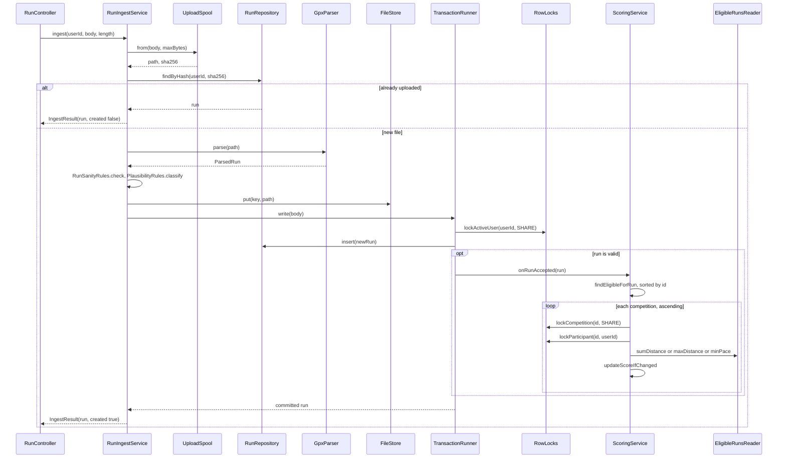

| | |
|---|---|
| **Boundary** | `TransactionRunner.write`, around lock, insert and scoring. Spooling, parsing and storing are outside |
| **Locks, in order** | `FOR SHARE` user. For each competition, ascending: `FOR SHARE` competition, then `FOR UPDATE` participant |
| **Skip rules** | Competition gone or `closed_at` set: skip (CLS-4). Participant gone: skip |
| **Failures** | `23505`: rollback, return 200 with the existing run. `23P01`: rollback, re-check the hash (CLS-5), then 409 with `conflictingRunId`. Storage down: 503 `storage_unavailable`, nothing saved. No active user: 401. Deadlock: retried with the same file key. Timeout: 503, safe to retry. Any stored file with no row becomes an orphan for the daily job |
| **Order of checks** | api 7.2. The temp file is removed by `try-with-resources` |

### 8.2 Join competition, with backfill

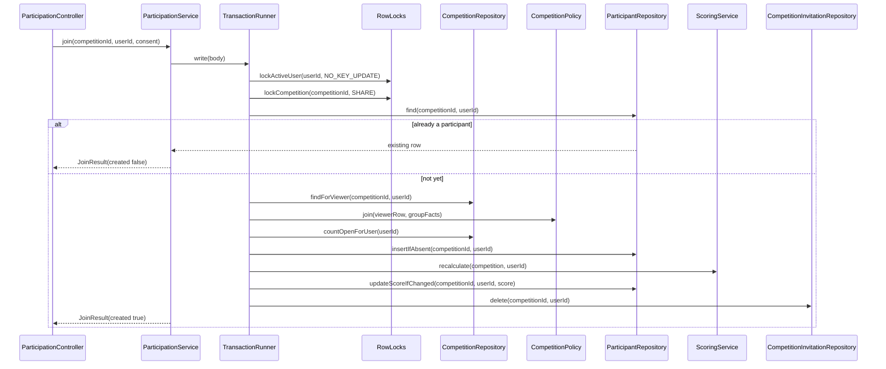

| | |
|---|---|
| **Boundary** | The whole body |
| **Locks, in order** | `FOR NO KEY UPDATE` user, `FOR SHARE` competition. The new participant row needs no lock of its own |
| **Why this lock** | D34: without the per-user lock, ingest and join can both miss a run (database 6.4) |
| **Order of checks** | Participant first (API-3), then 404, consent, `ends_at`, limit. A retry after `ends_at` still gets 200 |
| **Failures** | Hidden or gone: 404. 422 `consent_required`. 409 `competition_join_closed`, `competition_limit_reached`. Racing with a deletion: the lock serializes them, so the join sees no row and returns 404 |

### 8.3 Leave competition

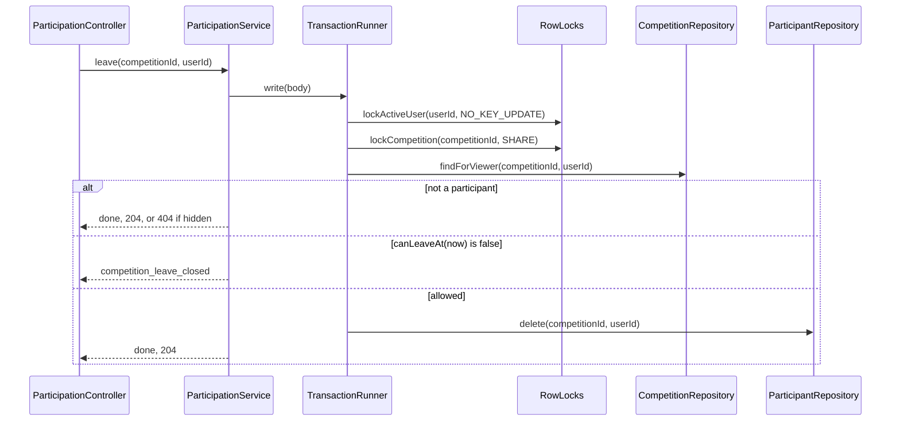

| | |
|---|---|
| **Boundary** | The whole body |
| **Locks, in order** | `FOR NO KEY UPDATE` user, `FOR SHARE` competition |
| **Failures** | 409 `competition_leave_closed` from `ends_at` on (D39). Hidden: 404. A scoring transaction that loses the race skips the missing row, with no error (database 6.4) |

### 8.4 Closure scheduler

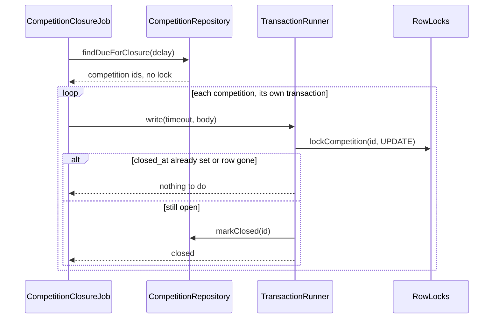

| | |
|---|---|
| **Boundary** | One transaction per competition, so one failure can't block others |
| **Locks** | `FOR UPDATE` competition, which **waits** for ingest's `FOR SHARE` (database 6.5). Timeout 60 s |
| **Failures** | Logged and counted, and the next tick retries. A delay is safe, because eligibility uses `closes_at`, not `closed_at`. Two instances: the second waits, sees `closed_at`, and stops |

### 8.5 Account deletion, phase 1

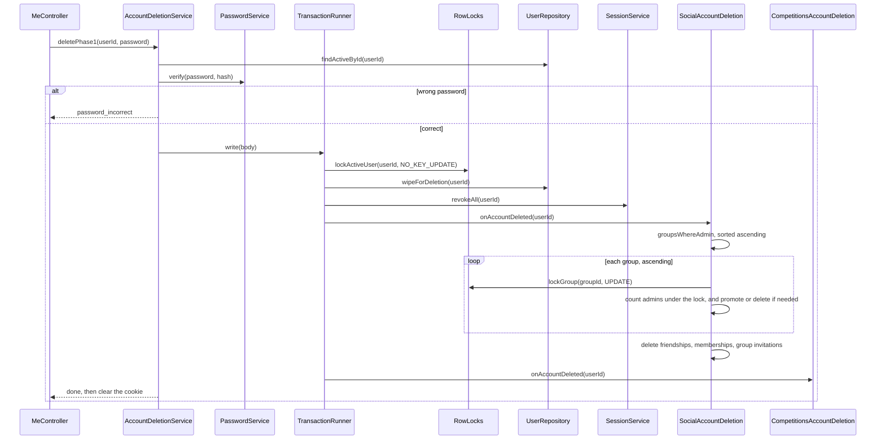

| | |
|---|---|
| **Boundary** | One transaction around everything after the password check. **The password check is never inside a transaction**, because Argon2 would hold a connection for a deliberately slow operation |
| **Locks, in order** | `FOR NO KEY UPDATE` user (which waits for in-flight ingests), then `FOR UPDATE` groups ascending (CLS-2) |
| **Why every group where the user is an admin** | Locking only the groups where they look like the last admin has a race. If another admin leaves at the same moment, an unlocked read still sees two admins, so nothing protects the group, and it ends up with none. So each candidate is locked first, and the count is read under its lock (CLS-2) |
| **Failures** | 403 `password_incorrect` leaves everything unchanged. Any later failure rolls back, so the account stays intact |
| **Not done here** | Participant rows, runs, files and the row itself wait for the purge. Read-time filters hide them meanwhile (D17, D29) |

### 8.6 Account deletion, phase 2 (the sweeper)

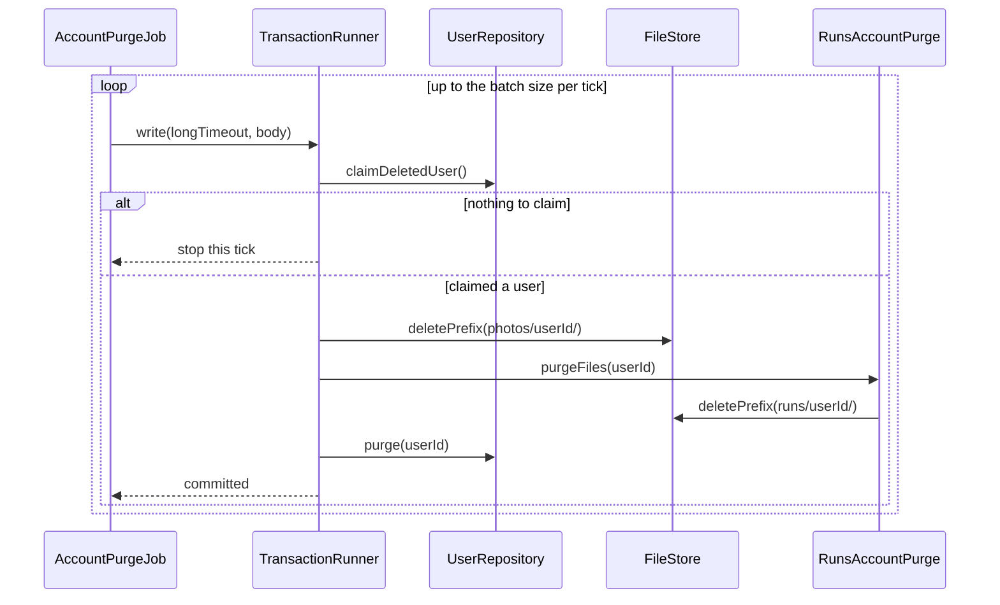

| | |
|---|---|
| **Boundary** | One transaction per user. The object-store calls run inside it, as database 8.2 specifies, because the row lock is the claim. **This is the one place a transaction spans external calls**, and it's safe because deleting a prefix can be repeated |
| **Locks** | `FOR UPDATE SKIP LOCKED` on the user row. Timeout 5 minutes (CLS-3), since a heavy user can have many files |
| **Failures** | The row survives as the retry marker (database 6.6). Two sweepers: each skips the other's row |

### 8.7 Login

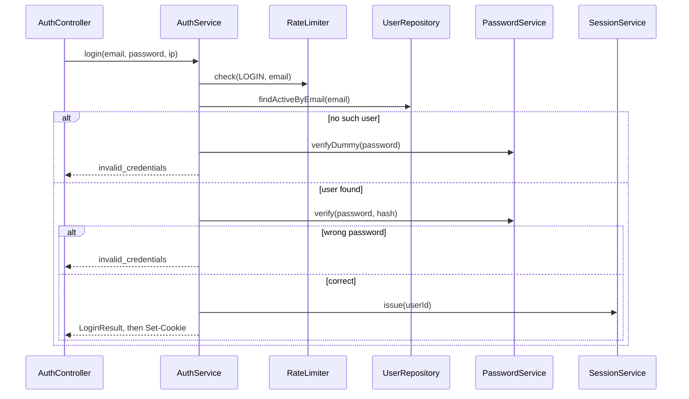

| | |
|---|---|
| **Boundary** | Only the session insert, in autocommit. If `needsRehash` is true, the password update runs best-effort after it |
| **Locks** | None. A login racing with account deletion is handled by the join in `findValid` (API-1) |
| **Failures** | The same 401 for both cases, with matching timing through the dummy hash (api 8.5). `rate_limited` by email here, and by IP in the interceptor |

### 8.8 Session validation and CSRF, on every request

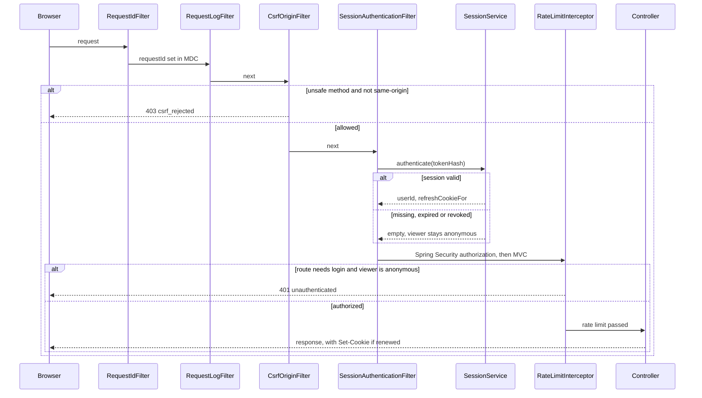

| | |
|---|---|
| **Filter order** | `RequestIdFilter`, `RequestLogFilter`, then Spring Security's chain (security headers, `CsrfOriginFilter`, `SessionAuthenticationFilter`, authorization), `BodyLimitFilter`, then `DispatcherServlet` with `RateLimitInterceptor`. `RequestLogFilter` sits outside security so rejected requests are logged too |
| **Boundary** | None. An autocommit read per request, and `renew` only when `findValid` says it's due (at most hourly) |
| **CSRF** | api 8.4: `Sec-Fetch-Site` must be `same-origin` if present, otherwise `Origin` must match. **Neither present: reject.** Safe methods skip this. Spring Security's own CSRF is turned off |
| **Optional routes** | `GET /competitions/{competitionId}` and the leaderboard declare no 401. **So an invalid cookie there means anonymous, not an error.** This is why the filter leaves the viewer anonymous, and authorization decides |
| **Failures** | A renewal failure fails open: it's logged, and the request continues |

### 8.9 Leaderboard: top N and my rank

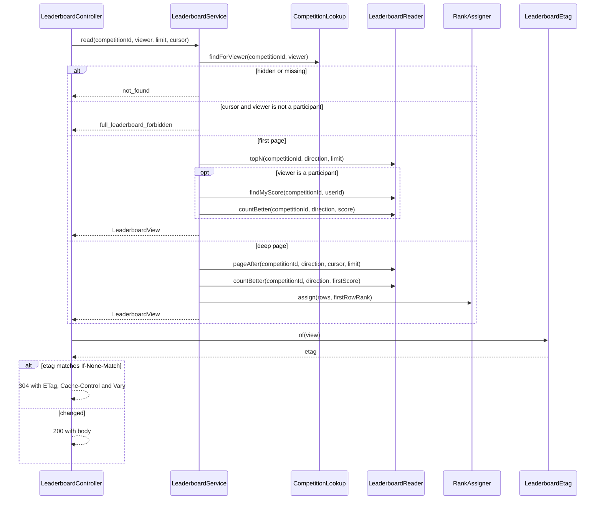

| | |
|---|---|
| **Boundary** | None. Separate autocommit statements, which may differ for an instant (database 7.3) |
| **Locks** | None |
| **Failures** | 404, 403 `full_leaderboard_forbidden`, 400 `invalid_cursor`. **The queries run even for a 304**, because computing the ETag needs the data (api 13) |

### 8.10 Group role change, kick and leave

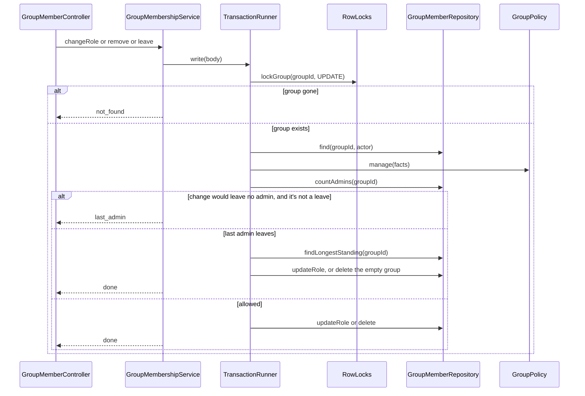

| | |
|---|---|
| **Boundary** | The whole body |
| **Locks** | `FOR UPDATE` group, read before the count (API-6). This prevents **write skew**: two admins demoting each other, each seeing two admins |
| **Failures** | 404, 403 `forbidden`, 409 `last_admin` |

### 8.11 Group create, join and delete

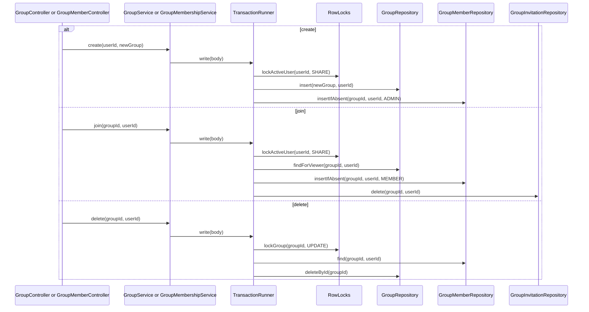

| | |
|---|---|
| **Locks** | Create and join: `FOR SHARE` user (CLS-6), so a deleted user can't slip a membership in. Delete: `FOR UPDATE` group |
| **Failures** | `23503` during a join means the group was deleted meanwhile: 404. A competition's `group_id` becomes `NULL` by cascade, so it continues without a group |

### 8.12 Create competition

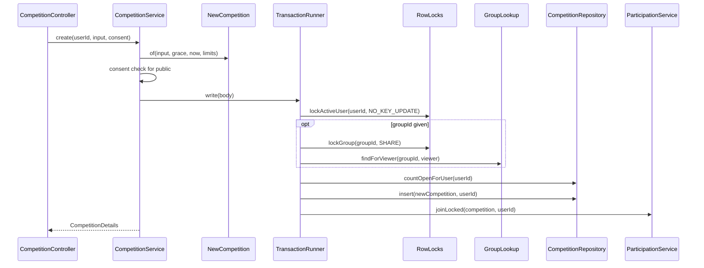

| | |
|---|---|
| **Boundary** | Everything after validation |
| **Locks, in order** | `FOR NO KEY UPDATE` user, optional `FOR SHARE` group. **The new competition needs no lock**, since nobody else can see it yet (API-6) |
| **Failures** | 422 `validation_failed`, `consent_required`. 404 if the group is hidden. 403 if the viewer isn't its admin. 409 `competition_limit_reached` |

### 8.13 Delete competition

```mermaid
sequenceDiagram
    participant C as CompetitionController
    participant S as CompetitionService
    participant T as TransactionRunner
    participant L as RowLocks
    participant R as CompetitionRepository
    participant U as ParticipantUsersReader
    participant P as CompetitionPolicy

    C->>S: delete(competitionId, userId)
    S->>T: write(body)
    T->>L: lockCompetition(competitionId, UPDATE)
    T->>R: findForViewer(competitionId, userId)
    T->>U: countActive(competitionId)
    T->>P: delete(viewerRow, count)
    alt not allowed
        S-->>C: forbidden or competition_not_deletable
    else allowed
        T->>R: deleteById(competitionId)
        S-->>C: done, cascades to participants and invitations
    end
```

| | |
|---|---|
| **Locks** | `FOR UPDATE` competition, which waits for any join holding `FOR SHARE` (API-6) |
| **Failures** | 404, 403, 409 `competition_not_deletable`. A join waiting on this lock then finds no row, and returns 404 |

---

## 9. Cross-cutting design

### 9.1 Request ID and logging context

`RequestIdFilter` runs first. It accepts `X-Request-Id` only if it matches `^[A-Za-z0-9._-]{8,64}$`, and otherwise generates one, to prevent log injection (api 16). It sets MDC `requestId` and the response header, and clears MDC in `finally`. **MDC** (Mapped Diagnostic Context) is a per-thread map that the logger adds to every line, which is how the ID gets into every log line with no extra code.

`SessionAuthenticationFilter` adds MDC `userId`. Jobs use `job-<name>-<uuid>` as their ID (section 10).

`RequestLogFilter` writes one line per request: `method`, `route` (from Spring's best-matching-pattern attribute, or `unmatched`), `status`, `durationMs`, `errorCode`. **It never logs the query string, email, tokens, passwords, coordinates or file contents** (api 15).

Structured JSON logging uses Spring Boot's built-in support (section 15). No logging abstraction of our own.

### 9.2 Metrics hooks

| Metric | Source | Note |
|---|---|---|
| `http.server.requests` | Spring Boot, by configuration | Histogram buckets at 200 ms, 300 ms, 500 ms and 1 s, by route template |
| `pace.ingest.step` (timer) | `RunIngestService` | `step` is `parse`, `store` or `transaction` |
| `pace.ingest.outcome` (counter) | `RunIngestService` | `created`, `duplicate`, `overlap`, `invalid`, and each rejection |
| `pace.login.outcome` (counter) | `AuthService` | |
| `pace.ratelimit.rejected` (counter) | `RateLimiter` | By class |
| `pace.job.duration`, `pace.job.last_success` | `JobRunner` | By job |
| `pace.competition.overdue_closures` (gauge) | `CompetitionClosureJob` | The alert in database 6.5 |

`MeterRegistry` is used directly, with no wrapper classes. **No user IDs in labels** (api 16). Actuator runs on a separate port by configuration.

### 9.3 Exceptions and Problem Details (D64)

**One path:** a service throws `ApiException(ErrorCode, ...)`, `ProblemExceptionHandler` catches it, and `ProblemFactory` writes the body. Exceptions raised in filters take the same `ProblemFactory` through `ProblemSecurityHandlers` and `CsrfOriginFilter`, because filters run outside Spring MVC and `@RestControllerAdvice` can't see them.

`ProblemFactory` builds `type` as `urn:pace:problem:<code>`, `instance` from the path with no query string, and adds `requestId` from MDC.

**Rejected:** one exception class per code, which is 34 classes with no behavior. `ApiException` carries extensions such as `conflictingRunId` as data.

**Where each code is raised:**

| Code | Raised by |
|---|---|
| `malformed_request` | `ProblemExceptionHandler`, for an unreadable body, a type mismatch or an unknown field |
| `invalid_cursor` | `CursorCodec.decode` |
| `invalid_credentials` | `AuthService.login` |
| `unauthenticated` | `ProblemSecurityHandlers`, and `RunIngestService` when the user was deleted mid-upload |
| `forbidden` | `AccessDecision.enforce`, from `GroupPolicy` and `CompetitionPolicy` |
| `csrf_rejected` | `CsrfOriginFilter` |
| `password_incorrect` | `AccountService.changePassword`, `AccountDeletionService.deletePhase1` |
| `runs_not_visible` | `RunVisibilityPolicy`, through `RunQueryService.listForUser` |
| `full_leaderboard_forbidden` | `LeaderboardService.read` |
| `not_found` | `AccessDecision.enforce`, services, and `ProblemExceptionHandler` on a foreign-key failure |
| `method_not_allowed` | `ProblemExceptionHandler`, from Spring MVC |
| `email_taken` | `AccountService.register` |
| `run_overlap` | `RunIngestService.ingest` |
| `last_admin` | `GroupMembershipService` |
| `invitation_not_applicable` | `GroupMembershipService.invite`, `CompetitionInvitationService.invite` |
| `competition_limit_reached` | `ParticipationService.joinLocked` |
| `competition_join_closed` | `ParticipationService.joinLocked` |
| `competition_leave_closed` | `ParticipationService.leave` |
| `competition_not_deletable` | `CompetitionService.delete` |
| `payload_too_large` | `BodyLimitFilter`, `UploadSpool` |
| `unsupported_media_type` | `ProblemExceptionHandler`, `BodyLimitFilter` for compressed bodies, `RunController` |
| `validation_failed` | `ProblemExceptionHandler` for Bean Validation, plus `NewCompetition` and `Rule` |
| `weak_password` | `PasswordService.requireStrong` |
| `image_invalid` | `PhotoService.put` |
| `friend_self` | `FriendshipService.request` |
| `consent_required` | `ParticipationService.joinLocked`, `CompetitionService.create` |
| `gpx_malformed` | `GpxParser.parse` |
| `gpx_out_of_range` | `RunSanityRules.check` |
| `run_in_future` | `RunSanityRules.check` |
| `run_too_old` | `RunSanityRules.check` |
| `rate_limited` | `RateLimiter.check` |
| `internal_error` | `ProblemExceptionHandler`, for anything unexpected |
| `temporarily_unavailable` | `TransactionRunner`, `ProblemExceptionHandler` |
| `storage_unavailable` | `S3FileStore`, as `ApiException` |

### 9.4 Validation placement

| Layer | Checks | Example | Failure |
|---|---|---|---|
| **`web`** | Shape: types, unknown fields, ranges from the spec | `displayName` length, `limit` range | 400, 422 `validation_failed` |
| **`service` and `domain`** | Rules needing state, the clock or several fields | `NewCompetition` window, `RunSanityRules`, policies | 422, 403, 404, 409 |
| **Database** | The backstop. Should never fire for validated input | `ck_users_city`, `ck_runs_duration` | 500 and an alert |

**Request enum fields are `String` with `@Pattern`,** so an unknown value is 422 rather than 400. It parses, and breaks a rule (api 10.1). Query parameters follow the same rule, which is why the 7 list operations gained a declared 422 (section 16.2).

**A malformed path UUID is 400**, from Spring's type mismatch.

**Why validate twice:** the web layer gives good error messages, and the database is the only place immune to races and bugs. Neither replaces the other.

### 9.5 Security filter chain

**Spring Security stays, with its CSRF off.** It gives deny-by-default authorization, security headers and a request firewall for free, and it's worth learning. **Rejected:** plain servlet filters, which would mean rewriting those parts and getting them wrong.

```text
RequestIdFilter -> RequestLogFilter
  -> Spring Security: headers, CsrfOriginFilter, SessionAuthenticationFilter, authorization
  -> BodyLimitFilter -> DispatcherServlet -> RateLimitInterceptor -> controller
```

| Rule | Routes |
|---|---|
| Public | `POST /auth/register`, `POST /auth/login` |
| Optional | `GET /competitions/{competitionId}`, `GET /competitions/{competitionId}/leaderboard` |
| Authenticated | **Everything else, by default** |

Headers come from api 15. `CsrfOriginFilter` needs its own tests, because it replaces a framework default and a mistake fails silently (api 8.4).

### 9.6 Sessions and current-user resolution

`platform` owns the filter, but `identity` owns the table, so `SessionAuthenticator` connects them (section 2.3). A controller just declares `Viewer` or `Viewer.Authenticated` as a parameter, and `ViewerArgumentResolver` supplies it. A controller that declares `Viewer.Authenticated` can't run for an anonymous viewer.

**Renewal (CLS-8):** `SessionRepository.findValid` returns a `needsRenewal` flag computed in the same statement. Only when it's true does `renew` run, and the filter writes a new `Set-Cookie`. **Otherwise the browser would drop the cookie 30 days after login, however active the user is.**

**`SessionToken.generate`** uses 256 bits from `SecureRandom`, encoded as base64url. Only the SHA-256 is stored (D43).

### 9.7 Rate limiter

`RateLimitInterceptor` runs after authentication and before the controller, so the key can be the user. The class comes from `@RateLimit` if present, otherwise from the method: `GET` is `OTHER_READ`, or `ANONYMOUS_READ` with no user, and anything else is `OTHER_WRITE`.

| Class | Key | Where |
|---|---|---|
| `LOGIN` | IP, and email | IP in the interceptor. **Email in `AuthService`, because the body isn't parsed yet in the interceptor** |
| `REGISTER` | IP | Interceptor |
| `UPLOAD`, `FRIEND_INVITE`, `PHOTO_PASSWORD`, `SEARCH`, `OTHER_WRITE`, `OTHER_READ` | User | Interceptor |
| `ANONYMOUS_READ` | IP | Interceptor |

**Fails open** (D53): any limiter error is logged, and the request continues. The IP comes only from `ClientIpResolver`. Limits are per instance (api 14.1).

**A known small deviation:** a `consumes` mismatch is rejected during Spring's handler mapping, before the interceptor runs, so it isn't rate-limited. `POST /runs` declares no `consumes` and checks the type in `RunController`, to keep the order in api 7.2.

### 9.8 ETag and conditional requests

`LeaderboardEtag.of(view)` serializes `state`, `entries`, `me` and `nextCursor` to JSON, and returns a quoted SHA-256. `LeaderboardController` compares it with `If-None-Match`, and returns 304 with `ETag`, `Cache-Control: private, no-cache` and `Vary: Cookie`.

**Not `ShallowEtagHeaderFilter`,** which hashes the whole body including `asOf`, so it would never match (api 13). `viewerAccess` isn't in the hash, because a change of access always changes `me`.

Every other endpoint is `no-store`, and photos are `private, max-age=31536000, immutable`. Controllers set these through one small helper in `platform.web`.

### 9.9 Configuration properties

One immutable `@ConfigurationProperties` record per module, validated at startup. **Rejected:** one global properties class, which would make every module depend on every setting. **Starting values come from the design documents, and they're all configurable.**

| Property | Default | Class | Used by |
|---|---|---|---|
| `pace.platform.origin` | none, required | `PlatformProperties` | `CsrfOriginFilter` |
| `pace.platform.trusted-proxy-header` | `X-Real-IP` | `PlatformProperties` | `ClientIpResolver` |
| `pace.platform.body-limit.json` | 64 KB | `PlatformProperties` | `BodyLimitFilter` |
| `pace.platform.rate-limits.*` | api 14.1 | `PlatformProperties` | `RateLimiter` |
| `pace.tx.default-timeout` | 30 s | `TxProperties` | `TransactionRunner` |
| `pace.tx.max-retries` | 2 | `TxProperties` | `TransactionRunner` |
| `pace.tx.jitter` | 50 to 200 ms | `TxProperties` | `TransactionRunner` |
| `pace.jobs.enabled` | `true` | `PlatformProperties` | All jobs |
| `pace.identity.session.sliding` | 30 days | `IdentityProperties` | `SessionRepository` |
| `pace.identity.session.absolute` | 90 days | `IdentityProperties` | `SessionRepository` |
| `pace.identity.session.renewal-interval` | 1 hour | `IdentityProperties` | `SessionRepository` |
| `pace.identity.cookie.name`, `.secure` | `__Host-pace_session`, `true` | `IdentityProperties` | `SessionCookies` |
| `pace.identity.argon2.*` | 19 MiB, t=2, p=1 | `IdentityProperties` | `PasswordService` |
| `pace.identity.argon2.max-concurrent` | 4 | `IdentityProperties` | `PasswordService` |
| `pace.identity.photo.max-bytes`, `.size` | 2 MB, 512 | `IdentityProperties` | `PhotoService`, `BodyLimitFilter` |
| `pace.identity.purge.batch`, `.timeout` | 50, 5 min | `IdentityProperties` | `AccountPurgeJob` |
| `pace.runs.max-upload-bytes` | 20 MB | `RunsProperties` | `UploadSpool`, `BodyLimitFilter` |
| `pace.runs.max-trackpoints` | 200,000 | `RunsProperties` | `GpxParser` |
| `pace.runs.max-age` | **30 days** (D36) | `RunsProperties` | `RunSanityRules` |
| `pace.runs.future-tolerance` | 2 min | `RunsProperties` | `RunSanityRules` |
| `pace.runs.max-duration` | **7 days** (D36) | `RunsProperties` | `RunSanityRules` |
| `pace.runs.plausibility.*` | 150 and 1,800 s/km, 15 m/s, 50 m, 48 h (D49) | `RunsProperties` | `PlausibilityRules`, `GpxParser` |
| `pace.runs.orphan.min-age` | 1 day | `RunsProperties` | `OrphanFileCleanupJob` |
| `pace.runs.stats.pace-distances` | 1K, 5K, 10K, half, marathon | `RunsProperties` | `StatsService` |
| `pace.competitions.grace-default` | **6 hours** (D28) | `CompetitionProperties` | `NewCompetition` |
| `pace.competitions.grace-max` | 72 hours | `CompetitionProperties` | `NewCompetition` |
| `pace.competitions.max-open` | **10** | `CompetitionProperties` | `ParticipationService` |
| `pace.competitions.max-backdate` | 30 days | `CompetitionProperties` | `NewCompetition` |
| `pace.competitions.max-window` | 366 days | `CompetitionProperties` | `NewCompetition` |
| `pace.competitions.closure-delay` | 60 s | `CompetitionProperties` | `CompetitionClosureJob` |
| `pace.competitions.closure-timeout` | 60 s | `CompetitionProperties` | `CompetitionClosureJob` |
| `pace.leaderboards.top-n` | **10** (D16) | `LeaderboardProperties` | `LeaderboardService` |
| `pace.leaderboards.poll-interval` | 25 s (D51) | `LeaderboardProperties` | `LeaderboardService` |

**`max-age` and `max-backdate` are separate on purpose.** Both start at 30 days, but one limits run files, and the other limits competition windows.

### 9.10 Absent versus null in responses (D65)

The contract separates absent ("you aren't entitled to this") from null ("no value"). Plain Java records can't express that, so:

| Shape | Answer | Example |
|---|---|---|
| Two shapes with different field sets | **Two records** | `RunDto`, `OwnRunDto`. `TopNEntryDto`, `FullEntryDto`. `UserCardDto`, `UserCardWithCityDto` |
| A field with three states: absent, null, value | **`JsonNullable<T>`** | `Competition.createdBy`, `Leaderboard.me` |
| Object that's absent or present, never null | `@JsonInclude(NON_NULL)` | `Competition.viewer` |

**`JsonNullable` also solves `PATCH /me`** (api 3.4): `UpdateMeRequest` fields are `JsonNullable<String>` and so on, so "absent means unchanged" works. Its Jackson 3 and record support needs a short test (section 15).

**Rejected:** a `Map` for `PATCH` (no type checks), and one big DTO with `NON_NULL` (`photoUrl` for a full viewer can really be null, and that would drop it).

---

## 10. Scheduled jobs

Jobs run inside the application process for now (D26).

| Job class | Schedule | Across instances | Timeout | Observability |
|---|---|---|---|---|
| `CompetitionClosureJob` | Every minute | Waits on `FOR UPDATE`, and the second sees `closed_at` | 60 s | Overdue gauge |
| `AccountPurgeJob` | Every minute, up to 50 users per tick | `SKIP LOCKED` | 5 min | Purged count, alert on backlog |
| `OrphanFileCleanupJob` | Daily | No lock, repeating is harmless | Not in a transaction | Deleted count |
| `SessionCleanupJob` | Daily | No lock, repeating is harmless | Default | Deleted count |

**Structure.** Each job has a public `runOnce()` doing one tick's work. A thin `@Scheduled` method calls it through `JobRunner`. **Tests call `runOnce()` directly**, with scheduling turned off by `pace.jobs.enabled=false`, so no test has to wait for a timer.

**`JobRunner`** sets MDC `requestId` to `job-<name>-<uuid>`, records a timer and last-success time, catches and logs every exception, and returns. An exception must never kill the scheduler, and the next tick retries.

**`fixedDelay`, not `fixedRate`:** the next run starts after the last one ends, so runs can't overlap inside one instance.

**The thread pool** has 4 threads by configuration, so a long purge can't delay closure.

**Why no ShedLock** (a library that keeps a job on one instance): every job is already safe to run on several instances at once.

**Error handling, per job:**
- **Closure:** one transaction per competition, and a failure is logged and retried at the next tick.
- **Purge:** the row is the retry marker.
- **Orphans:** one object's failure is logged, and the scan continues.

**Testing with a fixed clock.** `OrphanFileCleanupJob` compares object age against the injected `Clock`, so tests use `Clock.fixed`. Closure compares in SQL with the database's `now()`, so its tests seed rows relative to real time, for example `closes_at = now() - interval '2 minutes'`. **Mocking the database clock isn't possible, and it isn't needed.**

**Seam:** when the worker of the deferred queue milestone arrives, the same classes move to it unchanged.

---

## 11. Time (D63)

**The rule:** anything compared against a stored competition or session time uses the **database clock**. Coarse validation of client input uses **`java.time.Clock`**.

| Flow | "Now" comes from | Why |
|---|---|---|
| `received_at`, `closed_at`, `joined_at`, `score_updated_at` | `now()` in SQL | Database 3.2: one clock for closure |
| Session expiry and renewal | `now()` in SQL | Database 14.1 |
| Competition `state`, join, leave and delete rules | `now()` selected with the row, passed to `Competition` | One clock, and one copy of the rule |
| `asOf` on leaderboards | The same selected `now()` | Api 12.6 |
| Closure candidates | `now() - closure delay` in SQL | Database 6.5 |
| State filters in search | `now()` in SQL | Must run in `WHERE` |
| GPX future and age checks | `Clock` | Coarse, and it runs before any database call that would return time |
| Competition creation window checks | `Clock` | Input validation |
| Orphan-file age | `Clock`, against the object's timestamp | Object storage's clock anyway |
| Rate limiting | Bucket4j's own time source | D53 |
| HTTP `Date` header | The server's | Standard |

**No custom time port.** Domain methods take `now`, and `Clock` is already an interface.

### Inconsistencies found

| # | Finding | Assessment |
|---|---|---|
| 1 | **Database 6.3 doesn't say which clock the sanity checks use.** They run before the transaction | Application clock. The 2-minute tolerance makes normal skew harmless. No invariant depends on these checks being exact |
| 2 | **`now()` is the transaction's start time, so it goes stale during a lock wait.** A leave could pass `now() < ends_at` a few seconds after `ends_at` | Harmless, and bounded by the timeout that CLS-3 adds to every write. Accepted. `clock_timestamp()` would be precise, but would mix two times in one transaction |
| 3 | **API-6 says an upload can't conflict with deleting a competition,** because a run can't be scored before it starts. The 2-minute tolerance makes that slightly untrue | The locks still make it safe, provided ingest skips a competition row that's gone (CLS-4) |
| 4 | **A skew between the application and database clocks** can make a just-validated `endsAt` already past | No harm: the competition would simply be `finalizing`, or the state rule runs on the database's time. Not worth a check |

**Closure is safe by construction:** the candidate query uses `closes_at <= now() - 60 s`, and an ingest transaction lasts at most 30 s, so `closed_at >= closes_at` always holds (`ck_competitions_closed`).

---

## 12. Extension points

**Seams only. None of this is built now.**

### Outbox and queue (database 9)

**The seam is `RunAcceptedListener`.** Today, `ScoringService` implements it and scores inside the ingest transaction. At the milestone:

1. A new implementation writes `outbox_events` in that same transaction.
2. A worker calls `ScoringService.rescoreForRun(run)`, the same scoring steps that run today.
3. `CompetitionClosureJob` gains the recalculation that database 9.3 requires under its lock.

`RunIngestService` doesn't change. The 201 stays, because D48 deliberately doesn't return affected competitions.

### A new competition type (Phase 2)

1. Add a `RuleType` value, with its `ScoreDirection` and `ScoreUnit`.
2. Migrate `ck_competitions_rule_type`. The enum test fails until you do.
3. Add one strategy class. Startup fails until you do.
4. If it needs a new aggregate, add one `EligibleRunsReader` method. **Area coverage or streaks** may need a different read, or a new column, which is fine, because the strategy decides.
5. Add the rule's parameters to `Rule` and `RuleRequest`.

**Team vs team** is the one that doesn't fit, since it changes who a participant is. It'll need its own design step.

### Route geometry

Add a field to `ParsedRun`, a migration, and a new endpoint that applies the privacy zone (open question 9, api 15). `GpxParser` already streams each point, so collecting a polyline is local to it.

### History import without scoring (backlog)

Add a `RunSource` value, and an ingest path that skips the listener and the age check.

**A catch to record now:** skipping the listener isn't enough. Scoring recalculates from *all* eligible runs. An imported run that falls inside a long competition's window would be counted by that user's next recalculation. **`EligibleRunsReader` must also exclude that source**, and `findEligibleForRun` needs no change, since import never calls it.

### Email flows (D50)

A new `EmailSender` port in `identity` only, plus `EmailVerificationService` and `PasswordResetService`. Registration's response gains `emailVerifiedAt`, which is additive. Password-reset tokens get a table with the same hash-only rule as sessions. Registration moves to the "we've sent you an email" response, which ends the enumeration exception in api 8.5.

### Other room left

| Future | Seam |
|---|---|
| Live recording | A new caller of the ingest steps, starting from `ParsedRun`, plus a `RunSource` value |
| Redis leaderboards | `LeaderboardReader` is the only class to change |
| Bearer tokens | A second filter next to `SessionAuthenticationFilter`, using the same `SessionAuthenticator` |
| Service split | `api/` interfaces become clients, and section 2.5 lists the joins to replace |

---

## 13. Package and file layout

Build-tool neutral. **Class names are expected to change somewhat during implementation.** DTOs are listed in section 3.7. Small result records aren't repeated here.

```text
src/main/java/com/pace/
    PaceApplication.java
    platform/
        error/      ErrorCode, ApiException, FieldError, ProblemFactory, ProblemExceptionHandler, DbErrors, DbFailure
        tx/         TransactionRunner, RowLocks, LockMode, LockedCompetition, TxProperties
        security/   SecurityConfig, CsrfOriginFilter, SessionAuthenticationFilter, SessionAuthenticator,
                    AuthenticatedSession, TokenHash, SessionCookies, ProblemSecurityHandlers, Viewer,
                    ViewerArgumentResolver, AccessDecision
        web/        RequestIdFilter, RequestLogFilter, BodyLimitFilter, Page, PageRequest, CursorCodec,
                    ClientIpResolver, JacksonConfig, PlatformProperties
        ratelimit/  RateLimiter, RateLimitClass, RateLimit, RateLimitInterceptor
        storage/    FileStore, StoredObject, S3FileStore
        jobs/       JobRunner
        id/         UserId, GroupId, CompetitionId, RunId, Ids
    identity/
        api/          UserDirectory, AccountDeletionParticipant, AccountPurgeParticipant, UserCard, UserFacts, RunPrivacy
        web/          AuthController, MeController, UserController, plus DTOs
        service/      AccountService, AuthService, SessionService, PasswordService, PhotoService,
                      UserDirectoryService, AccountDeletionService, AccountPurgeJob, SessionCleanupJob, IdentityProperties
        domain/       User, ProfilePatch, SessionToken
        persistence/  UserRepository, SessionRepository
    social/
        api/          FriendshipLookup, GroupLookup, GroupInvitationLookup, GroupFacts, GroupInvitationView, GroupRole, GroupVisibility
        web/          FriendController, GroupController, GroupMemberController, UserCardController, plus DTOs
        service/      FriendshipService, GroupService, GroupMembershipService, GroupPolicy, SocialAccountDeletion
        domain/       FriendPair, Friendship, Group, Membership
        persistence/  FriendshipRepository, GroupRepository, GroupMemberRepository, GroupInvitationRepository
    runs/
        api/          RunAcceptedListener, AcceptedRun
        web/          RunController, StatsController, plus DTOs
        service/      RunIngestService, RunQueryService, StatsService, RunVisibilityPolicy, GpxParser, UploadSpool,
                      OrphanFileCleanupJob, RunsAccountPurge, RunsProperties
        domain/       ParsedRun, RunMetrics, RunSanityRules, PlausibilityRules, RunVerdict, Run, NewRun,
                      RunStatus, RunSource, InvalidReason, RunFileKey, IngestResult
        persistence/  RunRepository, RunStatsRepository
    competitions/
        api/          CompetitionLookup, CompetitionFacts, CompetitionState, CompetitionVisibility, RuleType,
                      ScoreDirection, ScoreUnit, Rule
        web/          CompetitionController, ParticipationController, InvitationController, plus DTOs
        service/      CompetitionService, ParticipationService, CompetitionInvitationService, CompetitionPolicy,
                      ScoringService, ScoringStrategy, TotalDistanceStrategy, LongestRunStrategy, FastestPaceStrategy,
                      ScoringStrategies, CompetitionClosureJob, CompetitionsAccountDeletion, CompetitionProperties
        domain/       Competition, EligibilityWindow, NewCompetition, Participant
        persistence/  CompetitionRepository, ParticipantRepository, CompetitionInvitationRepository,
                      EligibleRunsReader, ParticipantUsersReader, CompetitionStateSql
    leaderboards/
        web/          LeaderboardController, plus DTOs
        service/      LeaderboardService, RankAssigner, LeaderboardEtag, LeaderboardView, LeaderboardProperties
        persistence/  LeaderboardReader
src/main/resources/
    application.yml
    common-passwords.txt
    db/migration/     V0001__enable_extensions.sql ... (database 10.4)
src/test/java/com/pace/
    architecture/     ArchUnit rules, the source-scan lock test
    <module>/         mirrors main. Integration tests use Testcontainers
```

`DbCode` and `DbCodes` go in `platform.tx`, and `InMemoryFileStore` goes in test sources.

**Which `web` DTO uses which `api` type is unrestricted.** Layers within one module may use the module's own `api` freely.

---

## 14. Traceability

### 14.1 Endpoints

All 45 operations in `openapi.yaml`. DB refers to `database.md` items.

| Endpoint | Controller method | Service method | Repository method | DB |
|---|---|---|---|---|
| `POST /auth/register` | `AuthController.register` | `AccountService.register` | `UserRepository.insert`, `SessionRepository.insert` | 3.1, 14.1 |
| `POST /auth/login` | `AuthController.login` | `AuthService.login` | `UserRepository.findActiveByEmail`, `SessionRepository.insert` | 14.1 |
| `POST /auth/logout` | `AuthController.logout` | `AuthService.logout` | `SessionRepository.delete` | 14.1 |
| `GET /me` | `MeController.get` | `AccountService.get` | `UserRepository.findActiveById` | 3.1 |
| `PATCH /me` | `MeController.update` | `AccountService.update` | `UserRepository.updateProfile` | 3.1 |
| `PUT /me/password` | `MeController.changePassword` | `AccountService.changePassword` | `UserRepository.updatePassword`, `SessionRepository.deleteAllExcept` | 14.1 |
| `POST /me/deletion` | `MeController.delete` | `AccountDeletionService.deletePhase1` | `UserRepository.wipeForDeletion`, `SessionRepository.deleteAllForUser` | 6.6, 14.4 |
| `PUT /me/photo` | `MeController.putPhoto` | `PhotoService.put` | `UserRepository.updatePhotoKey` | 14.4 |
| `DELETE /me/photo` | `MeController.deletePhoto` | `PhotoService.delete` | `UserRepository.updatePhotoKey` | 14.4 |
| `GET /me/stats` | `StatsController.get` | `StatsService.get` | `RunStatsRepository.periods` | 14.7 |
| `GET /users` | `UserController.search` | `UserDirectoryService.search` | `UserRepository.searchByDisplayName` | 14.7 |
| `GET /users/{userId}` | `UserCardController.get` | `FriendshipService.cardFor` | `FriendshipRepository.exists` | 14.7 |
| `GET /users/{userId}/photos/{photoId}` | `UserController.photo` | `PhotoService.open` | `UserRepository.findActiveById` | 14.7 |
| `GET /users/{userId}/runs` | `RunController.listForUser` | `RunQueryService.listForUser` | `RunRepository.pageValidForViewer` | 7.5 |
| `POST /runs` | `RunController.upload` | `RunIngestService.ingest` | `RunRepository.findByHash`, `RunRepository.insert` | 14.2, 6.3, 6.2 |
| `GET /me/runs` | `RunController.listMine` | `RunQueryService.listMine` | `RunRepository.pageForOwner` | 7.5 |
| `GET /runs/{runId}` | `RunController.get` | `RunQueryService.get` | `RunRepository.findById` | 7.5 |
| `GET /me/friends` | `FriendController.list` | `FriendshipService.list` | `FriendshipRepository.page` | 14.7 |
| `PUT /me/friends/{userId}` | `FriendController.put` | `FriendshipService.request` | `FriendshipRepository.insertIfAbsent`, `FriendshipRepository.accept` | 3.5 |
| `DELETE /me/friends/{userId}` | `FriendController.delete` | `FriendshipService.remove` | `FriendshipRepository.delete` | 3.5 |
| `POST /groups` | `GroupController.create` | `GroupService.create` | `GroupRepository.insert`, `GroupMemberRepository.insertIfAbsent` | 3.5 |
| `GET /groups` | `GroupController.search` | `GroupService.search` | `GroupRepository.searchPublic` | 14.7 |
| `GET /me/groups` | `GroupController.listMine` | `GroupService.listMine` | `GroupMemberRepository.pageForUser` | 14.7 |
| `GET /groups/{groupId}` | `GroupController.get` | `GroupService.get` | `GroupRepository.findForViewer`, `GroupMemberRepository.countMembers` | 3.5 |
| `DELETE /groups/{groupId}` | `GroupController.delete` | `GroupService.delete` | `GroupRepository.deleteById` | 14.6 |
| `GET /groups/{groupId}/members` | `GroupMemberController.list` | `GroupMembershipService.list` | `GroupMemberRepository.pageMembers` | 14.7 |
| `PUT /groups/{groupId}/members/me` | `GroupMemberController.join` | `GroupMembershipService.join` | `GroupMemberRepository.insertIfAbsent`, `GroupInvitationRepository.delete` | 3.5 |
| `DELETE /groups/{groupId}/members/me` | `GroupMemberController.leave` | `GroupMembershipService.leave` | `GroupMemberRepository.delete`, `GroupMemberRepository.findLongestStanding` | 14.6 |
| `PATCH /groups/{groupId}/members/{userId}` | `GroupMemberController.changeRole` | `GroupMembershipService.changeRole` | `GroupMemberRepository.updateRole`, `GroupMemberRepository.countAdmins` | 14.6 |
| `DELETE /groups/{groupId}/members/{userId}` | `GroupMemberController.remove` | `GroupMembershipService.remove` | `GroupMemberRepository.delete`, `GroupMemberRepository.countAdmins` | 14.6 |
| `PUT /groups/{groupId}/invitations/{userId}` | `GroupMemberController.invite` | `GroupMembershipService.invite` | `GroupInvitationRepository.insertIfAbsent` | 3.5 |
| `GET /groups/{groupId}/competitions` | `CompetitionController.listForGroup` | `CompetitionService.listForGroup` | `CompetitionRepository.pageForGroup` | 14.7 |
| `POST /competitions` | `CompetitionController.create` | `CompetitionService.create` | `CompetitionRepository.insert`, `ParticipantRepository.insertIfAbsent` | 14.6, 6.4 |
| `GET /competitions` | `CompetitionController.search` | `CompetitionService.search` | `CompetitionRepository.searchPublic` | 14.7 |
| `GET /me/competitions` | `CompetitionController.listMine` | `CompetitionService.listMine` | `CompetitionRepository.pageForUser` | 14.7 |
| `GET /competitions/{competitionId}` | `CompetitionController.get` | `CompetitionService.get` | `CompetitionRepository.findForViewer`, `ParticipantUsersReader.countActive` | 14.7 |
| `DELETE /competitions/{competitionId}` | `CompetitionController.delete` | `CompetitionService.delete` | `CompetitionRepository.deleteById` | 14.6 |
| `GET /competitions/{competitionId}/participants` | `ParticipationController.list` | `ParticipationService.list` | `ParticipantUsersReader.pageActive` | 14.7 |
| `PUT /competitions/{competitionId}/participants/me` | `ParticipationController.join` | `ParticipationService.join` | `ParticipantRepository.insertIfAbsent`, `EligibleRunsReader.sumDistance` | 14.3, 6.4 |
| `DELETE /competitions/{competitionId}/participants/me` | `ParticipationController.leave` | `ParticipationService.leave` | `ParticipantRepository.delete` | 6.4 |
| `PUT /competitions/{competitionId}/invitations/{userId}` | `InvitationController.invite` | `CompetitionInvitationService.invite` | `CompetitionInvitationRepository.insertIfAbsent` | 3.5 |
| `GET /competitions/{competitionId}/leaderboard` | `LeaderboardController.get` | `LeaderboardService.read` | `LeaderboardReader.topN`, `LeaderboardReader.countBetter` | 7.1, 7.2, 14.7 |
| `GET /me/invitations` | `InvitationController.listMine` | `CompetitionInvitationService.listMine` | `CompetitionInvitationRepository.newestFor`, `GroupInvitationRepository.newestFor` | 14.7 |
| `DELETE /me/invitations/groups/{groupId}` | `GroupMemberController.decline` | `GroupMembershipService.decline` | `GroupInvitationRepository.delete` | 3.5 |
| `DELETE /me/invitations/competitions/{competitionId}` | `InvitationController.decline` | `CompetitionInvitationService.decline` | `CompetitionInvitationRepository.delete` | 3.5 |

**No endpoint or requirement lacks a home.**

### 14.2 Access patterns

| Pattern | Owner |
|---|---|
| R1 | `SessionAuthenticationFilter`, `SessionService.authenticate`, `SessionRepository.findValid` |
| R2 | `LeaderboardService.read`, `LeaderboardReader` |
| R3 | `RunQueryService`, `RunRepository` |
| R4 | `StatsService`, `RunStatsRepository` |
| R5 | `CompetitionService.get`, `ParticipationService.list`, `ParticipantUsersReader` |
| R6 | `CompetitionService.listMine`, `CompetitionRepository.pageForUser` |
| R7 | `FriendshipService`, `GroupMembershipService.list`, `GroupService`, `UserDirectoryService` |
| R8 | `GroupService.search`, `CompetitionService.search` |
| W1 | `RunIngestService.ingest` |
| W2 | `ScoringService`, called from ingest, join and create |
| W3 | `CompetitionService`, `ParticipationService`, `CompetitionInvitationService` |
| W4 | `CompetitionClosureJob` |
| W5 | `FriendshipService`, `GroupService`, `GroupMembershipService` |
| W6 | `AccountService`, `PhotoService`, `AccountDeletionService`, `AccountPurgeJob` |

### 14.3 Transactions and races

**Transactions:**

| DB item | Transaction | Owner | Locks, in order |
|---|---|---|---|
| 6.3 | Ingest | `RunIngestService.ingest`, `ScoringService.onRunAccepted` | `SHARE` user, per competition `SHARE` competition then `UPDATE` participant |
| 6.4 | Join | `ParticipationService.join` | `NO_KEY_UPDATE` user, `SHARE` competition |
| 6.4 | Leave | `ParticipationService.leave` | `NO_KEY_UPDATE` user, `SHARE` competition |
| 6.5 | Closure | `CompetitionClosureJob.runOnce` | `UPDATE` competition |
| 6.6, 14.4 | Deletion, phase 1 | `AccountDeletionService.deletePhase1` | `NO_KEY_UPDATE` user, `UPDATE` groups ascending |
| 8.2, 14.4 | Purge | `AccountPurgeJob.runOnce` | `SKIP LOCKED` user |
| 8.3 | Orphan cleanup | `OrphanFileCleanupJob.runOnce` | None |
| 14.4 | Session cleanup | `SessionCleanupJob.runOnce` | None |
| 14.6 | Group role change | `GroupMembershipService.changeRole` | `UPDATE` group |
| 14.6 | Group kick | `GroupMembershipService.remove` | `UPDATE` group |
| 14.6 | Group leave | `GroupMembershipService.leave` | `UPDATE` group |
| 14.6 | Group delete | `GroupService.delete` | `UPDATE` group |
| 14.6 | Create competition | `CompetitionService.create` | `NO_KEY_UPDATE` user, optional `SHARE` group |
| 14.6 | Delete competition | `CompetitionService.delete` | `UPDATE` competition |
| 3.5 | Accept a group invitation | `GroupMembershipService.join` | `SHARE` user (CLS-6) |
| 3.5 | Accept a competition invitation | `ParticipationService.join` | As join |
| 14.1 | Change password | `AccountService.changePassword` | None. Last write wins |

**Races. Each name below is the exact row name in `database.md` or `api.md`, so a script can check them:**

| Source | Race | Handled by |
|---|---|---|
| DB 6.3 | Same file twice, or a client retry | `RunRepository.findByHash`, then `uq_runs_user_file_hash` in `RunIngestService` |
| DB 6.3 | Same activity from another device | `ex_runs_no_overlap` in `RunIngestService` |
| DB 6.3 | Two overlapping uploads at once | `ex_runs_no_overlap`, plus the hash re-check |
| DB 6.3 | Two non-overlapping uploads at once | `RowLocks.lockParticipant` in `ScoringService` |
| DB 6.3 | File stored, then transaction fails | `OrphanFileCleanupJob` |
| DB 6.3 | Crash after commit, before response | `RunRepository.findByHash` on retry |
| DB 6.3 | API crash before commit | `OrphanFileCleanupJob` |
| DB 6.4 | Double-click on join | `RowLocks.lockActiveUser`, `ParticipantRepository.find` |
| DB 6.4 | Join while closing | `RowLocks.lockCompetition` in both flows, then `Competition.canJoinAt` |
| DB 6.4 | Reaching the competition limit from two tabs | `RowLocks.lockActiveUser`, then `CompetitionRepository.countOpenForUser` |
| DB 6.5 | Upload began before `closes_at`, and hasn't committed | `RowLocks.lockCompetition` with `UPDATE` in `CompetitionClosureJob` |
| DB 6.5 | Upload received after `closes_at` | `CompetitionRepository.findEligibleForRun`, `EligibleRunsReader` |
| DB 6.5 | Two application instances | `CompetitionClosureJob`, rechecks `closedAt` under the lock |
| DB 6.5 | Scheduler down | Eligibility uses `closes_at`, plus the overdue gauge |
| DB 6.6 | Upload in progress during deletion | `RowLocks.lockActiveUser` in both flows |
| DB 6.6 | Upload starts just after deletion | `RowLocks.lockActiveUser` returns false, so `unauthenticated` |
| DB 6.6 | Join during deletion | `RowLocks.lockActiveUser` returns false |
| DB 6.6 | A file stored after the purge | `OrphanFileCleanupJob` |
| DB 6.6 | Failure halfway through the purge | `AccountPurgeJob`: the row is the retry marker |
| api 11.4 | Double-click on the join that reaches the limit | `ParticipationService.join` checks the participant first |
| api 11.4 | Retry of a join after `ends_at` by a participant | `ParticipationService.join` checks the participant first |
| api 11.4 | Two admins demoting each other at once | `RowLocks.lockGroup` in `GroupMembershipService` |
| api 11.4 | The last admin leaves | `GroupMembershipService.leave` |
| api 11.4 | Demoting yourself as the last admin | `GroupMembershipService.changeRole` |
| api 11.4 | Join racing with competition deletion | `RowLocks.lockCompetition` in both flows |
| api 11.4 | Login racing with account deletion | `SessionRepository.findValid` joins `users` |

**New races this design found, each needing a test:**

| Race | Handled by |
|---|---|
| An admin leaves while another admin's account is deleted, and each sees the other as an admin | `SocialAccountDeletion` locks **every** group where the user is an admin, then counts under the lock (CLS-2) |
| A group join by a user being deleted | `RowLocks.lockActiveUser` with `SHARE` (CLS-6) |
| An invitation from a deleted inviter | `newestFor` joins `users` (CLS-7) |
| A concurrent duplicate raising `23P01` | `RunIngestService` re-checks the hash (CLS-5) |
| A run inside the future tolerance, while the competition is deleted | `ScoringService` skips a missing competition (CLS-4) |

**Required race tests, database 11.3:**

| # | Test | Owner under test |
|---|---|---|
| 1 | Two identical uploads | `RunIngestService` |
| 2 | Two overlapping uploads with different hashes | `RunIngestService` |
| 3 | Two non-overlapping uploads in one competition | `ScoringService` |
| 4 | Join and upload at once | `ParticipationService`, `RunIngestService` |
| 5 | Upload just before `closes_at`, with closure running | `RunIngestService`, `CompetitionClosureJob` |
| 6 | Upload after `closes_at` | `ScoringService` |
| 7 | Two closers | `CompetitionClosureJob` |
| 8 | Deletion during upload | `AccountDeletionService`, `RunIngestService` |
| 9 | Two sweepers | `AccountPurgeJob` |
| 10 | Join at the competition limit from two connections | `ParticipationService` |
| 11 | Leave at or after `ends_at` | `ParticipationService` |
| 12 | Double join on the competition that reaches the limit | `ParticipationService` |
| 13 | Two admins demoting each other at once | `GroupMembershipService` |
| 14 | Login racing with account deletion | `SessionRepository` |
| 15 | Retry of an accepted upload after its `started_at` passes the age limit | `RunIngestService` |
| 16 | Join racing with competition deletion | `ParticipationService`, `CompetitionService` |

### 14.4 Decisions

Every decision in the log. "None" means it has no consequence in the backend's class design.

| ID | Where it's realized |
|---|---|
| D1 | The whole design: Java records, sealed types, Spring Boot |
| D2 | None here: the client. `SessionCookies` assumes a browser |
| D3 | None here: runtime |
| D4 | Section 15: only free libraries |
| D5 | Module chain and `api/` packages (section 2) |
| D6 | `JdbcClient` repositories (section 7) |
| D7 | `FileStore`, `RunRepository` (which stores only the key) |
| D8 | None now. `LeaderboardReader` is the single class to change (section 12) |
| D9 | None now: open |
| D10 | `RunAcceptedListener` seam (section 12) |
| D11 | `ParsedRun`, `RunSource` |
| D12 | None: no sport type exists in the model |
| D13 | `EligibleRunsReader`, `CompetitionRepository.findEligibleForRun` |
| D14 | No delete method on `RunRepository`. `PlausibilityRules` |
| D15 | `LeaderboardReader.topN`, `RankAssigner` |
| D16 | `LeaderboardService`, `TopNEntryDto`, `LeaderboardProperties` |
| D17 | `LeaderboardReader`, `ParticipantUsersReader` filter deleted users |
| D18 | `ScoringStrategy`, `ParticipantRepository.updateScoreIfChanged` |
| D19 | `CompetitionRepository.findEligibleForRun`, `ScoringService.onRunAccepted` |
| D20 | Separate `social` and `competitions` modules. `Competition.groupId` |
| D21 | None now: phasing (section 12) |
| D22 | Metrics (section 9.2) |
| D23 | None here: scale |
| D24 | `UserId`, `GroupId`, `CompetitionId`, `RunId`. Database generates IDs |
| D25 | `RunIngestService` handles `23P01` |
| D26 | `RunIngestService` scoring inside its transaction. `RunAcceptedListener` seam |
| D27 | `ScoringService.recalculate`, `EligibleRunsReader` |
| D28 | `NewCompetition`, `CompetitionProperties` |
| D29 | `AccountDeletionService`, `AccountPurgeJob` |
| D30 | `GpxParser`, `RunVerdict`. No pending status exists |
| D31 | `ParticipationService.joinLocked` |
| D32 | `GroupPolicy`, `GroupMembershipService.join` |
| D33 | `RowLocks`, `TransactionRunner` |
| D34 | `ParticipationService.join`, `RunIngestService` lock the user row |
| D35 | Section 2.5, each exception in one class |
| D36 | `RunSanityRules`, `RunsProperties` |
| D37 | Layout in section 13. Roles are configuration |
| D38 | Section 6.2 and "no interfaces until needed" |
| D39 | `Competition.canLeaveAt`, `ParticipationService.leave` |
| D40 | Section 2.6, ArchUnit |
| D41 | DTOs, `JacksonConfig`, enum codes |
| D42 | `CsrfOriginFilter` configured origin. No CORS configuration |
| D43 | `SessionService`, `SessionToken`, `SessionCookies`, `TokenHash` |
| D44 | `CsrfOriginFilter` |
| D45 | `ErrorCode`, `ProblemFactory` |
| D46 | `AccessDecision`, policies |
| D47 | `CursorCodec`, `Page`, `PageRequest` |
| D48 | `RunController`, `UploadSpool`, `IngestResult` |
| D49 | `PlausibilityRules`, `GpxParser`, `RunsProperties` |
| D50 | Section 12: deferred |
| D51 | `LeaderboardEtag`, `LeaderboardProperties` |
| D52 | Section 16: DTOs follow the contract |
| D53 | `RateLimiter`, `RateLimitInterceptor` |
| D54 | `RunVisibilityPolicy`, `UserDirectoryService.search`, `FriendshipService.cardFor` |
| D55 | `CompetitionService.create`, `ParticipationService.joinLocked` |
| D56 | No update method on `CompetitionRepository` or `GroupRepository`. `CompetitionService.delete` |
| D57 | Section 7.1 |
| D58 | Sections 2.2, 2.6 |
| D59 | Section 2.3 |
| D60 | `TransactionRunner` |
| D61 | `RowLocks` |
| D62 | Section 5 |
| D63 | Section 11 |
| D64 | `ErrorCode`, `ApiException`, `ProblemFactory` |
| D65 | Section 9.10 |

---

## 15. Library facts to verify

**Nothing here has been used in code.** Check the items marked **verify** when scaffolding starts.

| Fact | Status | Source |
|---|---|---|
| `JdbcClient` since Framework 6.1, with named parameters, `optional()` and `update()` | Confirmed on the page | [Spring docs](https://docs.spring.io/spring-framework/reference/data-access/jdbc/core.html) |
| An `UPDATE` touching a column with only an expression unique index takes `FOR NO KEY UPDATE`, and it conflicts with `FOR SHARE` | Confirmed on the page. So deletion's user lock conflicts with ingest, as database 6.6 assumes, and `lower(email)` doesn't raise it to `FOR UPDATE` | [PostgreSQL docs](https://www.postgresql.org/docs/current/explicit-locking.html) |
| `FOR KEY SHARE` conflicts only with `FOR UPDATE` | Confirmed on the page. It's why CLS-6 is needed | Same |
| jOOQ's open source edition is Apache-2.0, with PostgreSQL 18 as its minimum | From the support matrix. Java baseline **verify** if it's ever reconsidered | [jOOQ matrix](https://www.jooq.org/download/support-matrix) |
| Spring Data JDBC has composite IDs from 4.0 | From the Spring blog. Lock support **verify** | [Spring blog](https://spring.io/blog/2025/07/22/spring-data-jdbc-composite-id/) |
| Hibernate's `PESSIMISTIC_READ` is `FOR SHARE` | From the Hibernate docs. The `FOR NO KEY UPDATE` mapping, and how the persistence context interacts with locked reads: **verify**. Both are from my knowledge | [Hibernate docs](https://docs.hibernate.org/orm/7.2/javadocs/org/hibernate/LockMode.html) |
| Spring Boot 4 defaults to **Jackson 3**, on Framework 7 | From Spring's announcement. **Verify** the current line (4.1.x appeared latest). Imports (`tools.jackson`) and defaults differ from most examples online | [Spring blog](https://spring.io/blog/2025/10/07/introducing-jackson-3-support-in-spring/) |
| `jackson-databind-nullable` supports Jackson 3 and record components | Suggested by release 0.2.13, not stated outright. **Verify with a short test** | [Release notes](https://github.com/OpenAPITools/jackson-databind-nullable/releases/tag/v0.2.13) |
| Strict unknown-field rejection under Jackson 3 and Boot 4 | **Verify:** defaults may differ | |
| HikariCP discards the connection after a `transaction_timeout` `FATAL` | **Verify** with a failure test. The design only assumes that a lost connection maps to 503 | |
| Spring's `Argon2PasswordEncoder` needs BouncyCastle on the classpath | **Verify.** From my knowledge, and api 21.2 flags the same area | |
| MinIO's current community status, and which S3 client to use | **Verify.** `FileStore` keeps it swappable | |
| Spring Boot's structured logging, and Bucket4j's current API | **Verify** | |
| A unique index is checked before an exclusion constraint on insert | **Verify** through race test 1. CLS-5 makes the design safe either way | |
| Spring Security's filter ordering, as drawn in section 9.5 | **Verify** in the vertical slice | |

---

## 16. Consistency with the API contract

### 16.1 DTOs and schemas

Every object schema, with its fields. `check_classes.mjs` compares these lists to `openapi.yaml`, field by field, including `allOf` and nested objects.

| Schema path | Java type | Fields |
|---|---|---|
| Problem | `ProblemDetail`, from `ProblemFactory` | type, title, status, detail, instance, code, requestId, errors, conflictingRunId |
| CurrentUser | `CurrentUserDto` | id, email, displayName, birthDate, city, photoUrl, runPrivacy, timeZone, createdAt |
| UserCard | `UserCardDto`, `UserCardWithCityDto` | id, displayName, photoUrl, city |
| RegisterRequest | `RegisterRequest` | email, password, displayName, timeZone |
| LoginRequest | `LoginRequest` | email, password |
| UpdateMeRequest | `UpdateMeRequest` | displayName, birthDate, city, timeZone, runPrivacy |
| ChangePasswordRequest | `ChangePasswordRequest` | currentPassword, newPassword |
| DeleteAccountRequest | `DeleteAccountRequest` | password |
| PhotoResponse | `PhotoResponse` | photoUrl |
| Run | `RunDto`, `OwnRunDto` | id, source, startedAt, endedAt, distanceMeters, durationSeconds, paceSecondsPerKm, status, invalidReason, receivedAt |
| OwnRun | `OwnRunDto` | id, source, startedAt, endedAt, distanceMeters, durationSeconds, paceSecondsPerKm, status, invalidReason, receivedAt |
| Stats | `StatsDto` | timeZone, weekStart, weeks, months, totals, personalBests |
| Stats.totals | `StatsDto.Totals` | runCount, distanceMeters, durationSeconds |
| Stats.personalBests | `StatsDto.PersonalBests` | longestRun, fastestPace |
| StatsPeriod | `StatsPeriodDto` | startDate, runCount, distanceMeters, durationSeconds |
| Friendship | `FriendshipDto` | user, status, createdAt, acceptedAt |
| CreateGroupRequest | `CreateGroupRequest` | name, visibility, city |
| GroupSummary | `GroupSummaryDto` | id, name, visibility, city |
| MyGroup | `MyGroupDto` | id, name, visibility, city, role, joinedAt |
| Group | `GroupDto` | id, name, visibility, city, createdAt, memberCount, viewer |
| Group.viewer | `GroupDto.Viewer` | isMember, role, invited, canJoin, canInvite, canManage |
| Member | `MemberDto` | user, role, joinedAt |
| ChangeRoleRequest | `ChangeRoleRequest` | role |
| Rule | `RuleDto` | type, minDistanceMeters |
| CreateCompetitionRequest | `CreateCompetitionRequest` | name, city, rule, visibility, startsAt, endsAt, gracePeriodSeconds, groupId, consentToPublicLeaderboard |
| CompetitionSummary | `CompetitionSummaryDto` | id, name, city, rule, visibility, startsAt, endsAt, closesAt, state |
| MyCompetition | `MyCompetitionDto` | id, name, city, rule, visibility, startsAt, endsAt, closesAt, state, myScore, joinedAt |
| Competition | `CompetitionDto` | id, name, city, rule, visibility, startsAt, endsAt, closesAt, state, closedAt, createdAt, createdBy, group, participantCount, viewer |
| Competition.group | `CompetitionDto.GroupRef` | id, name |
| Competition.viewer | `CompetitionDto.Viewer` | isParticipant, invited, canJoin, canLeave, canInvite, canDelete |
| JoinCompetitionRequest | `JoinCompetitionRequest` | consentToPublicLeaderboard |
| Participation | `ParticipationDto` | competitionId, joinedAt, score |
| Participant | `ParticipantDto` | user, score, joinedAt |
| LeaderboardEntry | `TopNEntryDto`, `FullEntryDto` | rank, displayName, score, userId, photoUrl, isMe |
| Leaderboard | `LeaderboardDto` | state, scoreUnit, viewerAccess, asOf, pollIntervalSeconds, entries, me, nextCursor |
| Leaderboard.me | `LeaderboardDto.Me` | rank, score |
| Invitation | `InvitationDto` | type, target, invitedBy, createdAt |
| Invitation.target | `InvitationDto.Target` | id, name |

**Schemas that aren't objects:**

| Schema | Java |
|---|---|
| NextCursor | `String` on `Page` |
| GroupRole | `GroupRole`, via `code()` |
| CompetitionState | `CompetitionState`, via `code()` |
| RuleRequest | `RuleRequest(String type, Integer minDistanceMeters)`. Its `oneOf` is enforced by the `Rule` constructor, so a mismatch is 422 |

**Types:** IDs are `UUID`. Times are `Instant`. `birthDate` and `startDate` are `LocalDate`. Scores, distances and durations on a run are `int` or `Integer`. **Stats totals are `long`,** because `SUM` over a lifetime is `bigint`, and the contract's `integer` allows it. Enum fields in responses are `String` from `code()`, including open enums.

### 16.2 Mismatches found

All were **approved and applied** with this design. The contract was not changed silently.

| # | Finding | Change | Side |
|---|---|---|---|
| 1 | **Sliding sessions couldn't work as specified.** The cookie's `Max-Age` must be renewed with the session, or the browser drops it 30 days after login. No operation documented this `Set-Cookie` | A note in `info.description`, and the design refreshes the cookie on renewal | Spec, api 8.3 |
| 2 | **Out-of-range `limit` had no declared error on 7 operations:** `listUserRuns`, `listMyRuns`, `listMyGroups`, `listGroupMembers`, `listGroupCompetitions`, `listParticipants`, `getLeaderboard`. Others declare 422 for the same thing | 422 `validation_failed` added to these 7. Additive | Spec, api 4 |
| 3 | **`304` omitted `Vary`.** RFC 9110 requires a 304 to include `Vary` if the 200 would | `Vary: Cookie` added | Spec, api 13 |
| 4 | **The `createCompetition` example contradicted itself:** `state: running` with `canDelete: true`, but deletion requires "before it starts" | Example now has `canDelete: false` | Spec |
| 5 | **`Stats.weeks`:** did periods with no runs appear? | All requested periods, with zeros. Documented on the parameters | Spec |
| 6 | **`GET /groups/{groupId}/competitions` by an invitee of a private group:** the matrix didn't say, and no 403 is declared | Public competitions only, documented | Spec |
| 7 | **`pollIntervalSeconds` isn't in the ETag,** so a server-side interval change reaches a client only with the next real data change | Accepted, documented | api 13 |

**No field-name mismatches were found** when the script compared section 16.1 to the spec.

---

## 17. Small decisions

Each can be overturned without touching the structure.

| Decision | Reason |
|---|---|
| An invitee of a private group gets the group's **public** competitions only from `GET /groups/{groupId}/competitions` | They can see the group, but aren't members. No 403 is declared |
| `viewer.canJoin` ignores the limit of 10 | Saves a query on a hot read, and the 409 still protects the rule |
| `GET /users/{userId}/runs` with your own ID returns the `Run` shape, valid runs only | Same behavior as for anyone else. The owner's view is `/me/runs` |
| An old `photoId` returns 404 | Otherwise a replaced photo stays reachable |
| `leave` by a non-participant of a private competition returns 404, not 204 | They can't see it any more, and the spec declares 404 |
| Merged `/me/invitations` runs two queries and merges in Java | Each table stays with its owner |
| Controllers map with static `from(...)` on DTOs | No mapper layer |
| Spring Security stays, with its CSRF off | Deny-by-default, headers and a firewall for free |
| `FileStore` uses an S3 client, not a MinIO-specific one | D7 says S3-compatible |
| `users.updated_at` is set by repositories | No trigger exists, and database 3.4 rejected trigger logic |
| `RequestLogFilter` sits outside Spring Security | So rejected requests are logged too |
| Scheduler pool of 4 threads | A long purge can't delay closure |
| `competition_limit_reached` counts rows with `closed_at IS NULL` | Database 6.4's "open", so a delayed closure counts until it happens |
| Purge batch of 50 per tick | One user per minute is too slow after a backlog, and 50 is an estimate |
| `DbCode` for enums rather than a Jackson or JDBC converter | Explicit, and the test against `CHECK` lists needs it anyway |

---

## 18. Verification

**No code exists, so none of this design has been compiled or run.** Every check below tests consistency between documents. None shows that the design works, performs or avoids deadlocks. The race tests in database 11.3, plus the new ones in section 14.3, are the real proof, and they need the implementation.

### 18.1 What passed

Steps to reproduce: [`verification/README.md`](verification/README.md).

| Check | Tool | Result |
|---|---|---|
| The module graph has no cycle, and every edge points down the chain | `check_classes.mjs`, with a cyclic negative control | Pass, 6 modules |
| Every inventory row has a kind, visibility and responsibility | `check_classes.mjs` | 150 rows, 161 named types |
| Every operation has a controller, service, repository and existing database item, and each class is in the inventory | `check_classes.mjs` | 45 of 45 |
| Every repository method the endpoint table names is defined in section 7 | `check_classes.mjs` | 62 of 62 |
| Every R1-R8 and W1-W6 pattern has an owner | `check_classes.mjs` | 14 of 14 |
| Every race row in database 6.3 to 6.6 and api 11.4 has an owner | `check_classes.mjs` | 26 of 26 |
| Every required race test has an owner | `check_classes.mjs` | 16 of 16 |
| Every transaction in `database.md` has an owner | `check_classes.mjs` | 17 rows |
| Every decision is in section 14.4, and every cited D-number exists | `check_classes.mjs` | 65 of 65 |
| DTO fields match the schemas, including `allOf` and nested objects | `check_classes.mjs` | 35 schemas, 189 fields |
| Every error code has a named raiser | `check_classes.mjs` | 34 of 34 |
| Diagrams name real classes, and each required flow exists | `check_classes.mjs` | 21 diagrams, 91 participants, 13 flows |
| Mermaid blocks parse | `check_mermaid.mjs` (Mermaid 10.9.1), with a negative control | `classes.md` 21, `ARCHITECTURE.md` 2, `api.md` 2. No failures |
| The amended contract is valid | Spectral 6.17.0 and Redocly CLI 2.73.0 in `node:22-alpine` | No errors, and one Redocly warning |
| The amended contract matches `api.md`, and examples conform | `check_coverage.mjs` | 45 operations, 395 examples, 65 decisions, no failures |
| The SQL extractors still work on the amended `database.md` | `extract_ddl.js`, `extract_amendments.js` | Pass. Section 14.8 adds no DDL, so the schema suites weren't re-run |

**Can the checker fail?** Each of these deliberate defects, applied to a copy of the documents, was caught with exit code 1:

| Defect | Reported as |
|---|---|
| An endpoint row removed | `spec operation has no home` |
| `identity` made to depend on `runs` | `module cycle` |
| A service renamed to an unknown class | `is not in the inventory` |
| A race row removed | `race has no owner` |
| A decision row removed | `is not in the decision table` |
| A DTO field misnamed | `is not in the schema` |
| A new field added to the spec only | `is missing from the table` |
| An error code row removed | `has no raiser` |
| A citation to a D-number that doesn't exist | `is not in the log` |
| A responsibility emptied | `no one-sentence responsibility` |

### 18.2 What wasn't verified

- **Everything about behavior.** No class exists. Whether the lock order prevents deadlocks, whether the guard in `RowLocks` works as a transaction resource, and whether the flows meet their latency targets are all unproven.
- **DTO types.** The script compares field **names**. Java types were checked by reading, and only at the level of section 16.1.
- **Method-level consistency beyond names.** The script checks that a named repository method is defined, and that a class exists. It doesn't check parameters, or that a service method appears in that class's row.
- **CLS-1 to CLS-8.** None was run against a server. Section 14.3 and database 14.8 name the test each one needs.
- **Library facts** marked **verify** in section 15.
- **Hibernate's lock mapping and persistence-context behavior,** which are from my knowledge, and are part of why JPA was rejected. If they're wrong, the case against JPA is weaker, but keyset pagination, `RANK()` and `ON CONFLICT` would still mostly be native queries.
