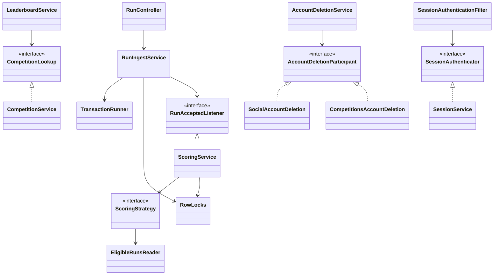
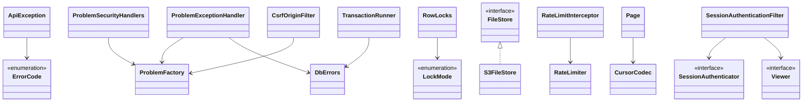
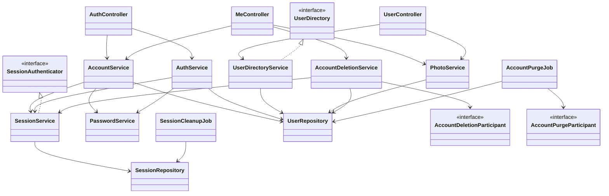
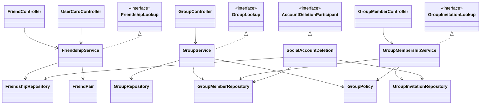
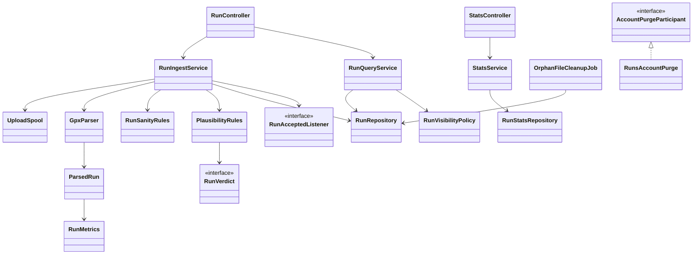
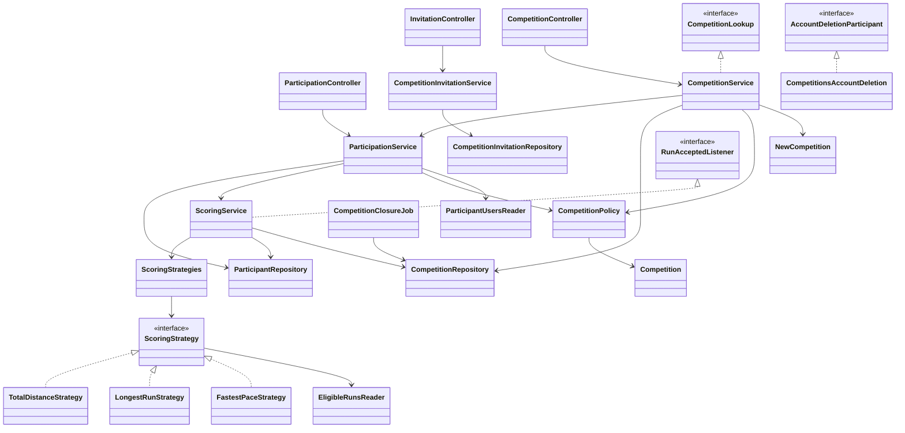
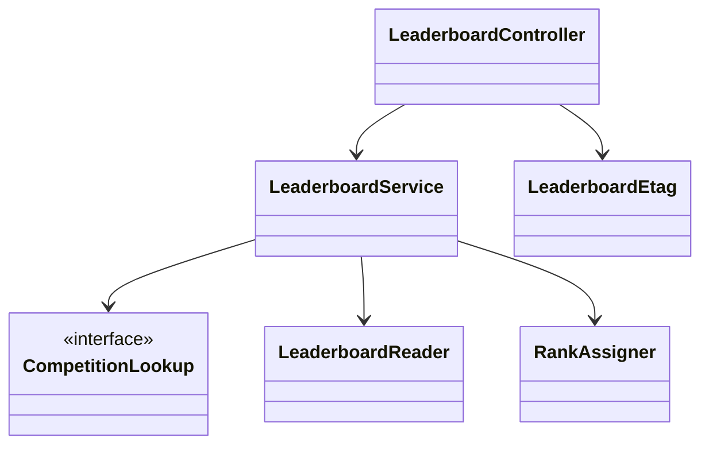

# Classes: Class diagrams

> **Covers:** The overview class diagram, and one diagram per module.
> **Read when:** you need the relationships between the classes of one module.
> **Related:** [inventory.md](inventory.md), [modules.md](modules.md)

## 4. Class diagrams

These show relationships only. Section 3 has the fields and methods.

### 4.1 Overview

### 4.2 `platform`

### 4.3 `identity`

### 4.4 `social`

### 4.5 `runs`

### 4.6 `competitions`

### 4.7 `leaderboards`

---

