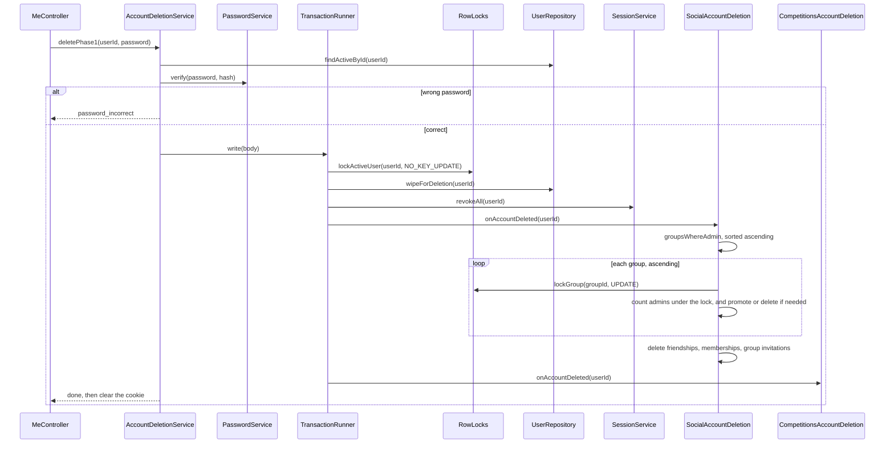
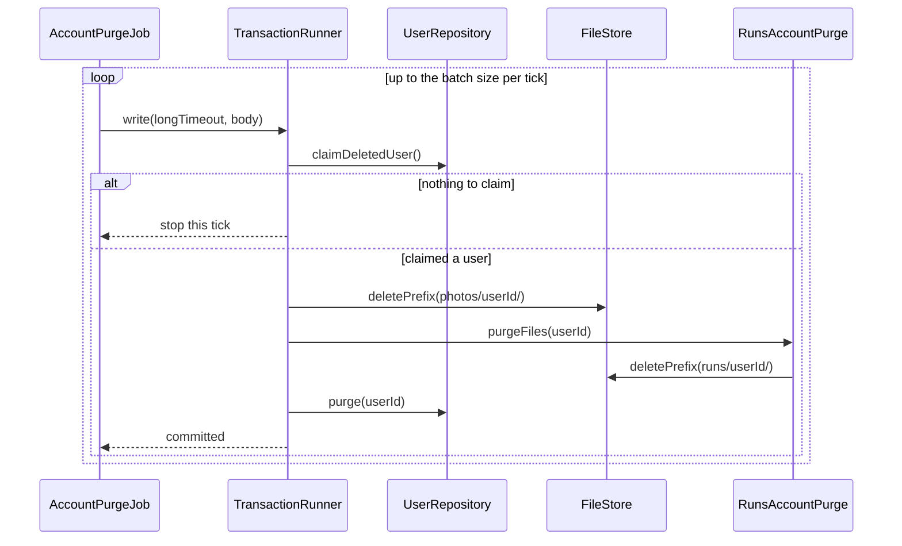
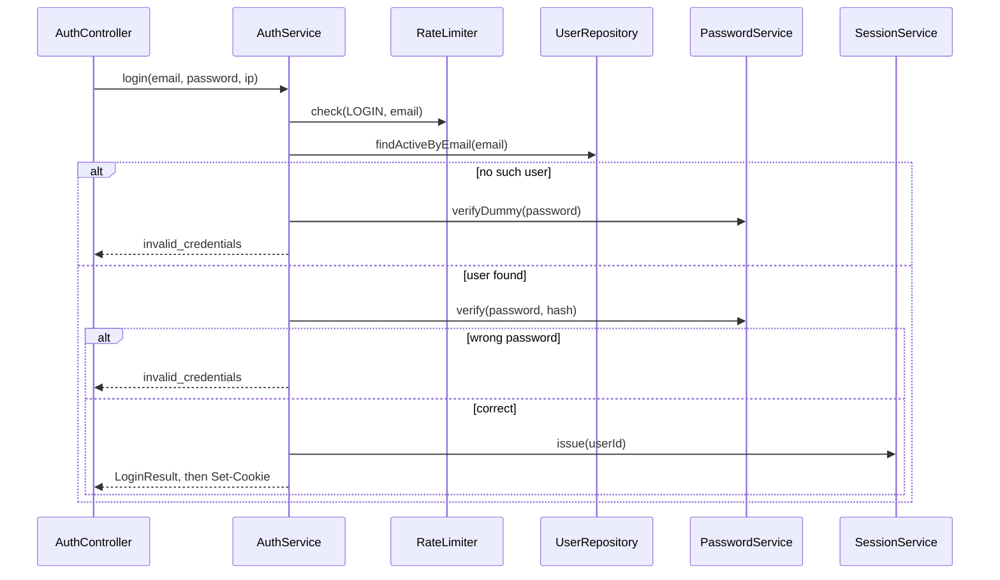
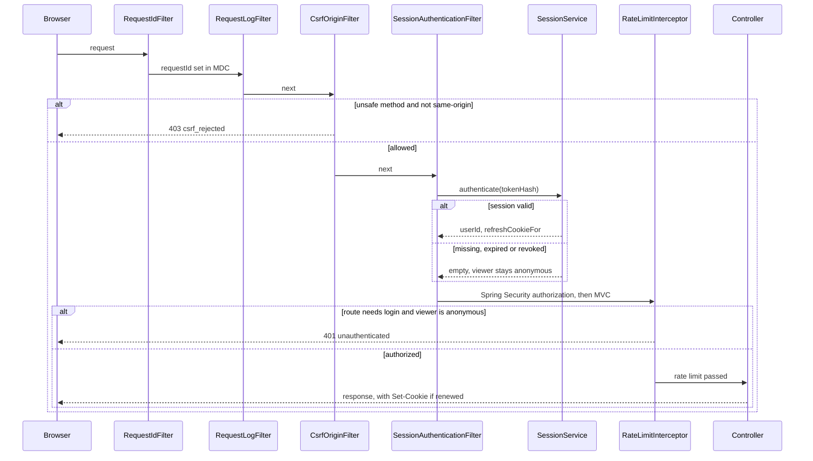
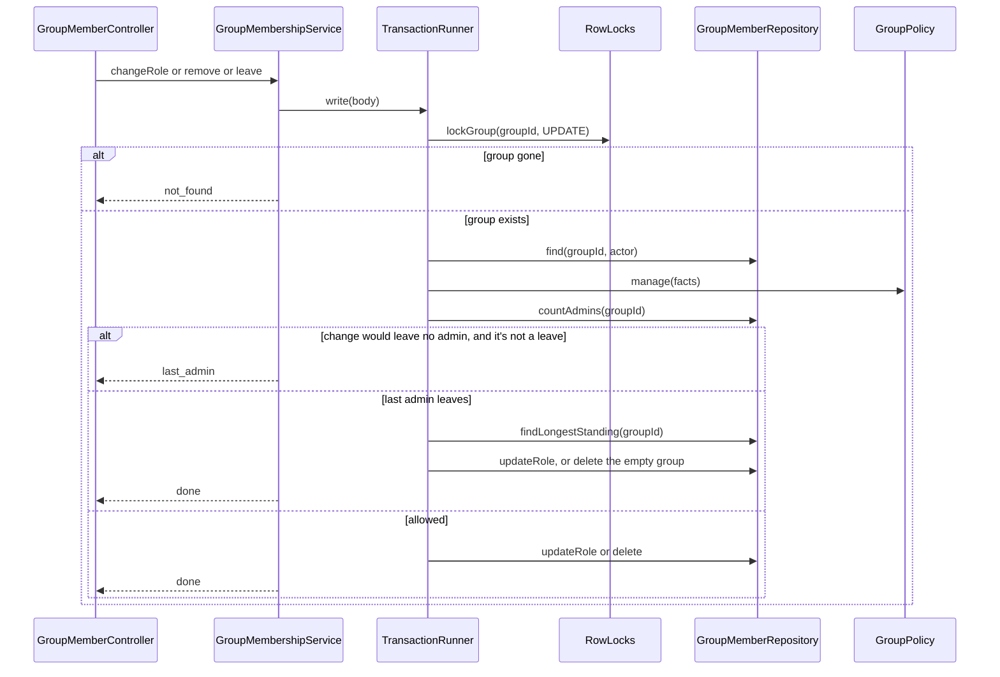
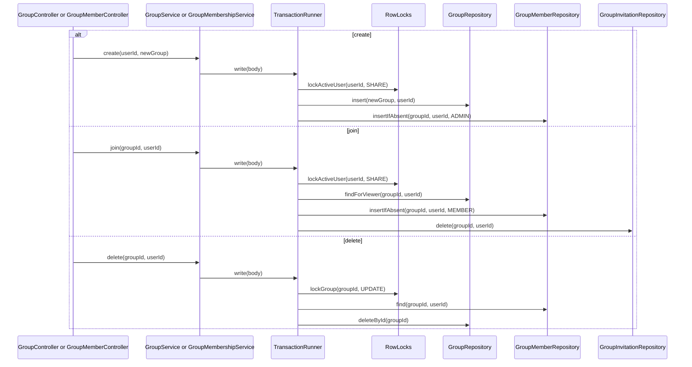

# Classes: Flows: identity and social

> **Covers:** The sequence flows for account deletion, login, session validation and CSRF, group role changes, and group create, join and delete. The section 8 introduction, which applies here too, is in `flows-runs-competitions.md`.
> **Read when:** implementing one of these flows.
> **Related:** [flows-runs-competitions.md](flows-runs-competitions.md), [../api/auth.md](../api/auth.md), [../database/deletion-and-jobs.md](../database/deletion-and-jobs.md)

### 8.5 Account deletion, phase 1

| | |
|---|---|
| **Boundary** | One transaction around everything after the password check. **The password check is never inside a transaction**, because Argon2 would hold a connection for a deliberately slow operation |
| **Locks, in order** | `FOR NO KEY UPDATE` user (which waits for in-flight ingests), then `FOR UPDATE` groups ascending (CLS-2) |
| **Why every group where the user is an admin** | Locking only the groups where they look like the last admin has a race. If another admin leaves at the same moment, an unlocked read still sees two admins, so nothing protects the group, and it ends up with none. So each candidate is locked first, and the count is read under its lock (CLS-2) |
| **Failures** | 403 `password_incorrect` leaves everything unchanged. Any later failure rolls back, so the account stays intact |
| **Not done here** | Participant rows, runs, files and the row itself wait for the purge. Read-time filters hide them meanwhile (D17, D29) |

### 8.6 Account deletion, phase 2 (the sweeper)

| | |
|---|---|
| **Boundary** | One transaction per user. The object-store calls run inside it, as database 8.2 specifies, because the row lock is the claim. **This is the one place a transaction spans external calls**, and it's safe because deleting a prefix can be repeated |
| **Locks** | `FOR UPDATE SKIP LOCKED` on the user row. Timeout 5 minutes (CLS-3), since a heavy user can have many files |
| **Failures** | The row survives as the retry marker (database 6.6). Two sweepers: each skips the other's row |

### 8.7 Login

| | |
|---|---|
| **Boundary** | Only the session insert, in autocommit. If `needsRehash` is true, the password update runs best-effort after it |
| **Locks** | None. A login racing with account deletion is handled by the join in `findValid` (API-1) |
| **Failures** | The same 401 for both cases, with matching timing through the dummy hash (api 8.5). `rate_limited` by email here, and by IP in the interceptor |

### 8.8 Session validation and CSRF, on every request

| | |
|---|---|
| **Filter order** | `RequestIdFilter`, `RequestLogFilter`, then Spring Security's chain (security headers, `CsrfOriginFilter`, `SessionAuthenticationFilter`, authorization), `BodyLimitFilter`, then `DispatcherServlet` with `RateLimitInterceptor`. `RequestLogFilter` sits outside security so rejected requests are logged too |
| **Boundary** | None. An autocommit read per request, and `renew` only when `findValid` says it's due (at most hourly) |
| **CSRF** | api 8.4: `Sec-Fetch-Site` must be `same-origin` if present, otherwise `Origin` must match. **Neither present: reject.** Safe methods skip this. Spring Security's own CSRF is turned off |
| **Optional routes** | `GET /competitions/{competitionId}` and the leaderboard declare no 401. **So an invalid cookie there means anonymous, not an error.** This is why the filter leaves the viewer anonymous, and authorization decides |
| **Failures** | A renewal failure fails open: it's logged, and the request continues |

### 8.10 Group role change, kick and leave

| | |
|---|---|
| **Boundary** | The whole body |
| **Locks** | `FOR UPDATE` group, read before the count (API-6). This prevents **write skew**: two admins demoting each other, each seeing two admins |
| **Failures** | 404, 403 `forbidden`, 409 `last_admin` |

### 8.11 Group create, join and delete

| | |
|---|---|
| **Locks** | Create and join: `FOR SHARE` user (CLS-6), so a deleted user can't slip a membership in. Delete: `FOR UPDATE` group |
| **Failures** | `23503` during a join means the group was deleted meanwhile: 404. A competition's `group_id` becomes `NULL` by cascade, so it continues without a group |

