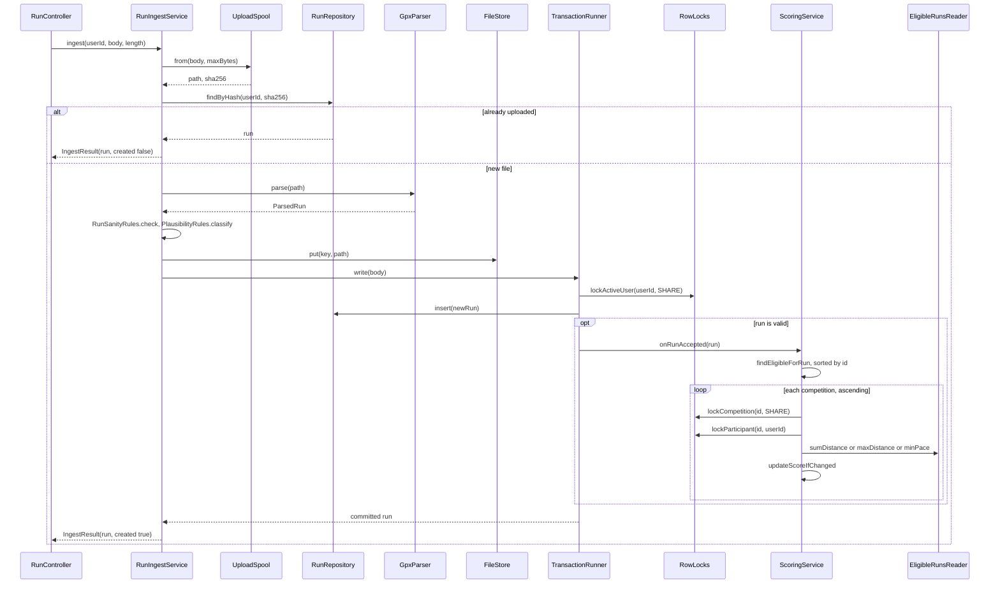
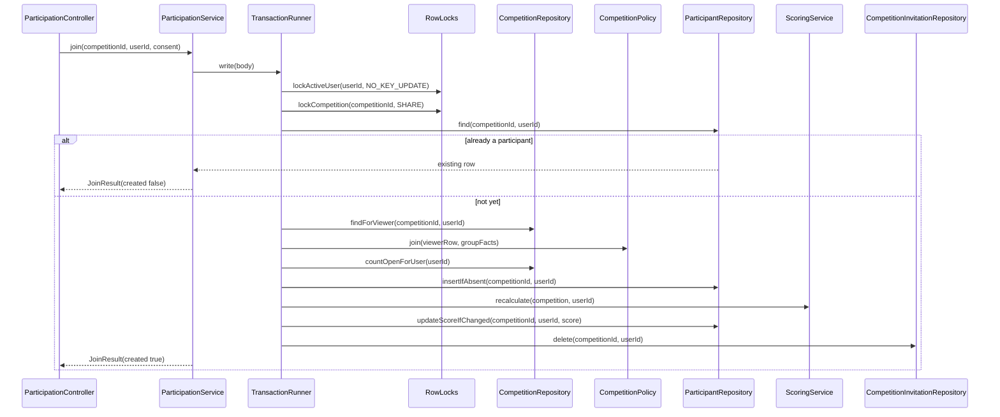
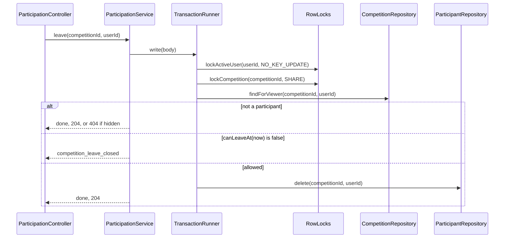
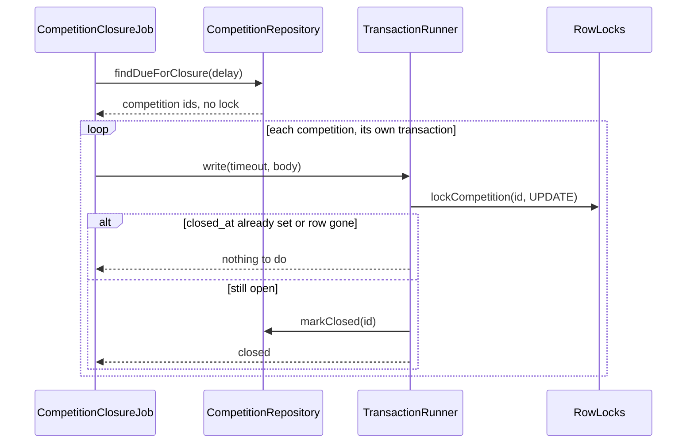
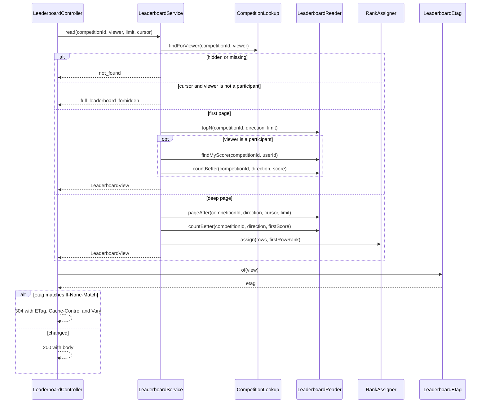
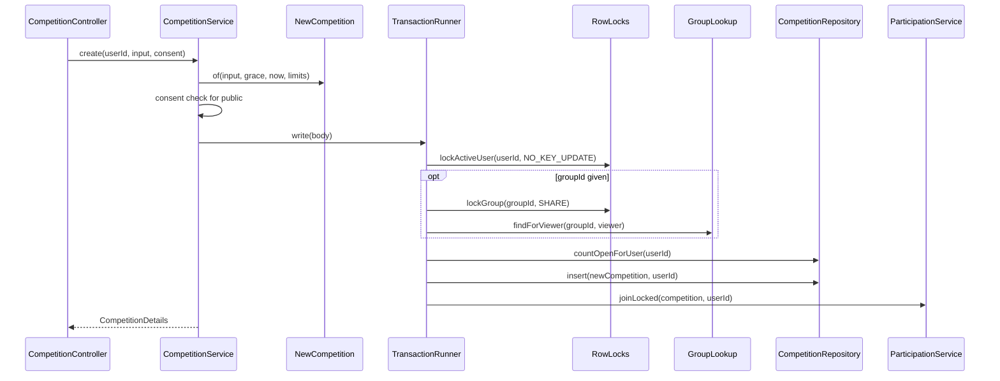
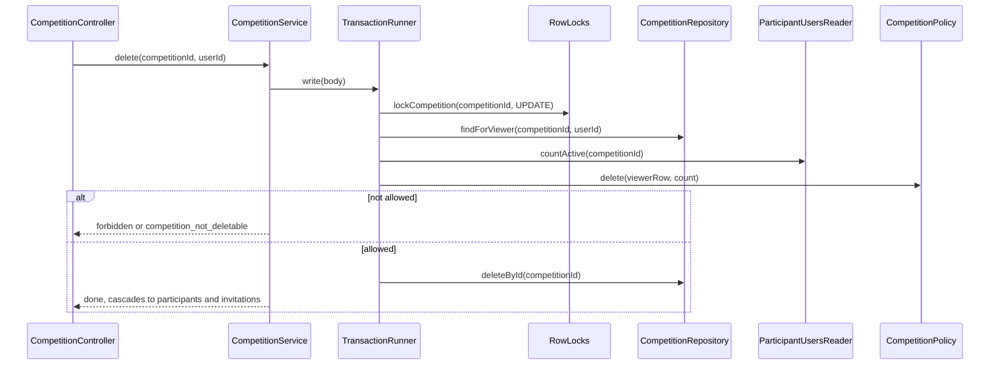

# Classes: Flows: runs and competitions

> **Covers:** The section 8 introduction, and the sequence flows for run ingest, join, leave, closure, leaderboard, and creating and deleting a competition. Flows 8.5 to 8.8, 8.10 and 8.11 are in `flows-identity-social.md`.
> **Read when:** implementing one of these flows.
> **Related:** [flows-identity-social.md](flows-identity-social.md), [persistence.md](persistence.md), [../database/transactions.md](../database/transactions.md)

## 8. Critical flows

Every flow below names its transaction boundary, its locks in order and its failure behavior. **Method names are expected to change, and the order isn't.**

### 8.1 Run ingest

| | |
|---|---|
| **Boundary** | `TransactionRunner.write`, around lock, insert and scoring. Spooling, parsing and storing are outside |
| **Locks, in order** | `FOR SHARE` user. For each competition, ascending: `FOR SHARE` competition, then `FOR UPDATE` participant |
| **Skip rules** | Competition gone or `closed_at` set: skip (CLS-4). Participant gone: skip |
| **Failures** | `23505`: rollback, return 200 with the existing run. `23P01`: rollback, re-check the hash (CLS-5), then 409 with `conflictingRunId`. Storage down: 503 `storage_unavailable`, nothing saved. No active user: 401. Deadlock: retried with the same file key. Timeout: 503, safe to retry. Any stored file with no row becomes an orphan for the daily job |
| **Order of checks** | api 7.2. The temp file is removed by `try-with-resources` |

### 8.2 Join competition, with backfill

| | |
|---|---|
| **Boundary** | The whole body |
| **Locks, in order** | `FOR NO KEY UPDATE` user, `FOR SHARE` competition. The new participant row needs no lock of its own |
| **Why this lock** | D34: without the per-user lock, ingest and join can both miss a run (database 6.4) |
| **Order of checks** | Participant first (API-3), then 404, consent, `ends_at`, limit. A retry after `ends_at` still gets 200 |
| **Failures** | Hidden or gone: 404. 422 `consent_required`. 409 `competition_join_closed`, `competition_limit_reached`. Racing with a deletion: the lock serializes them, so the join sees no row and returns 404 |

### 8.3 Leave competition

| | |
|---|---|
| **Boundary** | The whole body |
| **Locks, in order** | `FOR NO KEY UPDATE` user, `FOR SHARE` competition |
| **Failures** | 409 `competition_leave_closed` from `ends_at` on (D39). Hidden: 404. A scoring transaction that loses the race skips the missing row, with no error (database 6.4) |

### 8.4 Closure scheduler

| | |
|---|---|
| **Boundary** | One transaction per competition, so one failure can't block others |
| **Locks** | `FOR UPDATE` competition, which **waits** for ingest's `FOR SHARE` (database 6.5). Timeout 60 s |
| **Failures** | Logged and counted, and the next tick retries. A delay is safe, because eligibility uses `closes_at`, not `closed_at`. Two instances: the second waits, sees `closed_at`, and stops |

### 8.9 Leaderboard: top N and my rank

| | |
|---|---|
| **Boundary** | None. Separate autocommit statements, which may differ for an instant (database 7.3) |
| **Locks** | None |
| **Failures** | 404, 403 `full_leaderboard_forbidden`, 400 `invalid_cursor`. **The queries run even for a 304**, because computing the ETag needs the data (api 13) |

### 8.12 Create competition

| | |
|---|---|
| **Boundary** | Everything after validation |
| **Locks, in order** | `FOR NO KEY UPDATE` user, optional `FOR SHARE` group. **The new competition needs no lock**, since nobody else can see it yet (API-6) |
| **Failures** | 422 `validation_failed`, `consent_required`. 404 if the group is hidden. 403 if the viewer isn't its admin. 409 `competition_limit_reached` |

### 8.13 Delete competition

| | |
|---|---|
| **Locks** | `FOR UPDATE` competition, which waits for any join holding `FOR SHARE` (API-6) |
| **Failures** | 404, 403, 409 `competition_not_deletable`. A join waiting on this lock then finds no row, and returns 404 |

---

