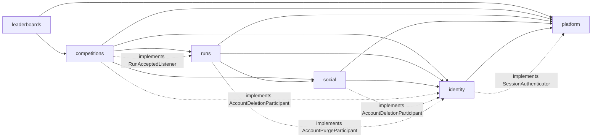

# Classes: Modules and package layout

> **Covers:** Module responsibilities, allowed dependencies, callback interfaces, public interfaces and read-only exceptions (2); the package and file layout (13).
> **Read when:** deciding where code goes, or adding a dependency between modules.
> **Related:** [inventory.md](inventory.md), [diagrams.md](diagrams.md), [../../../ARCHITECTURE.md](../../../ARCHITECTURE.md)

## 2. Module map

### 2.1 Responsibilities

| Module | Responsibility | Owns tables |
|---|---|---|
| `platform` | Cross-cutting infrastructure: errors, transactions, locks, security filters, rate limiting, file storage, jobs | None |
| `identity` | Accounts, sessions, profile, privacy settings, account deletion | `users`, `sessions` |
| `social` | Friendships, groups, memberships, group invitations | `friendships`, `groups`, `group_members`, `group_invitations` |
| `runs` | Upload, parsing, validation, history, personal stats | `runs` |
| `competitions` | Lifecycle, participation, scoring, closure, competition invitations | `competitions`, `competition_participants`, `competition_invitations` |
| `leaderboards` | Ranked reads | None (reads only, D35) |

### 2.2 Allowed dependencies

Every module may also use `platform`. The list below is what `check_classes.mjs` reads to prove the graph has no cycles.

| Module | May depend on |
|---|---|
| `platform` | none |
| `identity` | none |
| `social` | `identity` |
| `runs` | `identity`, `social` |
| `competitions` | `identity`, `social`, `runs` |
| `leaderboards` | `competitions` |



Solid lines are ordinary calls, and dashed lines mark a module implementing a callback that the lower module owns. **Every arrow, solid or dashed, points down the chain**, because implementing an interface is a compile-time dependency on it. At run time, the lower module calls up.

**Why a chain:** a total order makes a cycle impossible, instead of something we have to keep checking for. ArchUnit still checks it, because a rule that isn't enforced erodes.

**Consequences for where endpoints live:**

| Endpoint | Module | Why |
|---|---|---|
| `GET /users/{userId}` | `social` | `city` depends on friendship, and `identity` can't depend on `social` |
| `GET /users/{userId}/runs` | `runs` | Reads runs, and needs both privacy and friendship |
| `GET /groups/{groupId}/competitions` | `competitions` | Reads competitions, and asks `social` about the group |
| `GET /me/invitations` | `competitions` | The higher of the two modules whose data it merges |

### 2.3 Calls that go up the chain (D59)

| The lower module needs | Interface | Owned by | Implemented by | Runs in |
|---|---|---|---|---|
| The filter validates a session | `SessionAuthenticator` | `platform` | `SessionService` in `identity` | Autocommit |
| Deletion cleans other modules' rows | `AccountDeletionParticipant` | `identity` | `SocialAccountDeletion`, `CompetitionsAccountDeletion` | The caller's transaction |
| The purge deletes other modules' files | `AccountPurgeParticipant` | `identity` | `RunsAccountPurge` | The caller's transaction |
| Ingest triggers scoring | `RunAcceptedListener` | `runs` | `ScoringService` in `competitions` | The caller's transaction |

**Why not Spring application events:** they work synchronously, but which listener runs, in what order, and what a failure means all become invisible at the call site. Lock order depends on that order. An injected `List<AccountDeletionParticipant>` with `@Order` says it plainly. `SocialAccountDeletion` must run first, because it takes group locks.

**Rejected:** a shared `common` module holding this logic (it would collect everything), and merging modules to remove the edges (it would give up D5's extraction path).

### 2.4 Public interfaces

These are the only types another module may touch, apart from `platform`. `Optional` means absent or not visible to this viewer. **Method lists are expected to grow a little during implementation.**

```java
// platform: shared kernel. IDs live here so RowLocks and security can use them.
record UserId(UUID value)  record GroupId(UUID value)  record CompetitionId(UUID value)  record RunId(UUID value)
sealed interface Viewer permits Viewer.Anonymous, Viewer.Authenticated   // Authenticated(UserId id)
interface SessionAuthenticator { Optional<AuthenticatedSession> authenticate(byte[] tokenHash); }

// identity.api
interface UserDirectory {
    Optional<UserCard> findCard(UserId id);                       // active users only
    Map<UserId, UserCard> findCards(Collection<UserId> ids);      // active users only, missing ones left out
    Optional<UserFacts> findFacts(UserId id);                     // runPrivacy, timeZone, city
}
interface AccountDeletionParticipant { void onAccountDeleted(UserId id); }   // inside the caller's transaction
interface AccountPurgeParticipant    { void purgeFiles(UserId id); }         // inside the purge transaction

// social.api
interface FriendshipLookup      { boolean areFriends(UserId a, UserId b); }
interface GroupLookup           { Optional<GroupFacts> findForViewer(GroupId id, Viewer viewer); }
interface GroupInvitationLookup { List<GroupInvitationView> newestFor(UserId invitee, int limit); }

// runs.api
interface RunAcceptedListener { void onRunAccepted(AcceptedRun run); }       // inside the ingest transaction

// competitions.api
interface CompetitionLookup {
    Optional<CompetitionFacts> findForViewer(CompetitionId id, Viewer viewer);
}
// leaderboards has no public interface. Nothing depends on it.
```

### 2.5 Documented read-only exceptions (D35)

Each one lives in exactly one class, so the cost of a future service split stays visible.

| Reader class | Reads | Why |
|---|---|---|
| `LeaderboardReader` | `competition_participants`, `competitions`, `users` | Ranking needs joins and a read-time filter |
| `EligibleRunsReader` | `runs` | Score recalculation aggregates a user's runs |
| `ParticipantUsersReader` | `users` | The participant count and list must hide deleted users, because their rows survive until the purge |
| `RowLocks` | Lock statements on `users`, `groups`, `competitions`, `competition_participants` | One place enforces the lock order. It returns only what's listed in section 7.4 |

Foreign-key cascades also cross modules, for example `SET NULL` on `competitions.group_id`. They're declared schema behavior rather than application writes, so they aren't exceptions.

### 2.6 Inside a module (D58)

```text
com.pace.<module>/
    api/          public contract for other modules: interfaces, facts records, enums
    web/          controllers and request/response records. No business logic
    service/      business rules, transaction boundaries, policies, strategies, jobs
    persistence/  repositories and SQL
    domain/       plain types with no Spring or JDBC imports
```

Dependencies point downward only: `web -> service -> persistence -> domain`. Each layer may also use its own module's `api`.

**Visibility.** A class is `public` only if another package needs it. Controllers, policies, strategies and jobs can be package-private. Services and repositories can't, because they're called from another layer, and that's the honest limit of what the compiler gives us here.

**ArchUnit rules**, which arrive with the first code:

1. Another module may touch only `..<module>.api..`, plus the callback interfaces it implements.
2. The layer direction above.
3. `web` never imports `persistence`.
4. `domain` has no Spring or JDBC imports.
5. No cycles between modules.
6. `platform` depends on no other module.

**Rejected:**

| Alternative | Why |
|---|---|
| Flat module packages, with everything package-private | Real compiler enforcement, but it contradicts D40, and layers would then rest on naming conventions |
| JPMS (Java modules) | Too heavy at this scale, and it fights with Spring's reflection |
| Spring Modulith | A plausible later addition, but D40 chose ArchUnit, and six rules already do this |

`platform` isn't a business feature, so it's organized by concern: `error`, `tx`, `security`, `web`, `ratelimit`, `storage`, `jobs`, `id`.

---

## 13. Package and file layout

Build-tool neutral. **Class names are expected to change somewhat during implementation.** DTOs are listed in section 3.7. Small result records aren't repeated here.

```text
src/main/java/com/pace/
    PaceApplication.java
    platform/
        error/      ErrorCode, ApiException, FieldError, ProblemFactory, ProblemExceptionHandler, DbErrors, DbFailure
        tx/         TransactionRunner, RowLocks, LockMode, LockedCompetition, TxProperties
        security/   SecurityConfig, CsrfOriginFilter, SessionAuthenticationFilter, SessionAuthenticator,
                    AuthenticatedSession, TokenHash, SessionCookies, ProblemSecurityHandlers, Viewer,
                    ViewerArgumentResolver, AccessDecision
        web/        RequestIdFilter, RequestLogFilter, BodyLimitFilter, Page, PageRequest, CursorCodec,
                    ClientIpResolver, JacksonConfig, PlatformProperties
        ratelimit/  RateLimiter, RateLimitClass, RateLimit, RateLimitInterceptor
        storage/    FileStore, StoredObject, S3FileStore
        jobs/       JobRunner
        id/         UserId, GroupId, CompetitionId, RunId, Ids
    identity/
        api/          UserDirectory, AccountDeletionParticipant, AccountPurgeParticipant, UserCard, UserFacts, RunPrivacy
        web/          AuthController, MeController, UserController, plus DTOs
        service/      AccountService, AuthService, SessionService, PasswordService, PhotoService,
                      UserDirectoryService, AccountDeletionService, AccountPurgeJob, SessionCleanupJob, IdentityProperties
        domain/       User, ProfilePatch, SessionToken
        persistence/  UserRepository, SessionRepository
    social/
        api/          FriendshipLookup, GroupLookup, GroupInvitationLookup, GroupFacts, GroupInvitationView, GroupRole, GroupVisibility
        web/          FriendController, GroupController, GroupMemberController, UserCardController, plus DTOs
        service/      FriendshipService, GroupService, GroupMembershipService, GroupPolicy, SocialAccountDeletion
        domain/       FriendPair, Friendship, Group, Membership
        persistence/  FriendshipRepository, GroupRepository, GroupMemberRepository, GroupInvitationRepository
    runs/
        api/          RunAcceptedListener, AcceptedRun
        web/          RunController, StatsController, plus DTOs
        service/      RunIngestService, RunQueryService, StatsService, RunVisibilityPolicy, GpxParser, UploadSpool,
                      OrphanFileCleanupJob, RunsAccountPurge, RunsProperties
        domain/       ParsedRun, RunMetrics, RunSanityRules, PlausibilityRules, RunVerdict, Run, NewRun,
                      RunStatus, RunSource, InvalidReason, RunFileKey, IngestResult
        persistence/  RunRepository, RunStatsRepository
    competitions/
        api/          CompetitionLookup, CompetitionFacts, CompetitionState, CompetitionVisibility, RuleType,
                      ScoreDirection, ScoreUnit, Rule
        web/          CompetitionController, ParticipationController, InvitationController, plus DTOs
        service/      CompetitionService, ParticipationService, CompetitionInvitationService, CompetitionPolicy,
                      ScoringService, ScoringStrategy, TotalDistanceStrategy, LongestRunStrategy, FastestPaceStrategy,
                      ScoringStrategies, CompetitionClosureJob, CompetitionsAccountDeletion, CompetitionProperties
        domain/       Competition, EligibilityWindow, NewCompetition, Participant
        persistence/  CompetitionRepository, ParticipantRepository, CompetitionInvitationRepository,
                      EligibleRunsReader, ParticipantUsersReader, CompetitionStateSql
    leaderboards/
        web/          LeaderboardController, plus DTOs
        service/      LeaderboardService, RankAssigner, LeaderboardEtag, LeaderboardView, LeaderboardProperties
        persistence/  LeaderboardReader
src/main/resources/
    application.yml
    common-passwords.txt
    db/migration/     V0001__enable_extensions.sql ... (database 10.4)
src/test/java/com/pace/
    architecture/     ArchUnit rules, the source-scan lock test
    <module>/         mirrors main. Integration tests use Testcontainers
```

`DbCode` and `DbCodes` go in `platform.tx`, and `InMemoryFileStore` goes in test sources.

**Which `web` DTO uses which `api` type is unrestricted.** Layers within one module may use the module's own `api` freely.

---

