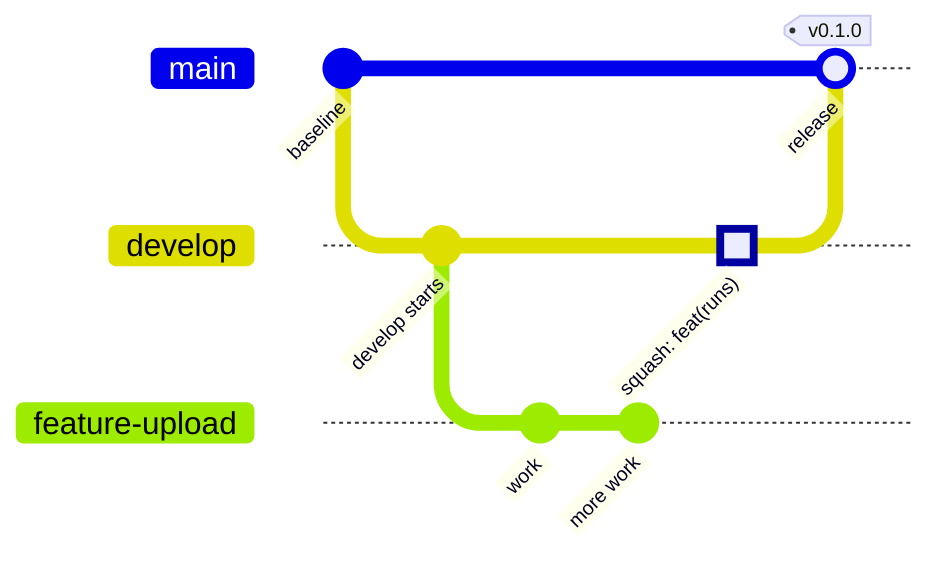

# Git workflow, versioning and secrets

> **Covers:** The branch model, merging, commit messages, versioning, the full command cycle, hotfixes, the secrets policy and incident procedure, the rules for Claude, the enforcement configuration and the GitHub settings to apply.
> **Read when:** branching, committing, opening or merging a pull request, making a release, handling a suspected leak, or changing `.claude/settings.json`.
> **Related:** [../../CLAUDE.md](../../CLAUDE.md), [../../ARCHITECTURE.md](../../ARCHITECTURE.md)

The decision is recorded as D66. All commands are PowerShell, run from the repository root.

## 1. Branch model

This is a lean GitFlow, chosen because learning it is a goal. For one developer, GitHub Flow (only main, short branches and tags) would be simpler. Reconsider after two or three releases if develop has only added friction.



| Branch | Created from | Merged into | Purpose |
|---|---|---|---|
| `main` | | | Always a released, stable state. Never committed to directly, never deleted |
| `develop` | `main` | `main` (release) | Integration, and the GitHub default branch. Never committed to directly, never deleted |
| `feature/<short-kebab-name>` | `develop` | `develop` | An implementation slice |
| `fix/<name>` | `develop` | `develop` | A bug fix before release |
| `docs/<name>` | `develop` | `develop` | Documentation only |
| `chore/<name>` | `develop` | `develop` | Tooling, process, release preparation |
| `test/<name>` | `develop` | `develop` | Tests only |
| `hotfix/<name>` | `main` | `main`, then `develop` | An urgent fix to a released version. Not used until a release exists |

One task is one branch. Work branches are deleted after merging.

**develop is the default branch** because docs-only changes don't create a release, so main stays old until the first version. With main as default, new pull requests would target the wrong branch, and clones and new sessions would get old rules.

**No release branches for now.** Add them when a release needs days of stabilization while develop keeps moving, or when there is a second developer.

Terms used in this document:

- **Fast-forward:** the branch pointer just moves ahead to a newer commit, and no new commit is created.
- **Squash merge:** all commits of a branch are combined into one new commit on the target.
- **Merge commit:** a commit with two parents, which records that two histories joined.
- **Rebase:** replays commits on a new base, which rewrites their hashes.
- **Tag:** a named pointer to one commit. An annotated tag also has its own message, author and date.
- **Upstream:** the remote branch that a local branch tracks.
- **Protected branch:** the server refuses some operations on it, such as direct pushes or deletion.

## 2. Merging

| From | To | How | Why |
|---|---|---|---|
| Work branch | `develop` | Pull request, **squash merge** | One tidy commit per piece of work |
| `develop` | `main` | Pull request, **merge commit**, then a tag | main's history shows each release |
| `hotfix/<name>` | `main` | Pull request, **merge commit**, then a tag | The same as a release |

- To keep a work branch up to date, merge develop into it. Do not rebase a branch that has been pushed, because the rewrite breaks every other copy of it.
- Update a local main or develop only with `git pull --ff-only`. It fails loudly if histories have diverged, instead of creating a surprise merge.
- Before opening a pull request, tests pass and the Definition of Done for the slice is met, once that definition exists (the test design will define it).
- After a normal release, no back-merge from main to develop is needed, because main only gained a merge commit with no new content.

## 3. Commit messages

Conventional Commits: `<type>(<optional scope>): <imperative summary>`.

- **Types:** `feat`, `fix`, `docs`, `test`, `refactor`, `perf`, `build`, `ci`, `chore`.
- **Scopes:** the module name, one of `identity`, `social`, `runs`, `competitions`, `leaderboards`, `platform`.
- **Example:** `feat(runs): add GPX upload endpoint`.
- One logical change per commit.

**The pull request title must follow the same format.** The squash commit takes its message from the title, so the title is what stays in history.

## 4. Versioning

Semantic Versioning, `MAJOR.MINOR.PATCH`, with annotated tags on main in the format `vX.Y.Z`.

- The version stays at 0.x.y until the first version real users can use. The first tag, `v0.1.0`, is placed when the first working vertical slice reaches main.
- Documentation-only changes do not create a release. They reach main with the next release.
- After 1.0.0, MAJOR tracks breaking changes to the OpenAPI contract, which is the public API.

**Version in the build file (later, not implemented yet).** One plain version line, bumped on a `chore/release-x.y.z` branch before the release pull request, with a CI check later that the tag matches it. Deriving the version from tags through a plugin is rejected for now, because it is more machinery than this project needs.

**CHANGELOG.md (created at v0.1.0).** Keep a Changelog format, written by hand once per release on that same release branch, from `git log --oneline <previous tag>..develop`. Squash merges keep that log clean. Updating it on every pull request is rejected because it causes constant conflicts with no benefit for one developer. Generators are rejected as extra tooling.

## 5. The full cycle

### 5.1 Create a branch, commit, push

```powershell
git fetch origin
git switch -c feature/<name> --no-track origin/develop
git status
git add <explicit paths>
git commit -m "feat(runs): add GPX upload endpoint"
git push -u origin feature/<name>
```

`--no-track` stops the new branch from tracking `origin/develop`. Branching from `origin/develop` means the local develop can be out of date without harm, and no merge is needed. `-u` records the upstream on the first push.

### 5.2 Keep the branch up to date

```powershell
git fetch origin
git merge origin/develop
```

### 5.3 Open and merge the pull request

The GitHub web UI needs no extra tools. `gh` is not installed on this machine, and `gh pr create` and `gh pr merge --squash` are the optional equivalents if it ever is.

1. Open `https://github.com/ron-ladin/Pace/compare/develop...feature/<name>`.
2. Give it a Conventional Commit title, and create the pull request.
3. Choose **Squash and merge**.

### 5.4 Update local develop and delete the branch

```powershell
git switch develop
git pull --ff-only origin develop
git fetch --prune origin
git branch -D feature/<name>
```

**Check that the pull request shows Merged before running `git branch -D`.** After a squash merge, `git branch -d` refuses, because git can't see the branch's commits in develop: the squash created a different commit. `-D` skips that safety check, which is why the check is yours to do. `--prune` removes the local record of the remote branch.

### 5.5 Make a release

```powershell
git fetch origin
git switch -c chore/release-0.1.0 --no-track origin/develop
# Bump the version in the build file, write CHANGELOG.md, then commit and push
# Pull request into develop, squash merge, as in 5.3
```

Then:

1. Open `https://github.com/ron-ladin/Pace/compare/main...develop`, and title the pull request `chore: release v0.1.0`.
2. Choose **Create a merge commit**.
3. Tag the result:

```powershell
git switch main
git pull --ff-only origin main
git tag -a v0.1.0 -m "v0.1.0"
git push origin v0.1.0
git switch develop
git pull --ff-only origin develop
```

## 6. Hotfix

Documented now, and used only once a released version exists.

```powershell
git fetch origin
git switch -c hotfix/<name> --no-track origin/main
# Fix, commit, push
```

1. Open a pull request into **main**, and choose **Create a merge commit**.
2. Tag the result with the next PATCH version, as in 5.5.
3. Bring the fix to develop. The merge may have deleted the hotfix branch, so copy the fix onto a new branch:

```powershell
git fetch origin
git switch -c fix/<name>-backport --no-track origin/develop
git cherry-pick -m 1 <hotfix merge commit on main>
git push -u origin fix/<name>-backport
```

4. Open a pull request into develop, and squash merge it.

The next release normally merges cleanly, because both sides made the same change. If develop has since changed the same lines, the release pull request shows a conflict. To resolve it, create `chore/sync-main` from `origin/develop`, run `git merge origin/main` there, fix the conflict, and squash merge that branch into develop.

## 7. Secrets policy

The repository is **public**, so anything pushed is public immediately.

**Hard rules:**

- Never commit, write into any repository file, print in output, or ask the owner to paste into a prompt: API keys, tokens, passwords, private keys, certificates, cloud or payment credentials, connection strings with passwords, session secrets, or real personal data.
- Configuration comes from environment variables or untracked local files. The repository holds only a committed `.env.example` with placeholders and comments, never a real value. It will be created with the vertical slice's Docker Compose file.
- Local development credentials, such as the PostgreSQL and MinIO passwords in Docker Compose, also come from an untracked `.env` file.
- Never create accounts or enter payment details on external services.

**Staged-diff check, run by Claude before every commit.** This is a procedure, not a technical block. It prints **file names only**, because a normal text search would print the matching line, and that line is the value.

```powershell
$pattern = '(password|passwd|pwd|secret|token|api[_-]?key|access[_-]?key|private[_-]?key)[^[:alnum:]]{0,2}[=:]|-----BEGIN [A-Z ]*PRIVATE KEY|AKIA[0-9A-Z]{16}|ghp_[A-Za-z0-9]{36}|github_pat_[A-Za-z0-9_]{20,}|(^|[^A-Za-z0-9])sk-[A-Za-z0-9_-]{20,}|://[^/[:space:]:]+:[^/[:space:]@]+@|[A-Za-z0-9+_=]{40,}'
git diff --cached --name-only -i "-G$pattern"
git diff --cached --name-only | Select-String -Pattern '(^|/)\.env($|\.)|\.(pem|key|p12|pfx|jks|keystore)$|(^|/)secrets/|application-local\.' | Where-Object { $_ -notmatch '\.env\.example$' }
```

The first command catches key patterns, assignments, private key headers and long high-entropy strings in changed lines. The second catches secret-looking file names. If either prints anything, Claude stops and tells the owner the file name, without printing the value. A match can be a false positive, such as a long hash, and the owner decides.

**Manual full scan with gitleaks through Docker.** This needs no install. It writes its report outside the repository, with values redacted. Replace `<report-dir>` with a new empty directory:

```powershell
docker run --rm -v "$((Get-Location).Path):/repo:ro" -v "<report-dir>:/out" -e GIT_CONFIG_COUNT=1 -e GIT_CONFIG_KEY_0=safe.directory -e GIT_CONFIG_VALUE_0=* zricethezav/gitleaks:v8.30.1 git /repo --redact --no-banner --exit-code 0 --report-format json --report-path /out/history.json
```

For the staged diff only, add `--pre-commit --staged` after `/repo`.

## 8. If a secret is committed or pushed

1. **Treat it as compromised**, even if the push was seconds ago and the repository looked quiet. This repository is public, and copies can be made immediately.
2. **Rotate it at the provider first:** revoke the old value and issue a new one. This is the step that actually removes the risk.
3. **Only then clean the history**, if it is still worth doing. The owner decides and runs this. **Claude never rewrites history on its own.**

Deleting the file in a later commit does **not** remove it from history: every earlier commit still contains it. If the commit was never pushed, rotating may still be wise, and the owner can amend or redo the local commit.

## 9. Rules for Claude

**Allowed without asking in chat:** `git status`, `git diff`, `git log`, `git show`; `git fetch origin` and `git switch`; creating a work branch from an up-to-date develop; `git add` with explicit paths; committing on a work branch. There are deliberately no allow rules in the settings, so Claude Code may still show a permission prompt for these, and the owner approves it.

**Never:** commit directly to main or develop.

**Only when the owner explicitly asks in the current task:** merge, pull, stash, restore, revert, cherry-pick, any `gh` command.

**Technically denied, so Claude cannot run them even when asked.** The owner runs them in their own terminal: push; reset; rebase; `commit --amend` and `--no-verify`; force forms of checkout and switch; deleting or renaming branches; creating or moving tags; changing git config; `git add -A`, `--all`, `.` or `-f`; editing the remote; clean; filter-branch, filter-repo, update-ref; recursive or forced deletion.

**Before every commit,** Claude shows the owner `git status`, `git diff --stat` and exactly what is staged, and runs the check in section 7.

**If something looks wrong,** such as unexpected files, large files, merge conflicts, a detached HEAD or a missing git identity, Claude stops and tells the owner instead of fixing it silently.

**Read-only replacements for blocked commands:**

| Instead of | Use |
|---|---|
| `git tag -l` | `git for-each-ref refs/tags` |
| `git config --get user.name` | `git var GIT_AUTHOR_IDENT` |
| `git reset <path>` (to unstage) | `git restore --staged <path>`, only when asked |

## 10. Enforcement

CLAUDE.md is guidance. The permission rules in the committed `.claude/settings.json` are enforced by Claude Code itself.

### 10.1 What is configured

- **Deny rules only**, each git and deletion rule written for both `Bash(...)` and `PowerShell(...)`. There are deliberately no ask or allow rules.
- **`Read` and `Edit` denies** for `.env` and `.env.*` (with a `!.env.example` carve-out), `*.pem`, `*.key`, `*.p12`, `*.pfx`, `*.jks`, `*.keystore`, `secrets/**` and `application-local.*`. There are no `Write(...)` rules, because the documentation says they never match: `Edit` rules apply to all built-in tools that edit files.
- **`disableBypassPermissionsMode: "disable"`**, so a session can't skip the rules.

### 10.2 Which file goes where

| File | Tracked | Purpose |
|---|---|---|
| `.claude/settings.json` | Yes | The shared rules in this section |
| `.claude/settings.local.json` | No (ignored) | Personal overrides for this machine |

Precedence, highest first: managed, command line, project local, shared project, user. Lists merge across files, and deny rules are checked first: a deny at any level beats an allow at any level, so a local file can't lift a rule from the shared file.

### 10.3 "Never commit on main or develop"

**This has no local technical block.** A deny rule can't express it, because the branch name isn't in the command text. It is enforced by:

- **Procedure:** the session-start checklist in CLAUDE.md.
- **GitHub rulesets:** direct pushes to main and develop are refused on the server (section 11).
- **The push deny rules:** Claude can't push anyway, within the limits below.

So a wrong local commit is possible, but it can't reach GitHub through a direct push. If one happens, stop and tell the owner.

### 10.4 What this can't guarantee

- Rules match command text. The documentation says a deny rule "isn't a security boundary around the program". It lists `git 'push'` and similar rewrites as forms a `git push` rule doesn't stop. Forms such as `sh -c '...'`, or a Node or Python script that runs git or opens a file, also get past the rules.
- OS-level enforcement isn't available here: "On native Windows, Claude Code runs commands unsandboxed". It would need WSL2.
- None of this binds the owner, the owner's terminal or other tools.
- An installed mod can approve a call that a deny rule refused, when no managed settings or Team login are in use. Don't install mods you don't trust.
- **The only real boundary for main and develop is GitHub's rulesets**, because they apply whatever the client does. The check in section 7 depends on Claude following the procedure.

### 10.5 Recovery: a mistake in `.claude/settings.json`

A wrong rule can block something legitimate, and Claude can't lift a deny rule for you. Fix it yourself, outside Claude Code:

1. Open `.claude/settings.json` in your own editor.
2. To lift a rule, delete its whole line from the `deny` array. Keep the file strict JSON: no comments, and no comma after the last entry.
3. Save. Claude Code reloads permission changes in a running session. Run `/permissions` to see the rules and which file each comes from, and `/status` to confirm the file loaded. A broken file shows a Settings Error at the next start, and Claude Code offers to continue without it.
4. **A temporary lift:** after you finish, run `git restore .claude/settings.json` in your own terminal to put the rule back.
5. **A permanent change:** make it on a `chore/` branch and merge it through a pull request, so that it is reviewed like code.

### 10.6 Optional hardening for later

None of these exist yet:

- **A Claude guard hook:** a `PreToolUse` hook that inspects the full command. It could catch rewritten git forms, and block `git commit` on main or develop.
- **A git pre-commit hook with gitleaks:** refuses commits on main and develop and scans staged changes, including the owner's own commits in a terminal.
- **A gitleaks step in GitHub Actions**, once CI exists (order-of-work step 7 in `ARCHITECTURE.md`). The documentation says personal accounts need no license, and standard runners are free in public repositories. Then make it a required status check.

The gitleaks README now describes gitleaks as feature complete, with security patches only, and recommends Betterleaks. Stay on gitleaks v8.30.1 for now, and reconsider once Betterleaks v2 is stable.

## 11. GitHub settings to apply

Apply these yourself, **in this order**, after develop is pushed. The default branch can't change while the repository has only one branch.

1. **Check availability:** open Settings > Rules > Rulesets, and confirm rulesets can be created. *Fallback:* if they aren't available, use Settings > Branches, classic branch protection, for main and develop. It has no per-branch merge method, so the merge method becomes procedure.
2. **Default branch:** Settings > General > Default branch: `develop`.
3. **Pull Requests**, in Settings > General: allow merge commits and squash merging, turn off rebase merging, and set the squash message to the pull request title.
4. **Ruleset for `main`:** require a pull request with allowed method **merge**, 0 required approvals, block force pushes, restrict deletions, empty bypass list.
5. **Ruleset for `develop`:** the same, with allowed method **squash**.
6. **Automatically delete head branches**, in Settings > General. **Only after steps 4 and 5.** Without "Restrict deletions", merging the develop-to-main pull request would try to delete develop.
7. **Secret scanning and push protection:** Settings > Advanced Security. Confirm or enable them.
8. **Optional:** a tag ruleset for `v*` that restricts updates and deletions.
9. **Later, with CI:** require status checks in both rulesets.

Use 0 approvals, because "Pull request authors cannot approve their own pull requests", so requiring one would lock you out.

### What was confirmed in GitHub's documentation

| Setting | Status |
|---|---|
| Secret scanning on a public repository | Confirmed free |
| Per-user push protection on public repositories | Confirmed on by default |
| Repository-level push protection on a public repository | **Not fully confirmed.** The security overview lists it for public repositories, but the push protection page says it requires Secret Protection. Check in Settings |
| Rulesets and protected branches on GitHub Free, public repository | **Not explicitly confirmed** on the current pages. The plans page says public repositories have a "full feature set", and lists protected branches under Pro only for private repositories. Check with step 1 |
| Per-branch allowed merge methods, block force pushes, restrict deletions | Confirmed as ruleset rules |
| Merge commits and squash merging enabled together | Confirmed |
| Automatic deletion of head branches | Exists for repository admins. **No plan requirement stated** |
| Rules can prevent automatic branch deletion | Confirmed |
| Changing the default branch needs more than one branch | Confirmed |
| Authors can't approve their own pull requests | Confirmed |
| Actions on standard runners in public repositories | Confirmed free |

These were checked on 2026-11-03, and plans and features change.

## 12. One-time bootstrap

Run this once, for the first pull request. It can be deleted from this document afterwards. origin/main was already at the starting commit, so main needs no push.

```powershell
git push -u origin develop
```

Apply the settings in section 11, then:

```powershell
git push -u origin chore/git-workflow
```

Open `https://github.com/ron-ladin/Pace/compare/develop...chore/git-workflow`, create the pull request, and choose **Squash and merge**. Then:

```powershell
git switch develop
git pull --ff-only origin develop
git fetch --prune origin
git branch -D chore/git-workflow
```

Run `git branch -D` only after checking that the pull request shows Merged.

The first run of these steps is also the first real test of this workflow.
